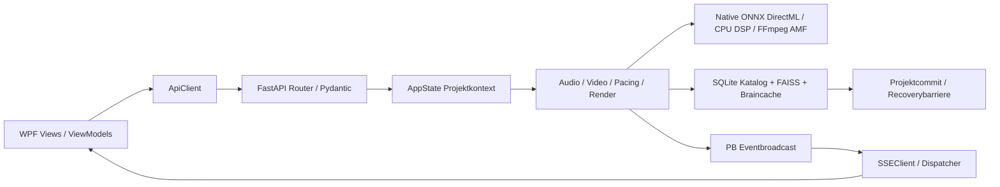
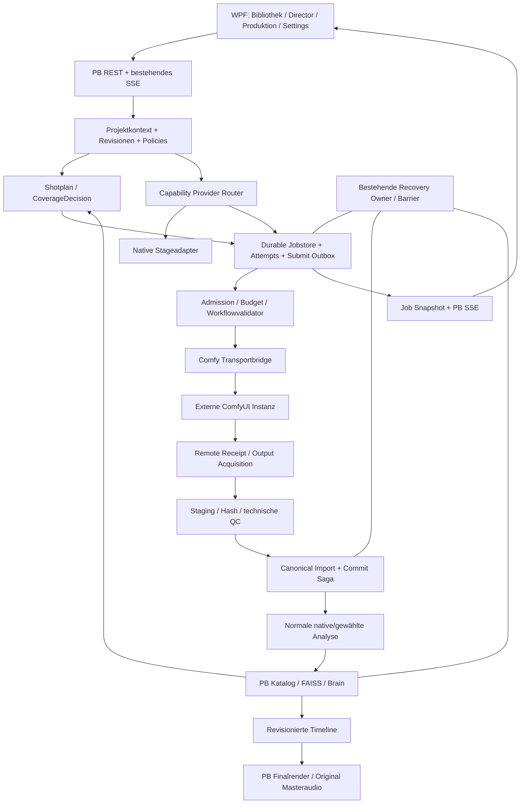
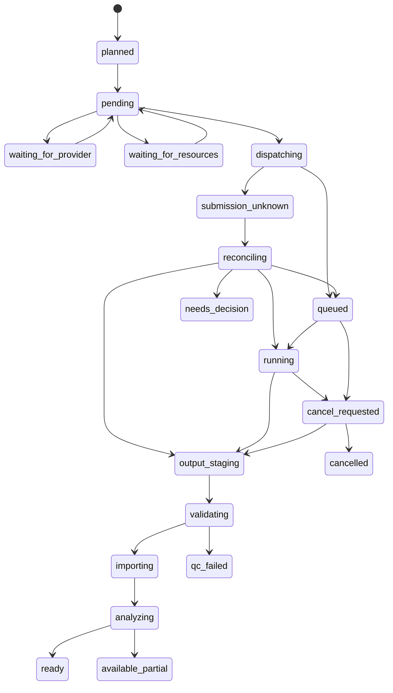

# PB-Studio Control Center — geprüfter Architektur- und Lieferentwurf

Stand 2026-10-12. **[ABSICHT] Dieser Entwurf ist nicht implementiert und ersetzt keine SDD-Freigabe.** IST-Angaben sind statisch gelesene Quellen; ausgeführte Prüfnachweise und Risiken stehen in [review.md](review.md). Vorgeschlagene neue Dateien sind mit **NEU/GEPLANT** markiert. Keine DB-Migration, Codeänderung oder Providerablösung durchgeführt.

**Bestätigte Nutzerentscheidungen:** externe ComfyUI-Ausführung darf eigene AMD-/ROCm-Laufzeit nutzen; PB-interne ONNX-Pfade bleiben DirectML. Erster Scope lokal; Cloud nur separat ausdrücklich freigegeben. [Verbindlicher Entscheidungsrecord D01/D02](decisions.md). Diese Freigaben ersetzen weder Hardwarequalifikation noch sichere Ressourcen-/Job-/Importverträge.

## A. IST-ZUSTAND und Komponentenkarte

Die vorhandenen Schichten sind WPF → REST/SSE → FastAPI → Python-Fachlogik → SQLite/FAISS/Brain/Dateisystem/GPU. Eine Suche nach `comfyui` im untersuchten PB-Quellbaum ergab keine Treffer; dies allein schließt eine anders benannte Integration nicht aus. Die folgende Karte belegt tatsächlich gelesene Komponenten und ihre hier relevante Rolle, nicht deren aktuelle Laufzeitfreigabe.

Alle PB-Pfade beziehen sich auf `C:\Users\david\Documents\Pb_studio_AMD_version`.

| Fachbereich | Gelesene Datei und Symbol/Pfad | Relevanter IST-Vertrag |
|---|---|---|
| Projektzustand | `backend/app_state.py:129` `ProjectOperationContext`; `:152` `AppState`; `:220` Kontext; `:312` `project_commit`; `:332` `project_operation` | ID/Root/Epoch; Guard für verspätete Commits; registrierte Projektoperationen |
| Projektwechsel WPF | `PBStudio.UI/Services/ProjectService.cs:302,335,351` | Operationgeneration und Kontextprüfung |
| Audio-API | `backend/schemas/audio_schemas.py:64` `AudioAnalysisResult`; `backend/routers/audio_router.py` | Beatobjekte, Kurven, Struktur/Subtracks, Drumzeitlisten, Stage-/Chunk-/Provenancedaten |
| Native Audioorchestrierung | `src/pb_studio/services/audio_service.py:17` `AudioService`; `src/pb_studio/audio/streaming_analyzer.py:500` Checkpointvalidierung | Stem-Service und spezielle Streaming-/Checkpointverträge; kein belegter universeller Audio-Providerrouter |
| Video-API | `backend/schemas/video_schemas.py:59` `VideoAnalysisResult`; `video_router.py:2325` SigLIP-Framepfad; `:1525` Commit | Szene/Motion/Tags/Colors/Key/Embeddingmetadaten; Vektor vor Commit als pending |
| Native Vision/GPU | `src/pb_studio/video/raft.py` `MotionAnalyzer`; `video/moondream.py`; `ai/siglip_wrapper.py` | ONNX-/DirectML-Ausführungspfade; alternative LM-Studio-Vision vorhanden |
| Director/Pacing | `src/pb_studio/services/pacing_service.py:95` `PacingService`; `pacing/advanced_pacing_engine.py` `AdvancedPacingEngine`; `pacing/clip_selector.py` `ClipSelector` | Analyse-/Clipdaten → Cut-Liste; FAISS-/Motionauswahl. Keine kalibrierte Generation-Coverageentscheidung belegt |
| Embeddings | `video_router.py:660` `video_index`; `:723` Braincache; `audio_router.py:836` CLAP-Pfad | Native SigLIP-/CLAP-Identitäten und modellgebundene Caches |
| Katalog | `src/pb_studio/data/database_core.py:72`; `data/repositories/media_repository.py:236` | `vector_map.faiss_id` ohne Raumidentität; Medienidentität projektbezogener normalisierter Pfad |
| Vectorstore | `src/pb_studio/data/vector_store.py:397` `add_embedding`; `:450` Löschpfad | Dimensionprüfung, Mapping, Tombstones/Recoverybarriere |
| Outbox | `src/pb_studio/data/vector_operation_outbox.py:176` | Dauerhafte, reparierbare Vektoroperationen; kein vollständiger generierter Importvertrag |
| Brain | `src/pb_studio/brain/post_processor.py:88,303`; `src/pb_studio/audio/audio_embedder.py:24`; `src/pb_studio/video/video_embedder.py:29` | CLAP512/SigLIP1152 und exakte Native-Versionen; trainierter Projektor nötig |
| LLM-Auswahl | `src/pb_studio/ai/llm_provider.py:60,94`; `ai/model_registry.py:93,193,479`; `ai/model_inventory.py:122` | LM Studio/Ollama; SelectionReceipt und Inventarpattern. Dieses AUTO ist kein Workflow-AUTO |
| GPUkoordination | `backend/dependencies.py:20,29`; `core/gpu_lock.py`; `core/vram_budget_manager.py:177,349,630` | PB-interne Locks, Eigenbuchhaltung, Sensorwarnung; keine Fremdprozess-Exklusivgarantie |
| Sessionmanagement | `src/pb_studio/core/model_loader.py:134,446,520` `ModelLoader` | Native Sessionbesitz und Entladepfade |
| Legacy Tasks | `src/pb_studio/core/task_queue.py:22` `TaskQueue`; `core/thread_pool.py:59` `ThreadPoolManager` | In-Memory-Queue bzw. Qt-Pattern; kein belegter persistenter FastAPI-Jobmanager |
| Render | `src/pb_studio/rendering/render_queue.py:258` `RenderQueue`; `rendering/render_service.py:112` `RenderService`; `preview_renderer.py:53` `PreviewGenerator` | Persistente FFmpeg-Queue/CAS/Dedupe; Preview/Finalexport bleiben PB |
| Echtzeit | `backend/dependencies.py:385,450,474`; `backend/routers/events_router.py:171`; `PBStudio.UI/Services/SSEClient.cs:440` | Broadcast, begrenztes RAM-Journal, Typfilter beidseitig |
| Recovery | `backend/recovery_runtime.py:44`; `storage/recovery_adapters.py:29,119,328,523,717`; `storage/recovery_generation.py:736`; `storage/recovery_barrier.py` | Generationssnapshot, Inventar, lokale Schreibbarriere und Quiesce |
| Backend-Lifecycle | `backend/main.py:346` | Idle-/Zombie-Watcher berücksichtigt bestehende Clients/GPUlock/Renderaktivität |
| Konfiguration | `src/pb_studio/config_manager.py:40`; `PBStudio.UI/Services/SettingsService.cs:15` | Backend-Config und WPF-Einstellungen mit unterschiedlichem Besitz |
| WPF-Navigation/DI | `PBStudio.UI/MainWindow.xaml:150`; `ViewModels/MainViewModel.cs:106`; `App.xaml.cs:145` | 13 Tabs; mindestens eine indexgebundene Navigation; DI-Lifetimes |

### Bestehender Datenfluss



Vollständige geprüfte Beispielkette: VideoRouter repräsentative Frames → SigLIP → gemittelter finiter normierter 1152-D-Vektor → pending embedding → `state.project_commit(context)` → `video_index`/`vector_map`/Analysedaten/Braincache → PacingRouter Clipdaten → ClipSelector. Dieser Übergang muss von externen Providern mit gleicher Datenbedeutung erfüllt werden; ein generisches `embedding`-Dictionary reicht nicht.

## B. SOLL-ARCHITEKTUR

**[ABSICHT]** PB besitzt Produktionsentscheidungen und persistente Wahrheit; Comfy besitzt Workflowausführung. PB ruft keine Comfy-Pythonmodule im eigenen Prozess auf.



Grenzen: Ein Workflow schreibt niemals über die Bridge direkt in PB-DB/FAISS. Ein Workflow darf Referenzen nur aus genehmigten Inputbereichen lesen. Für technisch durchgesetzte DB-Isolation benötigt Comfy entsprechende OS-Rechte/Prozessidentität; separate venvs alleine verhindern Dateizugriff nicht.

## C. KEEP / REPLACE / WRAP

| Komponente | Entscheidung | Begründung und Ablösegate |
|---|---|---|
| Projekt-/Medienkatalog, Projektkontext | KEEP | Eigentümer und sichere Commitgrenze bleiben PB |
| Pacing, Director, Shot-/Timelineplanung | KEEP + additive Coverage-/Assetplanung | Comfy entscheidet weder Projekt noch endgültige Cut-Liste |
| Finalexport/Preview/AMF | KEEP | Pipeline und Masteraudiosicherheit bleiben PB; erzeugtes Shot-Audio getrennt |
| Native Audio/Video/DSP | KEEP + WRAP an Stagegrenzen | Alternative erst nach unabhängigen Qualitäts- und Betriebsbenchmarks |
| Native SigLIP/FAISS/Brainencoder | KEEP für ersten Release | Kein vermischter Vektorraum; alternative Encoder gesonderter Scope |
| RenderQueue | KEEP; technische Patterns wiederverwenden | Externe Attempts benötigen andere Recoverysemantik |
| TaskQueue/Qt ThreadPool | KEEP unverändert; nicht als neuen Jobkern verwenden | Kein belegter dauerhafter Backend-Scheduler |
| Eventfanout/SSE | KEEP + neue typed Events/Snapshots | Eine UI-Wahrheit, kein zweiter Comfy-Client in WPF |
| ConfigManager/Settings | KEEP + definierter Owner | Keine zwei autoritativen Comfy-URLs |
| Native GPUlocks/Monitoring/Loader | KEEP + externe Admission ergänzen | Prozesslokale Schutzmaßnahmen bleiben notwendig |
| Comfy-Generierung/Postprocess | NEU/OPTIONAL, workflowbasiert | Neue Fähigkeit; kein Native-Ersatz notwendig |
| AUTO für Analysen | OPTIONAL nach Qualifikation | Benchmarkcohort und Degradepolicy nötig |
| Andere Embeddingräume/Generatorlernen | OPTIONAL später | Migration/Projektor/Ranking separat nachweisen |
| Irgendein bestehender Provider | REPLACE: derzeit keiner | Keine ausgeführte Vergleichsmessung rechtfertigt Entfernung |

## D. COMFYUI BRIDGE: Schnittstellen und Dateistruktur

**[ABSICHT]** Kleine neue Bridge, keine Kopie von DB, Recovery, Eventsystem oder Director. Namen hier sind Entwurf; vor Umsetzung vorhandene Typen/Importgrenzen abgleichen.

```text
NEU/GEPLANT src/pb_studio/comfyui/
  client.py                 HTTP/WebSocket; keine Businesspersistenz
  capabilities.py           Versionprofil + DiscoverySnapshot
  workflow_registry.py      Manifest/Prompt laden, validieren, pinnen
  workflow_parameters.py    Typed Parameter → konkrete Inputslots
  result_parser.py          Registrierte Outputadapter
  schemas.py                Bridge DTOs / Receipts

NEU/GEPLANT src/pb_studio/jobs/
  models.py                 LogicalJob / Attempt / Artifact / Events
  repository.py             PB-Katalogtransaktionen + CAS
  scheduler.py              Dispatch / Backpressure / lokale Admission
  reconciliation.py         Remotezustand + Outputreceipts abgleichen
  import_service.py         Staging / QC / idempotenter Canonical Import

NEU/GEPLANT src/pb_studio/providers/
  contracts.py              Capabilityverträge / ResultEnvelope
  native_adapters.py        Bestehende Stagepayloads adaptieren
  routing.py                Explizit / qualified AUTO / Receipt

NEU/GEPLANT backend/routers/comfyui_router.py
NEU/GEPLANT backend/routers/jobs_router.py
NEU/GEPLANT backend/schemas/comfyui_schemas.py
NEU/GEPLANT backend/schemas/jobs_schemas.py
NEU/GEPLANT workflows/     Gepinnte API-Prompts + PB-Manifeste
```

Das Jobpaket wird nicht Comfy-exklusiv benannt: es repräsentiert externe Produktionsaufträge. Der bestehende Render-Fachkern wird dabei zunächst nicht abstrahiert oder migriert. Wiederverwendbarer Code wird nur nach konkret belegter Doppelung herausgezogen.

### Transportinterface

```python
# Entwurf, nicht implementiert; Typdefinitionen gehören zu späterer Spec.
class ComfyClient:
    async def inspect(self) -> DiscoverySnapshot: ...
    async def validate_local(self, bundle: WorkflowBundle) -> ValidationReport: ...
    async def submit(self, request: PinnedSubmission) -> SubmissionReceipt: ...
    async def observe(self, prompt_id: str) -> RemoteJobSnapshot: ...
    async def cancel_owned(self, receipt: SubmissionReceipt) -> CancelReceipt: ...
    async def acquire_output(self, reference: OutputReference) -> StagedArtifact: ...
```

`validate_local` bedeutet eigene Graph-/Node-/Mapping-/Policyprüfung, keine behauptete universelle serverseitige Dry-Run-Route. `/prompt` kann serverseitig validieren, reiht bei Erfolg aber ein. Eine reine PB-Validierung darf keinen echten Lauf auslösen.

### Verifizierter aktueller Serververtrag

Die folgenden Routen existieren im gelesenen aktiven 0.39.2-Quelltext. Schreibende Routen wurden während dieses Audits **nicht ausgeführt**. Offizieller [Routenüberblick](https://docs.comfy.org/development/comfyui-server/comms_routes) und [gepinntes `server.py`](https://github.com/Comfy-Org/ComfyUI/blob/3c1b7a17fdf239d35ce98cc777756f572d089795/server.py) ergänzen lokale Evidenz.

| Bedarf | Route/Vertrag | PB-Policy |
|---|---|---|
| Version/Device | GET `/system_stats` | Nur aktueller Discoverybeleg, kein Modell-Smoke |
| Serverfeatures | GET `/features` | Begrenzte Flags; kein vollständiger Capability-/Versionsnachweis |
| Nodecontracts | GET `/object_info[/class]` | Input-/Outputdefinition + Schemafingerprint |
| Modellnamen | GET `/models[/folder]` | Namen ohne automatische Hash-/Kompatibilitätsgarantie |
| Submit | POST `/prompt` | Persistierte Attempt-/Payloadidentität davor; Antwortverlust reconciliieren |
| Progress | `/ws?clientId=...` | Client-/promptgebunden; binäre Previews ignorieren/begrenzt parsen |
| Queue/History | GET `/queue`, `/history/{id}` | RAM-Zustand; fehlender Record bedeutet unknown, nicht never-run |
| Jobquery | GET `/api/jobs[/id]` | Versionsprofil; kein eigener persistenter Store |
| Zielcancel | POST `/api/jobs/{id}/cancel` | Bevorzugt; ausschließlich eigene Attempt-IDs; Terminalzustand nachprüfen |
| Legacy interrupt | POST `/interrupt` | Kein ungezielter Fallback; target race/version berücksichtigen |
| Queuemanipulation | POST `/queue` | Niemals global clear; fremde Aufträge bleiben geschützt |
| Speicherfreigabe | POST `/free` | Serverweite, später abgearbeitete Flags; nicht als synchrones Leaseende behandeln |
| Dateien | POST `/upload/image`; GET `/view` | Kein ungeprüfter universeller Audio-/Video-Transport; Typ/Root/Loader prüfen |

Versionprofile sind eng und getestete Features explizit. Für unbekannte Versionen nur lesende Discovery; Ausführung erst nach bestandenen Contract-/Smoke-Gates oder ausdrücklichem experimentellem Modus. `/extensions` nicht als vollständige Custom-Node-Paketliste interpretieren.

### Geplante PB-REST-Verträge

| Route | Wirkung / Ergebnis |
|---|---|
| GET `/comfyui/status` | enabled, connected, server_id, version, policy/profile, Fehlergrund, Snapshotalter |
| GET `/comfyui/capabilities` | node/model/schema readiness mit unknown-Gründen |
| GET `/workflows` | Versionierter registrierter Katalog, keine Server-Nodetitel als semantische IDs |
| POST `/workflows/{revision}/validate` | Read-only lokale Validierung; `static_valid` getrennt von Smoke |
| POST `/jobs` | Idempotency-Key + Zielprojekt/Revision; durable logischer Job; HTTP 202; kein langer Request |
| GET `/jobs?project_uuid=...` | Snapshot mit Pagination und monotoner Revision |
| GET `/jobs/{id}` | Attempts, Stages, Outputs, Diagnose und Besitz |
| POST `/jobs/{id}/cancel` | `cancel_requested`; remote Wirkung gesondert |
| POST `/jobs/{id}/retry` | Neuer Attempt nach Reconciliation/Policy; terminaler Verlauf bleibt |
| POST `/production-batches/{id}/pause` | Neue Dispatches stoppen; aktiver Attempt standardmäßig läuft fertig |
| POST `/production-batches/{id}/resume` | Offene Arbeit anhand Job-/Artifactreceipts fortsetzen |

Mutationen erfordern vorhandene PB-Owner-/Projektkontextgrenzen. Fremde Projekte nicht über frei übergebene Rootstrings adressieren. WPF/C#-API-Kontraktänderungen erhalten eigenes vom Nutzer freizugebendes Gate gemäß Projektregeln; diese Prüfung führt sie nicht aus.

## E. PROVIDER SYSTEM: Verträge und Routing

Ein Provider ist kein monolithischer „Audio“-/„Video“-Schalter. Capabilitybeispiele: `audio.beats.v1`, `audio.stems.v1`, `video.caption.v1`, `video.motion.v1`, `video.embedding.v1`, `media.video_generation.v1`, `media.upscale.v1`. Native Beats + Comfy Stems + Native SigLIP kann gültig sein, wenn Stageabhängigkeiten und Zeitbasis vereinbar sind.

Gemeinsamer ResultEnvelope:

```text
schema_version
result_uuid, job_uuid, attempt_uuid
project_uuid
input_artifacts[]: role, artifact_uuid/reference, content_sha256, source_range, timebase
produced_artifact_uuids[]
media_id: nullable bis Canonical Import
source_sha256/source_range: capabilityabhängig; für T2V ohne Source nicht erforderlich
request_fingerprint, config_revision
provider_id/version, workflow_revision, effective_prompt_sha256
model_bundle_sha256, result_adapter_revision
started_at, completed_at, aggregate_status
stages[], artifacts[], provenance
```

Stage:

```text
stage_id, payload_schema_version
status: completed | failed | unavailable | not_requested | interrupted
reason_code, dependencies: result_uuid/stage_id
payload, evidence
measurement_origin: measured | derived | synthetic
confidence_method, coverage_intervals, uncovered_intervals
```

Enums pro Familie abschließend spezifizieren; `skipped`, `cancelled` und `stale` nicht unkoordiniert in bestehende API-Enums schreiben. `aggregate_status` wird aus Pflicht-/Optionalstages bestimmt, nicht von Comfy übernommen. Analysis erfordert konkrete Sourceidentität; Text-to-video kann null Eingabemedien haben, Referencegeneration null bis mehrere je Profil erlaubte Inputs. Artifact-ID existiert vor Media-ID; Prompt-/Requesthash bindet T2V-Intent ohne erfundene Source-Datei.

Embeddingpayload enthält explizit `embedding_space_id`, `model_sha256`, `processor_sha256`, `dimension`, `dtype`, `normalization`, `pooling`, `granularity`, `source_range` und `vector_artifact_sha256`. Query und Index benötigen denselben Raumvertrag; bloß gleiche Dimension reicht nicht. Großvektoren als typisierte, größenbegrenzte Artefakte transportieren, nicht als ungeprüfte beliebige Deserialisierung.

Zeitreihen: rationale Zeitbasis/Sourceoffset, Sekunden oder Samples mit expliziter Einheit; Samplezeiten oder start/step, Sample-/Hoprate, Normalisierungs-/Kalibrationsrevision. Beats als PB-Objekte mit `time`, `strength`, `beat_type`; Drumlisten adaptieren nach `kick_times`, `snare_times`, `hihat_times`; Energie nach `energy_curve`; Struktur nach `structure_segments`. Semantische Drop-/Peaklabels nur mit geeigneter Evidenz. Kein zweites Feldset neben bestehenden APIs ohne Consumer.

Einmaliger Validator vor Cache, Persistenz und Pacing: finite Zahlen, monotone Zeitpunkte, keine unerlaubten Überlappungen, Grenzen im Sourcebereich, ausreichende Chunkabdeckung, gültige Confidencebereiche, leere valide Ergebnisse getrennt von nicht verfügbaren Ergebnissen. Provideradapter korrigiert Zeitoffsets dokumentiert; niemals heimlich Timestamps clippen, falsche Dimensionen auffüllen oder unkalibrierte Motionwerte direkt übernehmen.

**AUTO:** Zuerst harte Gates für verfügbar/vertrauenswürdig/Schema/Hardware/Qualität/Budget/Policy. Danach deterministische profilgebundene Auswahl; keine globale „beste KI“. Receipt speichert Kandidaten, Ablehnungsgründe, Benchmarkcohort, Qualitätsnachweis, Konfigurationsrevision und gewählten Workflow. Unknown Quality bleibt unranked. Fallback unter Qualitätsminimum braucht explizite Degradepolicy; sonst warten. Bestehendes `ai.provider` bleibt unberührt.

## F. WORKFLOW SYSTEM: Registry, Mapping und Versionierung

Manifest v1 als spätere Specgrundlage:

```yaml
manifest_schema: 1
workflow_id: video.generate.pilot
revision: 1
api_prompt_sha256: REQUIRED
result_adapter: media_file.v1
capabilities: [media.video_generation.v1]
execution_location: local  # local | cloud | hybrid | unknown
server_profile: tested_profile_id
node_requirements: []      # konkrete class + Input/Outputschema-Fingerprint
model_bundle: []           # Rolle, Loaderadresse, Artefakthash oder identity_unverified
parameter_bindings: {}    # semantic_name -> node_id + input_name + typisierte Regeln
output_bindings: {}       # slot -> node_id + adapter + erwartete Artifactfamilie
resource_profile: REQUIRED
network_policy: REQUIRED
quality_profile: REQUIRED
reproducibility_level: traceable
```

`REQUIRED` ist hier Vertragsplatzhalter und kein ausführbarer Workflow. Pilotmanifest darf erst mit tatsächlichen Werten registriert werden. Keine ausgedachten Modelldateien oder Nodeanforderungen.

Bundle besteht aus Manifest, API-Prompt, optional UI-Graph, Parameternormalisierung und Testfixture. Bundlehash identifiziert diesen gespeicherten Vertrag; vollständige Ausführungsidentität entsteht erst zusammen mit Nodecode-/Modell-/Runtimeprofil und Effective-Graph-Receipt einschließlich tatsächlich wirksamer Serverersetzungen. UI-Positionen und Titel dürfen getrennt gehasht werden, wenn sie garantiert nicht wirken. Final gesendeter Graph wird pro Attempt ebenfalls gehasht. Auch Defaults werden aufgelöst und gespeichert.

Mapping `generation.prompt → node_id/input_name` ist zulässig **für eine gepinnte Revision**. Neue Node-ID invalidiert Mapping; Stringersatz im gesamten JSON ist verboten. Graphlinks `[node_id, output_index]` unterscheiden sich von literalen Listen; Typprüfung, Referenzauflösung, Outputindex und optionales DAG-Gate sind Pflicht. Nodeschemareplacement/-dynamische Expansion müssen entweder im getesteten Profil unterstützt oder abgewiesen werden. Subgraphs/UI-only Features nicht blind flatten.

Parameterconstraints: Seedrange/Randompolicy; max/min/integer width/height, Pixel-/Framebudget, modellgebundenes Framemultiple, rationale FPS, duration→frame_count mit definierter Endpunktkonvention, Referenceanzahl/-formate, LoRArollen, Strengthgrenzen. Modellwechsel nur innerhalb kompatibler Loaderfamilie. „LoRA“ und „negative_prompt“ sind nicht automatisch bei jedem Workflow vorhanden.

Update erzeugt neue Revision; laufende Jobs behalten alten Bundlehash. Registrierung prüft Herkunft, erlaubte Nodes, Input-/Output-/Cloudvertrag und Smoke-/Qualitätsstatus. Beliebiger Workflow darf keine beliebigen Parsermodule oder Shellbefehle aus Metadaten laden.

## G. DATENBANKÄNDERUNGEN und Kompatibilität

**[ABSICHT]** Additive Tabellen im vorhandenen PB-Katalog bevorzugen; dessen bestehende Recovery- und Migrationseinbindung konkret erweitern. Kein zweiter Comfy-Medienkatalog. Über das endgültige SQL entscheiden erst Schema-Spec und explizite Migrationsfreigabe.

| Geplante Tabelle | Schlüssel und Inhalt | Integritätsregel |
|---|---|---|
| `provider_job` | job_uuid; Projekt-UUID/-Rootbindung; capability; source/shotplanrevision; intenthash; requested/actual state; priority; pause/budgetpolicy | Projekt-FK/UUID-Regel, dauerhafte Logical-Job-ID; CAS state_revision |
| `provider_attempt` | attempt_uuid; job_uuid; ordinal; endpoint/server/profile; prompt_id; pinned payloadhash; uncertainty/cancel/error/times | UNIQUE job+ordinal; eigene UUID pro Versuch; terminale Attempts unveränderlich |
| `provider_submission_outbox` | attempt_uuid; pinned request; dispatchlease; send/receiptstatus | Vor Netzwerkaufruf durable; keine offenen DBtransaktionen während HTTP |
| `provider_artifact` | artifact_uuid; attempt; slot/ordinal; hash; size; staged/final location; QC; ownership | UNIQUE(attempt_uuid, slot_id); gleicher Hash idempotent, anderer Hash für selben Slot = Konflikt/Quarantäne; mehrere Outputs erhalten eigene Slot-/Ordinalidentität |
| `media_import_receipt` | job/attempt/outputslot/hash → canonical media_id; importstate | Duplicate Callback erzeugt keinen zweiten Clip; Hash allein ist keine Projektidentität |
| `media_derivation` | child/parent artifact/media; operation; sourcebereich | Varianten-/Retake-DAG; Parent nie überschreiben |
| `analysis_run` | result_uuid; sourcehash/range; complete fingerprint; Stagepayloads | Immutable Vergleichsresultate; aktiver Stagepointer separat |

Provenance kann in immutable Artifact-/Attemptrecords statt redundantem zweiten Blob liegen. Indexe auf pending/state/project/time; FK-Cascade darf nicht versehentlich verwendete Medien/Varianten löschen. Projektlöschung/Archivierung, globale Jobretention und Medien-GC eigener Sicherheitsvertrag.

Migrationsablauf: lesende Ausgangsinventur → getestete Kopie → additive Migration → Validierung → ganze konsistente Recoverygeneration → Releasegate. Keine Produktionsmigration während Planprüfung. Alte Projekte öffnen ohne neue Jobs; fehlende neue Daten haben definierte Defaults. Future-schema-Records bewahren oder ältere Reader fail-closed. Konfigurationsfallback auf Native benötigt keine **weitere** Migration; das verspricht keinen beliebigen Binärdowngrade.

Multi-Embedding-Räume werden zunächst vermieden. Wenn später nötig, `vector_map` auf Index-/Raumidentität erweitern und Queries/Outbox/Tombstones/Brainconsumer mitmigrieren. Keine zwei FAISS-Indizes mit kollidierenden lokalen IDs in bestehendem Primärschlüssel.

## H. UI / ViewModels

Bestehende WPF fortführen. Erster Release: Comfy-Verbindung/Diagnose in Settings oder MODELLE; Generate-Aktion in VideoLibrary; Produktionsjobliste mit Typ-/Projektfilter in Produktionsbereich. Eigener JOBS-Tab erst nach Flowprüfung, kein automatischer Dreifachtab COMFYUI/WORKFLOWS/JOBS.

**GEPLANT:** `PBStudio.UI/Models/ComfyStatusResponse.cs`, `ProviderJobResponse.cs`; `Services/ProviderJobStateService.cs`; passender `ProviderJobsViewModel`/View nur wenn bestehende Produktionsansicht nicht reicht. Bestehende `ApiClient.cs`, `IApiClient.cs`, `SSEClient.cs`, `App.xaml.cs`, Settings-/VideoLibrary-/Production-ViewModels müssen als komplette Kette behandelt werden. Neue API-Verträge nicht ungefragt als bereits genehmigt implementieren.

Anzeige unterscheidet Connected / statisch kompatibel / Smoke bestanden / Produktionsprofil abgenommen. Fehlerbeispiele: `model_identity_unknown`, `workflow_contract_mismatch`, `provider_offline`, `submission_unknown`, `qc_failed`, `artifact_missing`; Nutzertext plus exportierbare redigierte Details. Kein Traceback als einzige Erklärung, aber technische Diagnose nicht verlieren.

Progress: Phasenname und known/indeterminate Anteil. Step 15/20 ist kein Gesamtproduktionsfortschritt. Sampling100% geht weiter zu Decode/QC/Import. Pausieren erklärt Wirkung auf laufenden Job. Cancel bleibt pending bis tatsächliche Bestätigung. Wiederholen zeigt Seed-/Budgetpolicy. Variantenliste zeigt Elternbeziehung und tatsächliche Auflösung/FPS.

Jobstore liefert initialen/reconnect Snapshot; SSE zeigt Deltas mit job_id, attempt_id, project_uuid, state_revision, phase. Beide bestehenden Typfilter erweitern. Dispatcher, subscription disposal und stale Projektgenerationen testen. Feste Navigationsindizes durch stabile IDs ersetzen, wenn neue Tabs eingefügt werden.

## I. JOBSYSTEM: getrennte Zustände, Reconciliation und Recovery

Logical Job = Nutzerintent. Attempt = einzelne Ausführung. Artifact = konkrete Bytes. ImportReceipt = einmalige fachliche Übernahme. Diese Identitäten dürfen nicht zusammenfallen.



Zusätzliche Failurepfade `failed`, `retry_wait`, `artifact_missing`, `obsolete` pro Fachzustand spezifizieren. Diagramm zeigt Hauptpfade, nicht alle zulässigen Transitions; endgültige Transitiontabelle mit Preconditions/Effects ist Implementierungsvoraussetzung. Kein Terminalzustand wird durch verspätetes Progressereignis zurück nach running gesetzt. `cancel_requested → output_staging` bedeutet „Ausführung gewann Rennen“; Importpolicy entscheidet ausdrücklich, ob Ergebnis retained, quarantänisiert oder verworfen wird.

### Submitprotokoll

1. Scope/Projekt/Workflow/Capabilities/Inputhash/Budget prüfen; logical job und Attempt anlegen.
2. Vollständig aufgelösten Request, eigene kanonische UUID-`prompt_id` und Outbox committen; kurze Transaktion schließen.
3. Dispatchlease/CAS erwerben; optional Kooperation/Admission-Gate bestätigen.
4. Submit genau diesem Endpoint senden. Erfolgsreceipt durable speichern; keine Request-/DBtransaktion über Laufzeit halten.
5. Bei Transportunsicherheit `submission_unknown`; queue/history/artifact receipts abgleichen. HTTPtimeout ist kein Beweis fehlender Ausführung.
6. Remote Events mit Prompt-/Client-/Serveridentität zuordnen; autoritative terminale Ergebnisse/Outputs prüfen.

Keine echte exactly-once Remotegarantie aus UUID ableiten. Bei Serverrestart ohne Receipts kann Unknown bestehen bleiben. Ein kooperativer serverseitiger Receipt-/Idempotenzadapter wäre ein eigener optionaler Liefergegenstand und muss vor Einsatz getestet werden.

### Pause, Retry und Priorität

Pause stoppt weitere Dispatches; aktiver Shot beendet sich. „Sofort stoppen“ benutzt Owned-Cancel, verliert samplerinternen Fortschritt und benötigt später neuen Attempt. Samplercheckpoint nur bei spezifischem Workflow-/Latentvertrag. Retryklassifikation: transient/offline/ratelimit getrennt von permanent schema/model/QC/policy. Begrenzte Attempts mit Backoff und Jitter; OOM nicht blind unverändert wiederholen. Qualitätretry/Variant nicht als Transportretry tarnen.

PB hält Prioritäten und Dispatchreihenfolge vor Submit. Bereits fremdverwaltete Comfyqueue nicht global umordnen. Fairness/Aging verhindern dauerhafte Starvation. Batchpause und Einzelcancel getrennte Aktionen.

### Restart/Shutdown

PB-Restart: Jobstore → persistente Ownership/Revision → Remote-Reconciliation → Staging/Importreparatur → offene Dispatches. Nicht „erster fehlender Index“, sondern tatsächlicher DAG-/Receiptzustand. Comfyrestart: Sessionwechsel und leere History sind Unknown. Fertige hashgeprüfte Medien weiter nutzbar.

WPF-Schließen pausiert standardmäßig neue Dispatches; Runningremote darf weiterlaufen, wenn Betriebsvertrag dies erlaubt. Backend shutdown speichert Detached-/Uncertainty-Zustand; Idlewatcher kennt Remoteaktivität/Importsaga. Keine harten Prozesskills als Normalpfad. Bestehende Recoverygeneration erfasst Jobtabellen und neue Sidecars/Owner; Snapshot wartet nur auf begrenzte lokale Commits, nicht auf Netzwerk-/Samplerende.

## J. GPU / RAM / Disk-Koordination

| Modus | Garantie | Technischer Vertrag |
|---|---|---|
| `observed_shared` | Keine harte Fremdprozess-Exklusivität | PB dispatcht begrenzt, beobachtet Queue/LHM/RAM, wartet bei Konflikten; fremde Clients frei |
| `managed_exclusive` | Exklusivität nur für alle tatsächlich kooperierenden GPUclients | Comfy-seitiger Admission-Gate/Proxy, PB Lease, definierte Lockreihenfolge/Heartbeat/Fencing, bestätigte Entladung |
| `remote_independent` | Lokales PB-GPUbudget von Remote getrennt | Lokales CPU/RAM/Disk/Netzwerkbudget bleibt relevant; Remote-Admission eigenständig |

Ein benannter Mutex nur auf PB-Seite macht Comfy nicht kooperativ. Auch dedizierter Comfyport allein isoliert keine physische GPU. Garantien müssen alle konkurrierenden GPUprozesse umfassen oder den ausgeschlossenen Scope sichtbar nennen.

Lease enthält Boot-/Adapteridentität, Owner, Generation/Fencingtoken, Leasezustand und Ablaufpolicy. Leaseexpiry beweist nicht Prozess-/GPUende: wenn Anbieter nicht antwortet, unbekannte Nutzung behandeln; keine überlappende schwere Arbeit allein nach TTL starten. DXGI-LUID pro Boot verwenden, nicht dauerhaft aus historischer Notiz hardcoden; Deviceindex 0 von Comfy und PB-Index sind keine gemeinsame Geräteidentität.

Lockreihenfolge vor Umsetzung festlegen: kurze DBtransition → Ressourcenlease → PB-interner GPULock für tatsächliche native Operation; keine Netzwerkwartezeit unter SQLite-/Recoverylock. Native ModelLoader/Sessions zuerst definierte Freigabe liefern. `/free` ist asynchron/serverweit und nur in vereinbartem exklusivem Kontext erlaubt; Leasefreigabe benötigt Abschluss/Telemetrie, nicht bloß HTTP200.

Admissionprofil bindet Modellbundle, Auflösung, Frames, Dtype, Decoderstrategie, RAM-/VRAM-/Diskspitzen und Messdatum. Keine Modellgröße als Peak-VRAM annehmen. H3-offizieller Speicherbericht mit Offloading ersetzt keinen AMD-Lauf. Monitoringfail meldet degraded/unknown; kein erfundener freier VRAM. AMF-Endexport/Preview und Modellserver in Ressourcenmatrix aufnehmen.

## K. GENERATED MEDIA: vollständiger Lebenszyklus

```text
Remote execution success
→ Outputrefs und Vertragsprüfung
→ PB owned staging / begrenzter Download
→ Contenthash + Probe + Full Decode + QC
→ accepted / rejected / quarantined Artifactreceipt
→ immutable publish
→ normaler projektgebundener Canonical Import
→ normaler Analyse-Run mit ausgewählten Providern
→ native-kompatibles Embedding + Vektorcommit/Reconciliation
→ Director Eligibility
→ optional revisiongeprüfte Timelinezuweisung
```

Outputs nie ausschließlich durch willkürlichen filename prefix identifizieren. Mehrere Outputs, Bildfolgen, Videos, Audio/Stems und Latents brauchen explizite Slots/Adapter. Anzahl und Bytebudget prüfen; binäre Vektoren/NPZ/Pickle aus fremden Quellen nicht ungesichert deserialisieren. Endgültige Datei wird erst nach geschlossenem Writer und validiertem Inhalt veröffentlicht; Größenstabilität allein genügt nicht.

Local-reference: festgelegte Inputroot/Dateifreigabe, Source read-only, Loaderkompatibilität. Remote transport: streaming zur Destination, Hash/Timeout/Größenlimit/URLpolicy. Junction/Reparse/UNC/Traversal und Race zwischen Prüfung und Nutzung berücksichtigen. Cross-Volume-copy in Zielstaging; Rename/Replace ausschließlich nach erfolgreicher Prüfung. Keine Originalquelle verschieben oder löschen.

Provenance speichert tatsächliche statt nur gewünschte Frames/FPS/Dauer, Graph-/Modelbundle-/Input-/Outputhashes, Seed, Runtime, Qualitätsbericht und Ablehnungsgründe. Prompts gehören ins geschützte Produktionsrecord, nicht ungefiltert in Logs. Credentialreference statt Secret. Derivat-DAG umfasst Parentartifact, Sourcebereich, Operation, Revision; Retake/Upscale überschreibt Elternmedium nicht.

Bibliothek führt denselben normalen Mediaeintrag plus Herkunftsfilter. Datei-QC kann bestehen, während Caption/Embedding unavailable bleibt: Clip kann je Produktregel technisch verwendet werden, semantische Directorverwendung braucht passende Mindestdaten. Missing embedding darf nicht durch Fake-Vektor ersetzt werden. Director-Coverage unterscheidet `sufficient`, `insufficient`, `unknown`: fehlende Analyse löst nicht automatisch Generation aus.

Master-DJ-Audio bleibt eigenständige Originalreferenz. Generated-shot Audio wird standardmäßig nicht in Finalrender gemischt; gewünschtes Sounddesign separat deklarieren. „Unverändert“ meint je Gate Originalbytes, Samples oder Wiedergabesignal; encoding/normalization explizit, keine falsche bitidentische Zusage.

## L. MIGRATION: korrigierte Reihenfolge und Abnahme pro Phase

| Phase | Scope | Gate für nächste Phase | Rollback |
|---|---|---|---|
| P0 Ist/Policies/Baseline | Quellkarte, aktive Installation, Runtime-Scope, Referenzen, Requirement-IDs | Offene Runtime-/Ownership-/Cloudentscheidungen dokumentiert; Baseline-/Holdoutplan; Feature-Spec vorhanden | Keine Produktänderung |
| P1 Bridge + früher Profilgate | Lesende Endpointbindung/Discovery/Bundlevalidation; separat autorisierter minimaler Hardware-/Medien-Smoke mit bestehendem Workflow | Offline-Appstart, zwei Instanzen, klare Unknown-/Missinggründe; vor großem Job-/DB-/WPFausbau mindestens ein wirklich ausführbares Zielprofil nachweisen, keine globalen Mutationprobes | Feature disabled; Profil unqualified |
| P2 Durable vertikaler Pilot | Ein tatsächlich getestetes Generationprofil + Jobs/Attempts/Outbox, Own-Cancel, Staging/QC/Import/Provenance | Antwortverlust, Restart, Projektwechsel, Duplicate Callback, Fremdqueue und vollständiger Medienlauf bestanden | Neue Dispatches stoppen; vorhandene Artefakte/Receipts erhalten |
| P3 Manuelle Generation MVP | WPF Generate/Jobansicht, normaler Analyse-/Directorpfad, Real-Mediaabnahme | Echter Clip in Library/FAISS/Director/Timeline/Preview/AMF-Export; Golden Set menschlich geprüft | Native Arbeit weiter möglich; Generation UI disable |
| P4 Postprocess | Je ein qualifizierter Upscale/Interpolation/Reshotworkflow | Original bleibt, Derivat-/Timebase-/RAM-/Decodegates bestehen | Derivat deaktivieren, Parent weiter verwenden |
| P5 Alternative Analyseprovider | Eine Capability pro Paket, Native parallel | Gleiche Source/Holdout, Feld-/Stage-/Zeitvertrags- und Qualitätsgates | Aktiven Stagepointer zurück auf Native |
| P6 Qualifiziertes AUTO | Policy + kohortengebundene Receipts + sichtbares Degrade | Wiederholbare Auswahl; keine unqualifizierten Provider, kein stiller Qualitätsverlust | Explizite Native-/manuelle Auswahl |
| P7 Director-Coverage/Generation | CoverageDecision, Assetplan/DAG, Budget und Timelinekonflikte | Unknown erzeugt keine unkontrollierte Generation; Planrevision und Kontinuität bestanden | Nur vorhandene Clips; offene Jobs erhalten |
| P8 Longform Automation | Stundenlanger Plan, bounded Dispatch, Recovery/Budget/QC | Gesamtabnahme über vollständige Laufzeit/A-V-Sync/Übergänge/Restart, keine alten Assets regeneriert | Batchpause, native Library-/Renderbetrieb |

Benchmarks beginnen in P0 und laufen pro Providerphase, statt erst nach Integration aller Analysen. Ein Fehler in P2 darf nicht durch Ausbau in P3–P8 verdeckt werden. Jede Phase besitzt eigene SDD-Artefakte, `.completed`, QCbericht und `.qc-passed` für tatsächlich geprüften Stand. Dieser Entwurf erzeugt keine solchen Marker.

## M. TEST- und BENCHMARKPLAN

### Vertrags- und Fehlerprüfungen

| Ebene | Konkrete Prüfung | Bestanden bedeutet |
|---|---|---|
| Mapping | UI/API-Graph-Verwechslung, fehlender Slot, falscher Typ, Referenz-/Outputindex, Seed/Framesconstraints | Fehlgeschlagene Validierung vor Submit, keine stille Ersatzwerte |
| Result | Sekunden/ms/Samples, Chunkoffset, NaN, out-of-range, leere/unavailable Stages, falsche Motionkalibrierung | Einheitlicher Validator schützt Persistenz/Cache/Pacing |
| Ownership | Projektwechsel/-close, Timelineedit, Endpointwechsel, alter SSEevent | Ursprung bleibt stabil; kein stale Commit/Slotoverwrite |
| Submit | Antwortverlust nach Accept, Crash vor Receipt, doppelter PB-Request | Kein blindes Doppelrechnen; identischer Intent besitzt nachvollziehbare Attempts |
| Cancel | Fremdjob, queued/running/finished race, Serverwechsel | Nur eigene ID; Terminalwirkung verifiziert; keine globalen Aktionen |
| Recovery | Crash nach Staging/Publish/DB/FAISS/Brain/Jobready; Restoregeneration | Ein gültiger Clip oder reparierbarer sichtbarer Zustand; konsistente Eigentümer |
| Medien | defekte/partielle/wechselnde Datei, Pathausbruch, Disk voll, mehrere Outputs, fehlender Drive | Kein ungültiger Directorclip, keine Source-/DBbeschädigung |
| UI | Disconnect >500 Events, reconnect snapshot, mehrfache Tabs, indeterminate progress | Keine verlorenen terminalen Zustände oder Subscriptionduplikate |
| Ressourcen | Fremdsubmit im Racefenster, Offline-LHM, Leaseexpiry bei noch laufender GPU, Full-source Reshot | Garantien gemäß Betriebsmodus; Unknown wird nicht „frei“ |
| Sicherheit | Remote redirect, cloud/hybrid undeclared, Secretverschachtelung, manipulierte Manifestdatei | Fail-closed Ausführung; redigierte Diagnose |

### Fachqualität und statistische Auswertung

Referenzkorpus vor Parametertuning in Development/Validation/Holdout splitten; verwandte Titel/Varianten nicht über Splits verteilen. Lizenzen und Medienautorisierung protokollieren. Native und Comfy erhalten identische Sourcebytes/Sourcebereiche. Messgerät, Software, Cachemodus und vollständige End-to-End-Zeit speichern.

- **Beats:** BPM-Genauigkeit plus Half-/Doubletempo getrennt; Beat-/Downbeat-F1 mit vorab festgelegtem Zeitfenster, Phasen-/Driftverteilung und längste Fehlstrecke. DJ-Blenden als Bereiche annotieren; Dateiname/BPM-Metadaten nicht als ungeprüfte Groundtruth.
- **Drums:** Precision/Recall/Timing pro Instrument, Cross-talk und konstante/variierende BPM. Stemqualität nicht nur Triggerqualität nennen; Source-/Stemdelay, Kanal-/Sampleanzahl und Leakage getrennt messen.
- **Key/Structure:** Tonart-/Modequalität auf unabhängigen Labels; wechselnde Tonart und Blendsegmente; neutrale Strukturbezeichnungen bei unsicherer Semantik.
- **Video:** Scene-F1/Boundaryfehler, Caption-/Tagpräzision und Halluzinationen, Motionkalibrierung, Retrieval Recall@k/NDCG in gleichem Raum. Embeddingpresence ist keine Brainaktivierung.
- **Generation:** Prompttreue, Style/Character-Kontinuität, Motion/Pacing-Eignung, tatsächliche Auflösung/Dauer/FPS, Full Decode, Artefakte; menschliche Blindbewertung wo machbar. QC-Falschpositiven bei bewusst dunklen/statischen Clips messen.
- **Performance:** cold/fresh, warm und cache-reuse getrennt; Median/Tail/Peakram/Peakvram/Decodedbytes, Fehlerrate, Retry-/Resumequote, Kosten; Gesamtkette bis verwendbarem Clip. Anbieterqualität nicht aus Einzelbeispiel generalisieren.

Grenzwerte werden vor Ausführung pro Requirement/Kohorte festgelegt. Ohne Nutzervorgaben oder Baseline werden keine erfundenen Qualitätsprozente als Abnahme gesetzt. Non-Inferiority relativ zur freigegebenen Native-Baseline und harte Sicherheits-/Integritätsgates sind getrennt. Unsicherheiten/Referenzkonflikte gehören ins Ergebnis; gleiche BPM allein rechtfertigt keine Ablösung.

### Native Produktabnahme

Autorisierte Testprojektkopie: Projekt öffnen → Originalmix einbinden → frische Analyse → bestehende Bibliothek prüfen → manuellen Generatorjob → Fortschritt/Cancel/Retry/Restart → generierten Clip normal importieren/analysieren → semantische/technische Eignung → Director-/Timelinezuordnung → Preview → AMF-Finalexport → Full Decode und A/V-Sync → Projekt wiederöffnen und Herkunft/Receipts vergleichen. Sourcehashes vor/nach; DB-/FAISS-/Timelineintegrität vor/nach. WPF muss tatsächlich bedient/gerendert werden; Tests/build allein sind keine Abnahme.

## N. RISIKEN und betriebliche Grenzen

Die 40 Findings im Review sind verpflichtendes Riskregister, keine erfundenen Eintrittswahrscheinlichkeiten. Hoher Schaden: duplicate execution, stale Projektimport, verlorene Dateien, vermischte Vektorräume, ungenehmigter Cloudtransfer, nicht kooperierende GPUclients. Frühindikatoren: Unknown Submission, Mappingdrift, fehlende Modelhashes, unbounded Decode, Null-/NaNpayload, fehlende Artifactreceipts.

Betrieb: Endpoint-/Serverwechsel friert aktive Attempts nicht um; automatische Appstart-Probes zeitlich begrenzt und read-only. Kein Comfy-Autostart ohne expliziten Prozess-/Ownervertrag. Diagnoseexport whitelisted/redigiert; Prompt/References/Dateinamen können vertraulich sein. Monitoring ist Beobachtung, kein Besitznachweis. APIhistoryverlust kann nicht immer automatisch aufgelöst werden.

Runtime-Scope ist durch D01 geklärt, lokaler erster Scope und separate spätere Cloudfreigabe durch D02. Offen bleiben kooperative Ressourcengarantie, genaue Pause-/Shutdownsemantik und Golden Set. Konkrete Cloud-/Upload-/Budgetgrenzen werden erst mit einer späteren separaten Cloudfreigabe festgelegt; bis dahin keine Cloudausführung. Planung kann offene Gates darstellen; konkrete Ausführung darf ihre Antwort nicht erraten.

## O. ARBEITSPAKETE: implementierbar nach SDD-Freigabe

Alle Dateien unten sind **GEPLANT**, sofern nicht als bestehend bezeichnet. Aufwand ist qualitative Scopebewertung; keine Stunden-/Tageszusage. Neue Dependency nur nach Compatibilityresearch und Projektfreigabe; DBmigration und `IApiClient.cs`-Vertragsänderung besitzen getrennte Freigabegates.

### T001 — Scope und Entscheidungs-Spec

- **Ziel:** P0-Requirements mit IDs, Runtime-/GPU-/Cloud-/Pausepolicy und Out-of-Scope; offene Fragen als Gates.
- **Bereits entschieden:** D01 ComfyUI-ROCm-Ausnahme/PB-DirectML und D02 Local-first/Cloud-separate-Freigabe übernehmen; dafür keine erneute Grundsatzbestätigung verlangen.
- **Abhängigkeiten:** keine; **Aufwand:** mittel wegen widersprüchlicher Policies.
- **Betroffene Dateien:** aktuelle `AGENTS.md`, `CLAUDE.md`, Brain-Notizen lesend; **NEU:** `specs/<zugewiesenes-feature>/spec.md`, ADR-Entwürfe.
- **Änderungen:** nur abgestimmte Specs/ADRs; keine Runtimekonfiguration.
- **Tests/Abnahme:** jede Mussanforderung auf Gate abbildbar; explizite Entscheidungen statt stiller Ausnahmen.
- **Risiko/Rollback:** Regelkonflikte; Entwürfe revidieren, keine Produktdaten betroffen.

### T002 — Baseline und Golden-Set-Protokoll

- **Ziel:** autorisierte Medien, unabhängige Referenzen, Kohorten, Qualitäts-/Ressourcenmetriken vor Providerwechsel.
- **Abhängigkeiten:** T001; **Aufwand:** groß wegen Referenz-/Holdoutqualität.
- **Betroffene Dateien:** bestehende Tests/Measurementtools lesend; **NEU:** Benchmarkspec + Referenzmanifest/Benchmarkadapter.
- **Änderungen:** frische und cache-reuse Runs getrennt; kein Training aus Tests.
- **Tests/Abnahme:** Native Baseline reproduzierbar; ungelabelte Fakten als Unknown; Quellen unverändert.
- **Früher Profilteilgate:** Nach T003/T004, aber vor T005/T007/T010, bestehende belegte Generationsevidenz auf exakte Profilidentität prüfen oder separat autorisierten minimalen echten Comfy-Lauf mit Medien-QC durchführen. Kein solcher Lauf während dieser Review durchgeführt. Hier nur technische Ausführbarkeit/Ressourcenprofil; T011 bleibt vollständige integrierte Produkt-/Qualitätsabnahme.
- **Risiko/Rollback:** falsche Groundtruth; ungültige Benchmarks zurückziehen, keine Providerablösung.

### T003 — Endpointbindung und lesende Discovery

- **Ziel:** P1 Comfy erkennen ohne Nebenwirkungen; statische Fähigkeiten versiongebunden.
- **Abhängigkeiten:** T001; **Aufwand:** mittel.
- **Bestehend:** `config_manager.py`, Settingsschemas; **NEU:** Bridge `client.py`, `capabilities.py`, `schemas.py`, `comfyui_router.py`.
- **Änderungen:** Timeouts/TTL, server_id, Fehlercodes, mehrere Installationen, Local-only URLpolicy.
- **Tests/Abnahme:** offline PBstart funktioniert; falscher Dienst/zweiter Server/Versiondrift verständlich; keine mutierende Probe.
- **Risiko/Rollback:** falsche Instanz; Bridge disabled, vorhandene Features bleiben.

### T004 — Workflowbundle und typed Mapping

- **Ziel:** API-Prompt/Manifest/Mapping/Outputadapter gepinnt validieren.
- **Abhängigkeiten:** T003; **Aufwand:** groß wegen dynamischer Graphtypen.
- **Bestehend:** keine Kerneländerung; **NEU:** Registry/Mapping, workflowspec/fixture, parseradapter.
- **Änderungen:** konkrete Slots/Constraints, Herkunft-/Cloudpolicy, canonical/effective hashes.
- **Tests/Abnahme:** UI-Graphverwechslung, falsche Referenz, Changed-ID, unapproved Node blockieren Submit.
- **Risiko/Rollback:** Nodeupdates; Revision deaktivieren, alte Bundles erhalten.

### T005 — Durable Job-/Attemptstore und additive Migration

- **Ziel:** Logical Job, Attempt, Outbox, Artifact, Importreceipt mit CAS/FK/Dedupe.
- **Abhängigkeiten:** T001,T004,T002-Profilsmokegate und Migrationsfreigabe; **Aufwand:** groß.
- **Bestehend:** `database_core.py`, Migration-/Recoveryintegration; **NEU:** `jobs/models.py`, `repository.py`, `jobs_schemas.py`.
- **Änderungen:** additive Tabellen, Reader-/Writerkompatibilität; keine Medienumschreibung.
- **Tests/Abnahme:** CASrace, doppelte Requests, Crashpersistenz, alte Projekte und konsistente Restorekopie.
- **Risiko/Rollback:** Datenintegrität; Jobdispatch stoppen, neue Records erhalten; keine DB-only-Rücksetzung.

### T006 — Submit, Beobachtung und Owned-Cancel

- **Ziel:** P2 einzelne gepinnte Workflowausführung ohne Doppel-/Fremdjobaktionen.
- **Abhängigkeiten:** T003–T005; **Aufwand:** groß.
- **Bestehend:** Events/Ownergrenzen; **NEU:** scheduler/reconciliation, jobs_router.
- **Änderungen:** submission_unknown, Receiptbindung, WS/Historyabgleich, cancel_requested und bounded retry.
- **Tests/Abnahme:** Acceptantwortverlust, Fremdjob, Cancelrace, Historyverlust; kein blindes Resubmit.
- **Risiko/Rollback:** externe side effects; weitere Dispatches aus, vorhandene Attempts reconciliieren.

### T007 — Ressourcen- und Budgetadmission

- **Ziel:** expliziter Shared-/Managed-/Remotebetrieb plus RAM/Disk/Batchlimits.
- **Abhängigkeiten:** T001,T005,T006; **Aufwand:** sehr groß bei harter kooperativer Garantie.
- **Bestehend:** GPUlocks, VRAMmanager, ModelLoader, SystemMonitor; **NEU:** externer Lease-/Admissionvertrag; optional Comfy-gate als eigene externe Lieferung.
- **Änderungen:** Policy und Begrenzung; keine vorhandenen Locks umgehen, keine fremden Modelle entladen.
- **Tests/Abnahme:** Fremdsubmitrace, LHMunknown, expiry bei laufendem Provider, Budget/Disklimit.
- **Risiko/Rollback:** OOM/deadlock; Sharedmode mit eingeschränkten Garantien oder manuelle Generation, keine Fake-Exklusivität.

### T008 — Staging, technische QC und Canonical Import

- **Ziel:** Output→normales PB-Medium idempotent, immutable und projektgebunden.
- **Abhängigkeiten:** T005–T007; **Aufwand:** groß.
- **Bestehend:** `media_repository.py`, `video_router.py`, Vektoroutbox; **NEU:** `jobs/import_service.py`, Artifact-/QCadapter.
- **Änderungen:** Sourcehash, outputslots, Full Decode, Publish/Importreceipt; keine Parentoverwrites.
- **Tests/Abnahme:** Crash je Commitgrenze, duplicate callback, Cross-volume-copy, defekte Datei, Projektwechsel.
- **Risiko/Rollback:** dangling Medien; quarantänisieren, Saga reparieren; akzeptierte Dateien erhalten.

### T009 — Recovery-/Shutdownkonvergenz

- **Ziel:** Jobs/Sidecars/Ownmedia/Snapshots/Lifecycle konsistent.
- **Abhängigkeiten:** T005,T006,T008; **Aufwand:** groß.
- **Bestehend:** `recovery_runtime.py`, `recovery_adapters.py`, `recovery_generation.py`, `main.py` sequenziell shared zone.
- **NEU:** Jobquiesce-/Restoreadapter nur soweit bestehende Ownerstruktur benötigt.
- **Änderungen:** bounded lokale Commitbarriere, Remote-Detach-Reconciliation, Activitycontract.
- **Tests/Abnahme:** WPFclose mit Runningjob, Restore während Import, missingartifact, keine unbounded Netzwerkwartezeit im Snapshot.
- **Risiko/Rollback:** Produktrollback; keine Recoverydaten löschen; Dispatch aus bis konsistent repariert.

### T010 — WPF-Status und Jobansicht

- **Ziel:** komplette UI→API→Job→SSE→Snapshot-Kette für P3.
- **Abhängigkeiten:** T003,T005,T006,T008,T009; API-Kontraktfreigabe; **Aufwand:** groß.
- **Bestehend:** ApiClient/IApiClient/SSEClient/App DI; Settings/Production/VideoLibrary-VMs/Views; **NEU:** JobDTO/StateService, optional Jobview.
- **Änderungen:** typed Events beidseitig, Dispatcher/Dispose, indeterminate/staged progress, stabile Navigation.
- **Tests/Abnahme:** C#native Tests, WPF Releasebuild, tatsächlicher GUIflow, reconnectgap, Projektwechsel, keine doppelte Subscription.
- **Risiko/Rollback:** UI-/APIbruch; Featureflag disable; kompatible alte Views erhalten.

### T011 — Ein Generationprofil qualifizieren

- **Ziel:** echtes lokales Modell-/Workflow-/Hardwareprofil vom Submit bis Finalrender.
- **Abhängigkeiten:** T002–T010; **Aufwand:** groß wegen echter Qualitätsprüfung.
- **Bestehend:** Native Analyse/Director/Render; **NEU:** vollständiges Pilotbundle/QCreport/Golden-set receipt.
- **Änderungen:** keine Nativeablösung; Profil erst nach bestandenem Test „qualified“.
- **Tests/Abnahme:** Quelle unverändert, Clip Library→Analyse→FAISS→Director→Timeline→Preview→AMF→Full Decode; Restart/Cancel ebenfalls.
- **Risiko/Rollback:** Modell ungeeignet; Profil unqualified/deaktiviert, alle Herkunftsbelege erhalten.

### T012 — Derivate und Postprocessprofile

- **Ziel:** P4 Upscale/Interpolation/Reshot je einzeln, Parent erhalten.
- **Abhängigkeiten:** T008,T011; **Aufwand:** groß, Full-source-Decoding und Timebase relevant.
- **Bestehend:** Mediaimport/Timeline; **NEU:** Derivat-DAG/Workflowadapter.
- **Änderungen:** immutable child, parent/range/revision, begrenzter Kontext und QC.
- **Tests/Abnahme:** RAM bounded; framerate-/Framegrid-/Kontinuitätsgates; Timelineänderung separat.
- **Risiko/Rollback:** Qualitätsverlust; Parent verwenden, Derivat nicht freigeben.

### T013 — Native Stageadapter und Ergebnisrevisionen

- **Ziel:** vorhandene Felder/Stagestatus mit vollständigem Resultfingerprint erhalten.
- **Abhängigkeiten:** T002,T005,T008; **Aufwand:** groß wegen Consumer-/Cacheverdrahtung.
- **Bestehend:** Audio-/Video-Schemas/Router, Pacingcache, Braincache; **NEU:** providercontracts/native_adapters/analysis_run.
- **Änderungen:** keine Werteänderung ohne Requirement; aktive Stagepointer getrennt vom Benchmark.
- **Tests/Abnahme:** Feld-für-Feld echte Durchleitung Router→AppState→Pacing→WPF; fehlende Daten ehrlich, keine Fake-Embeddings.
- **Risiko/Rollback:** Stageverlust; Nativepointer erhalten/zurückwählen, immutable Runs nicht löschen.

### T014 — Ein alternativer Analyseprovider

- **Ziel:** P5 zunächst genau eine Capability auf Holdout non-inferior qualifizieren.
- **Abhängigkeiten:** T002,T004,T011,T013; **Aufwand:** groß.
- **Bestehend:** entsprechende Stage/Consumer; **NEU:** tatsächlicher Comfyworkflow + typed Resultadapter.
- **Änderungen:** Zeit-/Chunk-/Kalibrationsvertrag; keine zweite parallele öffentliche Feldfamilie.
- **Tests/Abnahme:** fresh Native/Comfy, difficult cohort, Langdatei, Ressourcen/Failure/Recovery; keine Produktionsüberschreibung im Vergleich.
- **Risiko/Rollback:** fachliche Regression; explizit Native verwenden.

### T015 — Qualifiziertes AUTO

- **Ziel:** P6 deterministische Auswahl und sichtbare Degradepolicy.
- **Abhängigkeiten:** T002,T013,T014; **Aufwand:** mittel/groß je Qualityprofile.
- **Bestehend:** Settings/Receiptpatterns; **NEU:** providers/routing.py, SelectionReceipt/Benchmarkregistry.
- **Änderungen:** Capabilityrouter unabhängig von LLMprovider; Qualität/Budget zuerst, Optimierung danach.
- **Tests/Abnahme:** Kandidatenwechsel, Provideroffline, unbekannte Quality, pinned Runningattempt, keine stille schlechtere Auswahl.
- **Risiko/Rollback:** Fehlrouting; manuelle Wahl/Nativefallback nach expliziter Regel.

### T016 — Director Coverage und Asset-DAG

- **Ziel:** P7 sufficient/insufficient/unknown, Assets statt Job je Cut, Kontinuität/Budget.
- **Abhängigkeiten:** T011,T013,T015 soweit AUTO verwendet; **Aufwand:** sehr groß wegen produktiver Planung.
- **Bestehend:** PacingService/ClipSelector/DirectorVM; **NEU:** CoverageDecision, AssetPlan/Dependencyrecords.
- **Änderungen:** unkalibrierte Similarity nicht als Wahrscheinlichkeit verwenden; kein Generate aus fehlenden Analysen.
- **Tests/Abnahme:** Planänderung/obsolete Jobs, reference chain, Seedstabilität, Budget, Timelineconflict, unabhängige Coverage-Holdouts.
- **Risiko/Rollback:** unkontrollierte Produktion; Generation ausschalten, vorhandene Libraryauswahl weiterverwenden.

### T017 — Longform und Betriebsgates

- **Ziel:** P8 gesamte autorisierte Stundenproduktion inklusive Resume/Synchronität.
- **Abhängigkeiten:** T009,T011,T016; **Aufwand:** sehr groß, vollständige Real-Mediaprüfung.
- **Bestehend:** Streaming/Pacing/Render/Recovery; **NEU:** bounded Batchadapter/Telemetry/Langform-QCreport.
- **Änderungen:** Zeit-/RAM-/Disk-/Retry-/Budgetprofile; Retention verwendeter Artefakte.
- **Tests/Abnahme:** 1h/2h/3h nur nach tatsächlich ausgeführtem jeweiligen Lauf beanspruchen; kein kompletter Sourceload in Shotnode; A/V-Sync und sämtliche Übergänge prüfen.
- **Risiko/Rollback:** lange Ressourcenlast; Dispatchpause, valide Outputs erhalten, Native Finalrender weiter möglich.

### T018 — Mehrere Embeddingräume nur separat nachweisen

- **Ziel:** optional alternative Encoder ohne semantische Vermischung.
- **Abhängigkeiten:** T002,T013,T014 und separate Schemafreigabe; **Aufwand:** sehr groß wegen DB/FAISS/Brainmigration.
- **Bestehend:** vector_map/store/outbox, Brainprojector/cache, Pacingquery; **NEU:** space registry/Namespace-/Consumeradapter.
- **Änderungen:** composite Mapping/global IDs, Raumidentität, Re-Embedding/Projektorqualifikation.
- **Tests/Abnahme:** gleicher Dimensionswert anderer Raum abgewiesen, keine IDkollision, Restore/Deletion/Tombstone und Retrievalholdout korrekt.
- **Risiko/Rollback:** Such-/Lernkorruption; bestehender Nativeindex unangetastet, neue Räume offline/isoliert.

### Parallelisierung nach Freigabe

Read-only Audits sind parallel möglich. Für Implementierung dürfen unabhängige Tests/Docs und isolierte WPF-Views parallel vorbereitet werden, sobald Schemas stabil sind. `backend/main.py`, `app_state.py`, Katalog-/Recovery-/GPUgrenzen bleiben sequenziell; C#Build nicht parallel. Jede Delegation braucht disjunkte Schreibzone, Ticket, Non-Goal, Verifikationskommando und nachgewiesene Write-Methode für tatsächliche Umgebung. Bestehender Dirty-State wird nie pauschal gestaged oder revertiert.

## Antworten auf die 15 Abschlussfragen des Auftrags

1. **PB Native bleibt:** Projekte/Katalog/FAISS, Director/Pacing/Timeline, technische Metadaten/validierte Analysen, Recovery, finaler AMFexport und Masteraudiohoheit.
2. **Comfy zuerst:** manuelle, gepinnte Videogenerierung; später qualifizierte Derivate.
3. **Beide Provider:** einzelne Analysecapabilities nach typed Vertrag und Benchmark; nicht automatisch alles.
4. **Entfernbare Komponenten:** aktuell keine zur Entfernung qualifiziert.
5. **Nicht entfernen:** Ownership/Commit/Recovery/Daten-/Planungs-/Exportkern und benötigte Offline-Nativefunktionen.
6. **Generierte Clips:** Artifact/QC/Importreceipt → normaler Mediaeintrag → echte Analyse/Embedding → Eligibility.
7. **Alte Projekte:** additive Defaults/Tabellen, kompatible Reader, isolierte Migration und generationskonsistenter Restore.
8. **PB ohne Comfy:** keine blockierende Startupabfrage, vorhandene Daten/Library/Timeline/Render bleiben nutzbar; Remotejobs warten.
9. **Comfy ohne PB:** keine Venv-/Modell-/Nodeordnervermischung; Sharedmode oder ausdrücklich vereinbarter managed Vertrag.
10. **Dependencies:** ausschließlich REST/WS/Dateivertrag, keine Comfyimports und keine Paketinstallation in PB zur Nodeausführung.
11. **GPUkonflikte:** Modus-/Kooperationsvertrag plus Native Admission; harte Garantie nur mit allen betroffenen Clients im Scope.
12. **Resume:** Durable logical jobs/attempts/receipts; remote reconcile und Importreparatur, kein blindes Requeue.
13. **Versionierung:** immutable Manifest/API-Prompt/ResultAdapterrevisionen und effective hashes pro Attempt.
14. **Node/Modelprüfung:** Discovery → schema compatibility → trusted artifact identity → echter Hardware-Smoke → Medien-/Produktprofilabnahme.
15. **Zukünftige Technik:** Bundle + bekannte Capability-/ResultAdapterfamilie; neue Semantik braucht Adapter/Tests, keinen neuen Director.
