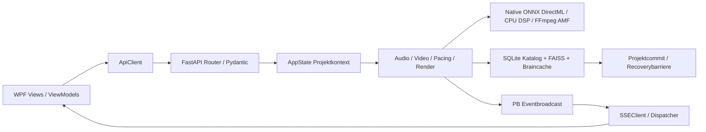
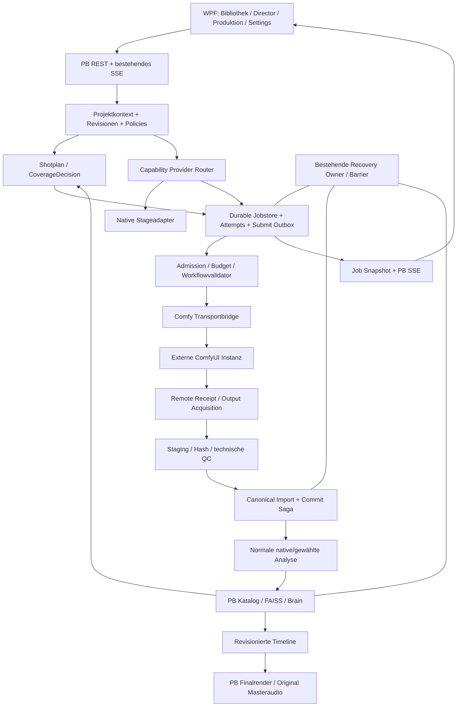

# PB-Studio Control Center Masterplan — Implementation Plan

> Aktuelle Freigabe 2026-10-13: T001/T003/T004 und zugehörige T045-Prüfungen sind zur Umsetzung freigegeben; siehe phase-manifests.md und wave-a/. Frühere Aussagen „keine Implementierung/alle Tasks offen“ dokumentieren den Planreviewstand und gelten nicht als Widerruf dieser begrenzten Freigabe. Keine Generierung, GPU-Läufe, Migrationen oder Installationen.

> **For agentic workers:** Dieser Auftrag erstellt ausschließlich den Plan. Erst nach expliziter späterer Implementierungsfreigabe: `superpowers:subagent-driven-development` oder `superpowers:executing-plans` taskweise verwenden; projektbezogene SDD-/Freigabegates beachten. Alle Checkboxen bleiben jetzt offen.

**Goal:** PB-Studio als Produktionskontrollzentrum mit separater, workflowbasierter ComfyUI-Ausführung schrittweise erweitern; Nativefunktionen und Projektdaten erhalten.

**Architecture:** PB besitzt Projekte, Katalog, FAISS/Brain, musikalische Planung, Timeline, Produktionsjobs, QC und AMF-Finalexport. ComfyUI besitzt externe Modell-/Workflowausführung; Bridge transportiert nur versiongebundene Aufträge/Receipts. Dauerhafte Attempts und reparierbarer Import schützen Übergänge zwischen Prozessen, Dateisystem, SQLite und Vektoren.

**Tech Stack:** bestehendes WPF/.NET + Python/FastAPI; PB ONNX/DirectML, FFmpeg AMF, SQLite/FAISS, bestehendes SSE. Externe ComfyUI-Runtime separat; AMD/ROCm dort ausdrücklich erlaubt.

**Spec:** [spec.md](spec.md). **Tasks:** [tasks.md](tasks.md). **Traceability:** [traceability.md](traceability.md). **Datum:** 2026-10-13. **Status:** vollständiger Planentwurf, weder implementiert noch produktiv abgenommen.

## Global Constraints

- D01 bestätigt: ComfyUI eigene externe AMD-/ROCm-Laufzeit; PB-interne ONNX-/GPU-Pfade DirectML. Keine gemeinsame venv/Dependency-/Modell-/Updateverwaltung.
- D02 aktualisiert am 2026-10-13: PB-Scope lokal. Cloud ausschließlich separat in ComfyUI einstellen; keine PB-Cloudsteuerung, Cloudaufgaben oder späteren Cloudfreigabegates in diesem Plan.
- PB Python 3.11.x, NumPy 1.26.4; DirectML-Sessions `enable_mem_pattern=False` UND `enable_cpu_mem_arena=False`; `PYTHONPATH=src`; `Tests/`.
- Finalexport FFmpeg AMF; GPUmonitor LHM, keine NVIDIAtools. Keine neue Dependency ohne Kompatibilitätsprüfung und Projektfreigabe.
- `src/pb_studio/audio/separator.py` bleibt LOCKED; neue Adapter arbeiten außen. Keine Nativeablösung ohne unabhängige Benchmarks.
- Keine Produktions-DBmigration, Originalmedienänderung, Installation, App-/Workflowausführung, Code-/Konfigurationsänderung oder Marker während dieser Planerstellung.
- Migrationen, `IApiClient.cs`-Kontraktänderungen und Löschungen besitzen eigene Projektfreigabegates. Bereits bestätigte D01/D02 nicht erneut fragen.
- Originalquelle, Review und bestehender Dirty-State bleiben erhalten. Keine pauschalen Gitadd-/Revert-/Restoreaktionen.
- Jeder Produktphase eigenes Spec/Plan/Tasks/Evidence/QC; `.completed` und `.qc-passed` ausschließlich nach tatsächlichen Nachweisen. Masterplan ist keine Blanket-Freigabe.

## Review Focus

1. Antwort geht nach Remoteannahme verloren: Unknown bleibt durable, kein blindes Resubmit; Tests T012/T013.
2. Projekt-/Timeline-/Endpointwechsel vor Fertigstellung: Ursprung und Revision bleiben gebunden, kein fremder Commit; Tests T010/T019/T040.
3. Fremdjob im GPU-/Cancelrace: keine globale Operation, keine Shared-Exklusivitätsbehauptung; Tests T014/T015/T016.
4. Crash zwischen Datei/DB/FAISS/Jobready: idempotente Import-/ADDsaga und Recovery konvergieren; Tests T019/T020/T021.
5. Modellraum/-vorverarbeitung ändert sich bei gleicher Dimension: Cache-/Queryraumprüfung blockiert Vermischung; Tests T008/T009/T037.

## Arbeitsmodus und Bindungsniveau

Dies ist die konsolidierte Neufassung des ursprünglichen Auftrags. Der ursprüngliche Auftrag bleibt in der Traceability nachvollziehbar; die Nutzerentscheidung vom 2026-10-13 entfernt externe Dienstesteuerung aus dem Zielumfang; Reihenfolge und Verträge enthalten alle 40 Reviewbefunde. Die ursprünglichen 82 Abschnitte werden thematisch neu strukturiert statt unverändert kopiert.

**BESTÄTIGT 2026-10-13:** D01/D02 und Grundentscheidungen O01–O04. O01 observed_shared zuerst; O02 Pause/Schließen/Abbruch gemäß [clarifications.md](clarifications.md); O03 repräsentative Referenzen + Native-Baseline + Holdout; O04 additive Erweiterung des bestehenden Katalogs/API. **OFFEN:** konkrete Referenzautorisierung, Qualitäts-/Ressourcenmesswerte (O03), konkrete Schema/API-Specs und Migrations-/API-Freigaben (O04), technische Qualifikation optionaler managed Koordination. Neue Interfaces/Tasks sind [ABSICHT], keine Implementierung oder Produktabnahme.

Bestätigte Betriebsregeln: observed_shared mit sichtbaren Grenzen; Pause stoppt neue Dispatches, laufender Shot darf fertig werden. Beim PB-Schließen Zustand dauerhaft sichern; separat laufende ComfyUI bleibt aktiv, danach Reconciliation ohne blindes Resubmit. Cancelled/obsolete Outputs gesichert/quarantänisiert, keine automatische Verwendung. Bereits committierte Medien erhalten, Verwendung sperren und lokale Schreibvorgänge konsistent abschließen. Rechner-/Comfy-Shutdown garantiert keine Fortsetzung mitten im Workflow. T001 übernimmt die Entscheidungen; Messungen und Änderungsfreigaben bleiben getrennte Gates.

## Quellen und IST-Evidenz

Repositoryroot `C:\Users\david\Documents\Pb_studio_AMD_version`. Review vom 2026-10-12, PB-HEAD `e51e798cc05cd6ec4f42a9e69ee3e9284dc5bcdb`, veränderter Worktree. [Review](../../docs/comfyui-plan-review-2026-10-12/review.md), [bestätigte Entscheidungen](../../docs/comfyui-plan-review-2026-10-12/decisions.md), [Evidence](../../docs/comfyui-plan-review-2026-10-12/evidence.json), [Quelleninventar](../../docs/comfyui-plan-review-2026-10-12/source-inventory.json).

Datierte Aufnahme: externe API0.39.2/Python3.13.12/torch2.12.0+rocm7.14.0/RX7800XT; passender gelesener Quellstand `C:\Users\david\ComfyUI-Installs\ComfyUI\ComfyUI`, SHA3c1b7a17fdf239d35ce98cc777756f572d089795. `C:\ComfyUI`0.38.1 ist anderer Stand. Diese Aufnahme ist **kein erneuter aktueller Laufbeleg** und keine getestete Generatorqualifikation. 1380 registrierte Nodes beweisen keine Runtimequalität.

Alle folgenden IST-Angaben stammen aus dem datierten Quellreview; vor Implementierung T001 Source-/API-Revisionsdrift prüfen. Nicht jede Quellzeile fachlich vollständig verifiziert. Frühere AST-/Compileprüfung beweist Syntax, nicht Funktion; in dieser Planerstellung keine Produktprüfung simulieren.

## A. IST-ZUSTAND und Komponentenkarte

Die vorhandenen Schichten sind WPF → REST/SSE → FastAPI → Python-Fachlogik → SQLite/FAISS/Brain/Dateisystem/GPU. Eine Suche nach `comfyui` im untersuchten PB-Quellbaum ergab keine Treffer; dies allein schließt eine anders benannte Integration nicht aus. Die folgende Karte belegt tatsächlich gelesene Komponenten und ihre hier relevante Rolle, nicht deren aktuelle Laufzeitfreigabe.

Alle PB-Pfade beziehen sich auf `C:\Users\david\Documents\Pb_studio_AMD_version`.

| Fachbereich | Gelesene Datei und Symbol/Pfad | Relevanter IST-Vertrag |
|---|---|---|
| Projektzustand | `backend/app_state.py:129` `ProjectOperationContext`; `:152` `AppState`; `:220` Kontext; `:312` `project_commit`; `:332` `project_operation` | ID/Root/Epoch; Guard für verspätete Commits; registrierte Projektoperationen |
| Projektwechsel WPF | `PBStudio.UI/Services/ProjectService.cs:302,335,351` | Operationgeneration und Kontextprüfung |
| Audio-API | `backend/schemas/audio_schemas.py:64` `AudioAnalysisResult`; `backend/routers/audio_router.py` | Beatobjekte, Kurven, Struktur/Subtracks, Drumzeitlisten, Stage-/Chunk-/Provenancedaten |
| Native Audioorchestrierung | `src/pb_studio/services/audio_service.py:17` `AudioService`; `src/pb_studio/audio/streaming_analyzer.py:500` Checkpointvalidierung | Stem-Service und spezielle Streaming-/Checkpointverträge; kein belegter universeller Audio-Providerrouter |
| Video-API | `backend/schemas/video_schemas.py:59` `VideoAnalysisResult`; `video_router.py:2325` SigLIP-Framepfad; `:1525` Commit | Szene/Motion/Tags/Colors/Key/Embeddingmetadaten; Vektor vor Commit als pending |
| Native Vision/GPU | `src/pb_studio/video/raft.py` `MotionAnalyzer`; `video/moondream.py`; `ai/siglip_wrapper.py` | ONNX-/DirectML-Ausführungspfade; alternative LM-Studio-Vision vorhanden |
| Director/Pacing | `src/pb_studio/services/pacing_service.py:95` `PacingService`; `pacing/advanced_pacing_engine.py` `AdvancedPacingEngine`; `pacing/clip_selector.py` `ClipSelector` | Analyse-/Clipdaten → Cut-Liste; FAISS-/Motionauswahl. Keine kalibrierte Generation-Coverageentscheidung belegt |
| Embeddings | `video_router.py:660` `video_index`; `:723` Braincache; `audio_router.py:836` CLAP-Pfad | Native SigLIP-/CLAP-Identitäten und modellgebundene Caches |
| Katalog | `src/pb_studio/data/database_core.py:72`; `data/repositories/media_repository.py:236` | `vector_map.faiss_id` ohne Raumidentität; Medienidentität projektbezogener normalisierter Pfad |
| Vectorstore | `src/pb_studio/data/vector_store.py:397` `add_embedding`; `:450` Löschpfad | Dimensionprüfung, Mapping, Tombstones/Recoverybarriere |
| Outbox | `src/pb_studio/data/vector_operation_outbox.py:176` | Dauerhafte, reparierbare Vektoroperationen; kein vollständiger generierter Importvertrag |
| Brain | `src/pb_studio/brain/post_processor.py:88,303`; `src/pb_studio/audio/audio_embedder.py:24`; `src/pb_studio/video/video_embedder.py:29` | CLAP512/SigLIP1152 und exakte Native-Versionen; trainierter Projektor nötig |
| LLM-Auswahl | `src/pb_studio/ai/llm_provider.py:60,94`; `ai/model_registry.py:93,193,479`; `ai/model_inventory.py:122` | LM Studio/Ollama; SelectionReceipt und Inventarpattern. Dieses AUTO ist kein Workflow-AUTO |
| GPUkoordination | `backend/dependencies.py:20,29`; `core/gpu_lock.py`; `core/vram_budget_manager.py:177,349,630` | PB-interne Locks, Eigenbuchhaltung, Sensorwarnung; keine Fremdprozess-Exklusivgarantie |
| Sessionmanagement | `src/pb_studio/core/model_loader.py:134,446,520` `ModelLoader` | Native Sessionbesitz und Entladepfade |
| Legacy Tasks | `src/pb_studio/core/task_queue.py:22` `TaskQueue`; `core/thread_pool.py:59` `ThreadPoolManager` | In-Memory-Queue bzw. Qt-Pattern; kein belegter persistenter FastAPI-Jobmanager |
| Render | `src/pb_studio/rendering/render_queue.py:258` `RenderQueue`; `rendering/render_service.py:112` `RenderService`; `preview_renderer.py:53` `PreviewGenerator` | Persistente FFmpeg-Queue/CAS/Dedupe; Preview/Finalexport bleiben PB |
| Echtzeit | `backend/dependencies.py:385,450,474`; `backend/routers/events_router.py:171`; `PBStudio.UI/Services/SSEClient.cs:440` | Broadcast, begrenztes RAM-Journal, Typfilter beidseitig |
| Recovery | `backend/recovery_runtime.py:44`; `storage/recovery_adapters.py:29,119,328,523,717`; `storage/recovery_generation.py:736`; `storage/recovery_barrier.py` | Generationssnapshot, Inventar, lokale Schreibbarriere und Quiesce |
| Backend-Lifecycle | `backend/main.py:346` | Idle-/Zombie-Watcher berücksichtigt bestehende Clients/GPUlock/Renderaktivität |
| Konfiguration | `src/pb_studio/config_manager.py:40`; `PBStudio.UI/Services/SettingsService.cs:15` | Backend-Config und WPF-Einstellungen mit unterschiedlichem Besitz |
| WPF-Navigation/DI | `PBStudio.UI/MainWindow.xaml:150`; `ViewModels/MainViewModel.cs:106`; `App.xaml.cs:145` | 13 Tabs; mindestens eine indexgebundene Navigation; DI-Lifetimes |

### Bestehender Datenfluss



Vollständige geprüfte Beispielkette: VideoRouter repräsentative Frames → SigLIP → gemittelter finiter normierter 1152-D-Vektor → pending embedding → `state.project_commit(context)` → `video_index`/`vector_map`/Analysedaten/Braincache → PacingRouter Clipdaten → ClipSelector. Dieser Übergang muss von externen Providern mit gleicher Datenbedeutung erfüllt werden; ein generisches `embedding`-Dictionary reicht nicht.

## B. SOLL-ARCHITEKTUR

**[ABSICHT]** PB besitzt Produktionsentscheidungen und persistente Wahrheit; Comfy besitzt Workflowausführung. PB ruft keine Comfy-Pythonmodule im eigenen Prozess auf.



Grenzen: Ein Workflow schreibt niemals über die Bridge direkt in PB-DB/FAISS. Ein Workflow darf Referenzen nur aus genehmigten Inputbereichen lesen. Für technisch durchgesetzte DB-Isolation benötigt Comfy entsprechende OS-Rechte/Prozessidentität; separate venvs alleine verhindern Dateizugriff nicht.

## C. KEEP / REPLACE / WRAP

| Komponente | Entscheidung | Begründung und Ablösegate |
|---|---|---|
| Projekt-/Medienkatalog, Projektkontext | KEEP | Eigentümer und sichere Commitgrenze bleiben PB |
| Pacing, Director, Shot-/Timelineplanung | KEEP + additive Coverage-/Assetplanung | Comfy entscheidet weder Projekt noch endgültige Cut-Liste |
| Finalexport/Preview/AMF | KEEP | Pipeline und Masteraudiosicherheit bleiben PB; erzeugtes Shot-Audio getrennt |
| Native Audio/Video/DSP | KEEP + WRAP an Stagegrenzen | Alternative erst nach unabhängigen Qualitäts- und Betriebsbenchmarks |
| Native SigLIP/FAISS/Brainencoder | KEEP für ersten Release | Kein vermischter Vektorraum; alternative Encoder gesonderter Scope |
| RenderQueue | KEEP; technische Patterns wiederverwenden | Externe Attempts benötigen andere Recoverysemantik |
| TaskQueue/Qt ThreadPool | KEEP unverändert; nicht als neuen Jobkern verwenden | Kein belegter dauerhafter Backend-Scheduler |
| Eventfanout/SSE | KEEP + neue typed Events/Snapshots | Eine UI-Wahrheit, kein zweiter Comfy-Client in WPF |
| ConfigManager/Settings | KEEP + definierter Owner | Keine zwei autoritativen Comfy-URLs |
| Native GPUlocks/Monitoring/Loader | KEEP + externe Admission ergänzen | Prozesslokale Schutzmaßnahmen bleiben notwendig |
| Comfy-Generierung/Postprocess | NEU/OPTIONAL, workflowbasiert | Neue Fähigkeit; kein Native-Ersatz notwendig |
| AUTO für Analysen | Verpflichtender späterer Zielumfang P6, außerhalb MVP | Benchmarkcohort und Degradepolicy nötig; keine unqualifizierte automatische Auswahl |
| Andere Embeddingräume/Generatorlernen | OPTIONAL später | Migration/Projektor/Ranking separat nachweisen |
| Irgendein bestehender Provider | REPLACE: derzeit keiner | Keine ausgeführte Vergleichsmessung rechtfertigt Entfernung |

## D. COMFYUI BRIDGE: Schnittstellen und Dateistruktur

**[ABSICHT]** Kleine neue Bridge, keine Kopie von DB, Recovery, Eventsystem oder Director. Namen hier sind Entwurf; vor Umsetzung vorhandene Typen/Importgrenzen abgleichen.

```text
NEU/GEPLANT src/pb_studio/comfyui/
  client.py                 HTTP/WebSocket; keine Businesspersistenz
  capabilities.py           Versionprofil + DiscoverySnapshot
  workflow_registry.py      Manifest/Prompt laden, validieren, pinnen
  workflow_parameters.py    Typed Parameter → konkrete Inputslots
  result_parser.py          Registrierte Outputadapter
  schemas.py                Bridge DTOs / Receipts

NEU/GEPLANT src/pb_studio/jobs/
  models.py                 LogicalJob / Attempt / Artifact / Events
  repository.py             PB-Katalogtransaktionen + CAS
  scheduler.py              Dispatch / Backpressure / lokale Admission
  reconciliation.py         Remotezustand + Outputreceipts abgleichen
  import_service.py         Staging / QC / idempotenter Canonical Import

NEU/GEPLANT src/pb_studio/providers/
  contracts.py              Capabilityverträge / ResultEnvelope
  native_adapters.py        Bestehende Stagepayloads adaptieren
  routing.py                Explizit / qualified AUTO / Receipt

NEU/GEPLANT backend/routers/comfyui_router.py
NEU/GEPLANT backend/routers/jobs_router.py
NEU/GEPLANT backend/schemas/comfyui_schemas.py
NEU/GEPLANT backend/schemas/jobs_schemas.py
NEU/GEPLANT workflows/     Gepinnte API-Prompts + PB-Manifeste
```

Das Jobpaket wird nicht Comfy-exklusiv benannt: es repräsentiert externe Produktionsaufträge. Der bestehende Render-Fachkern wird dabei zunächst nicht abstrahiert oder migriert. Wiederverwendbarer Code wird nur nach konkret belegter Doppelung herausgezogen.

### Transportinterface

Die endgültigen geplanten Signaturen stehen in P; `WorkflowRegistry.validate` prüft eigenen Graph-/Node-/Mapping-/Policyvertrag, nicht eine behauptete universelle serverseitige Dry-Run-Route. `/prompt` kann serverseitig validieren, reiht bei Erfolg aber ein. Eine reine PB-Validierung darf keinen echten Lauf auslösen.

### Datierter, quellverifizierter Serververtrag

Die folgenden Routen existieren im erneut gelesenen Comfy-Quellstand3c1b7a17 (Versionsaufnahme0.39.2 vom2026-10-12). GET-Probes am2026-10-13 auf den vorgesehenen Loopbackports wurden abgewiesen; aktuell laufender Server damit nicht belegt. Schreibende Routen wurden während dieses Audits **nicht ausgeführt**. Offizieller [Routenüberblick](https://docs.comfy.org/development/comfyui-server/comms_routes) und [gepinntes `server.py`](https://github.com/Comfy-Org/ComfyUI/blob/3c1b7a17fdf239d35ce98cc777756f572d089795/server.py) ergänzen lokale Evidenz.

| Bedarf | Route/Vertrag | PB-Policy |
|---|---|---|
| Version/Device | GET `/system_stats` | Nur aktueller Discoverybeleg, kein Modell-Smoke |
| Serverfeatures | GET `/features` | Begrenzte Flags; kein vollständiger Capability-/Versionsnachweis |
| Nodecontracts | GET `/object_info[/class]` | Input-/Outputdefinition + Schemafingerprint |
| Modellnamen | GET `/models[/folder]` | Namen ohne automatische Hash-/Kompatibilitätsgarantie |
| Submit | POST `/prompt` | Persistierte Attempt-/Payloadidentität davor; Antwortverlust reconciliieren |
| Progress | `/ws?clientId=...` | Nicht jedes Event promptgebunden; ein WS-Owner, ungekennzeichnete Events nur Anzeige, Binärframes getrennt; Kommunikationsvertrag4–5 |
| Queue/History | GET `/queue`, `/history/{id}` | RAM-Zustand; fehlender Record bedeutet unknown, nicht never-run |
| Jobquery | GET `/api/jobs[/id]` | Versionsprofil; normalisiertes completed ohne Rohsuccess kein Erfolgsbeleg; RAMhistorie kein persistenter Store |
| Zielcancel | POST `/api/jobs/{id}/cancel` | Eigene remote_prompt_uuid; cancelled:true bestätigt nur Begehren, Pendingdelete kann ohne Terminalrecord enden; bounded needs_decision gemäß Kommunikationsvertrag6 |
| Legacy interrupt | POST `/interrupt` | Kein ungezielter Fallback; target race/version berücksichtigen |
| Queuemanipulation | POST `/queue` | Niemals global clear; fremde Aufträge bleiben geschützt |
| Speicherfreigabe | POST `/free` | Serverweite, später abgearbeitete Flags; nicht als synchrones Leaseende behandeln |
| Dateien | POST `/upload/image`; GET `/view` | Kein ungeprüfter universeller Audio-/Video-Transport; Typ/Root/Loader prüfen |

Versionprofile sind eng und getestete Features explizit. Für unbekannte Versionen nur lesende Discovery; Ausführung erst nach bestandenen Contract-/Smoke-Gates oder ausdrücklichem experimentellem Modus. `/extensions` nicht als vollständige Custom-Node-Paketliste interpretieren.

### Geplante PB-REST-Verträge

| Route | Wirkung / Ergebnis |
|---|---|
| GET `/comfyui/status` | enabled, connected, server_id, version, policy/profile, Fehlergrund, Snapshotalter |
| GET `/comfyui/capabilities` | node/model/schema readiness mit unknown-Gründen |
| GET `/workflows` | Versionierter registrierter Katalog, keine Server-Nodetitel als semantische IDs |
| POST `/workflows/{revision}/validate` | Read-only lokale Validierung; `static_valid` getrennt von Smoke |
| POST `/jobs` | Idempotency-Key + Zielprojekt/Revision; durable logischer Job; HTTP 202; kein langer Request |
| GET `/jobs?project_uuid=...` | Konsistenter Snapshot mit snapshot_id/store_generation_uuid/watermark/opaque next_cursor; Kommunikationsvertrag8 |
| GET `/jobs/{id}` | Attempts, Stages, Outputs, Diagnose und Besitz |
| GET `/jobs/by-request/{client_request_id}` | Projektgebundener Abgleich eines dauerhaft gespeicherten WPF-Intents |
| GET `/jobs/changes` | Projektgebundener dauerhafter Changefeed mit Cursor/Generation/Retentionreset |
| POST `/jobs/lifecycle/prepare-close` | Idempotenter Dispatchfreeze und durable Handoff; kein Remoteende abwarten |
| GET `/jobs/lifecycle/close-intents/{id}` | Dauerhaftes CloseReceipt abfragen |
| POST `/jobs/lifecycle/close-intents/{id}/abort` | Eigenen Freeze nach Reconciliation per CAS lösen, Batchpause erhalten |
| POST `/jobs/{id}/cancel` | `cancel_requested`; remote Wirkung gesondert |
| POST `/jobs/{id}/retry` | Nichtterminal retry_wait: zulässige Wiederholung vorbereiten; terminal failed: nur neuer verknüpfter Intent. ready/cancelled/obsolete und unresolved Remoteattempt:409; ursprünglicher Job bleibt unverändert |
| POST `/production-batches/{id}/pause` | Bestätigte O02-Policy: neue Dispatches stoppen, aktiver Attempt läuft fertig; O02 bestätigt am 2026-10-13 |
| POST `/production-batches/{id}/resume` | Offene Arbeit anhand Job-/Artifactreceipts fortsetzen |
| PATCH `/comfyui/settings` | Backend-Konfiguration mit ConfigToken (Backendinstanz, Revision, Snapshotdigest), atomarer Patch-/Reload-/Persistenzvertrag; Endpointwechsel next_job, keine laufenden Attempts umbiegen |
| POST `/workflows` | Gepinntes Bundle registrieren; client_request_id/bundlehash, identische Wiederholung idempotent, geänderter Payload409 |
| PATCH `/workflows/{id}/revisions/{revision}/enabled` | expected_activation_token+client_request_id; WorkflowActivationReceipt, stale409; immutable Bundleinhalt bleibt unverändert |
| POST `/production-batches` | Minimale persistente Batchidentität/revision/geordnete Jobs bereits vor Longform; projektgebundene idempotente Anlage |
| POST `/jobs/{id}/priority` | Nur nicht dispatchter Job, expected_revision; aktive/terminale Versuche unverändert |
| POST `/production-batches/{id}/reorder` | ordered_job_ids+expected_revision; Scope/Dubletten prüfen, bereits dispatchte IDs dürfen ihre wirksame Reihenfolge nicht ändern |
| POST `/jobs/{id}/analyze` | Idempotenter projektgebundener Analysefortsetzungsintent mit expected_state_revision/import_receipt_uuid; nur ausdrücklich gewählte Analyse, kein neuer Generierungsattempt |
| POST `/artifacts/{id}/import` | Bewusster lokaler Importintent mit client_request_id/ProjectIdentity/expected_revision; keine neue Generierung und kein WPF→Comfyaufruf |

Mutationen erfordern vorhandene PB-Owner-/Projektkontextgrenzen. Fremde Projekte nicht über frei übergebene Rootstrings adressieren. WPF/C#-API-Kontraktänderungen erhalten eigenes vom Nutzer freizugebendes Gate gemäß Projektregeln; diese Prüfung führt sie nicht aus.

T022 besitzt zusätzlich `backend/main.py` für Routerimports/`include_router`, DI und Startupbindung. Abnahme gegen echte PB-App/OpenAPI, nicht bloß isolierten Router. T024/T025 besitzen App-DI/ApiClient/IApiClient/DTOs und den gewählten Navigationspfad. Jede Tabellenmutation hat typisierte Request-/Responsefelder, Owner-/Projektprüfung, CASrevision und Idempotencyregel; Gapi gilt vor Änderung.

## E. PROVIDER SYSTEM: Verträge und Routing

Ein Provider ist kein monolithischer „Audio“-/„Video“-Schalter. Capabilitybeispiele: `audio.beats.v1`, `audio.stems.v1`, `video.caption.v1`, `video.motion.v1`, `video.embedding.v1`, `media.video_generation.v1`, `media.upscale.v1`. Native Beats + Comfy Stems + Native SigLIP kann gültig sein, wenn Stageabhängigkeiten und Zeitbasis vereinbar sind.

Gemeinsamer ResultEnvelope:

```text
schema_version
result_uuid, project_uuid, execution_kind: native | comfy
job_uuid: nullable (aktueller PB-Ausführungskontext, sofern vorhanden)
attempt_uuid: bei comfy zwingend, bei native null
origin_generation_job_uuid/origin_generation_attempt_uuid: nullable Provenancerelation, niemals aktuelle Native-Ausführung
input_artifacts[]: role, artifact_uuid/reference, content_sha256, source_range, timebase
produced_artifact_uuids[]
media_id: nullable bis Canonical Import
source_sha256/source_range: capabilityabhängig; für T2V ohne Source nicht erforderlich
request_fingerprint, config_revision
provider_id/version, algorithm/code/processor/config identity (Native lokal; Comfy gemäß Node-/Runtimeprofil), result_adapter_revision
workflow_revision, remote_prompt_uuid: bei comfy zwingend, native null/not_applicable
effective_prompt_sha256: bei comfy gemäß Q6 assurance_basis, native null/not_applicable
model_bundle_sha256: für modellbasierte Ausführung erforderlich nach Qualifikationsregel; Native-DSP ohne Modell ausdrücklich not_applicable
started_at, completed_at, aggregate_status
stages[], artifacts[], provenance
```

Stage:

```text
stage_id, payload_schema_version
status: completed | partial | failed | unavailable | not_requested | interrupted
reason_code, dependencies: result_uuid/stage_id
payload, evidence
measurement_origin: measured | derived | synthetic
confidence_method, coverage_intervals, uncovered_intervals
```

Enums pro Familie abschließend spezifizieren; `skipped`, `cancelled` und `stale` nicht unkoordiniert in bestehende API-Enums schreiben. `aggregate_status` wird aus Pflicht-/Optionalstages bestimmt, nicht von Comfy übernommen. Analysis erfordert konkrete Sourceidentität; Text-to-video kann null Eingabemedien haben, Referencegeneration null bis mehrere je Profil erlaubte Inputs. Artifact-ID existiert vor Media-ID; Prompt-/Requesthash bindet T2V-Intent ohne erfundene Source-Datei.

Native ResultEnvelope braucht keinen künstlichen Comfyauftrag. AnalysisRun ist die persistierte analysebezogene Projektion desselben validierten Envelope-Kontexts: execution_kind, optionaler aktueller Jobbezug, native/comfy-spezifische Identität, unveränderliche Source-/Run-/Stageherkunft. Ein gemeinsamer diskriminierter Validator prüft beide Darstellungen; keine Umgehung über getrennte schwächere Nativevalidierung. Native-SigLIP nach Comfyimport bindet eigenen Analyse-Run und lokale Modell-/Processor-/Adapteridentität; origin_generation_attempt_uuid bleibt ausschließlich Medienherkunft. Nativeanalyse einer bestehenden Datei ohne Job ist zulässig, aber niemals ohne Result-/Projekt-/Sourceidentität.

Embeddingpayload enthält explizit `embedding_space_id`, `model_sha256`, `processor_sha256`, `dimension`, `dtype`, `normalization`, `pooling`, `granularity`, `source_range` und `vector_artifact_sha256`. Query und Index benötigen denselben Raumvertrag; bloß gleiche Dimension reicht nicht. Großvektoren als typisierte, größenbegrenzte Artefakte transportieren, nicht als ungeprüfte beliebige Deserialisierung.

Zeitreihen: rationale Zeitbasis/Sourceoffset, Sekunden oder Samples mit expliziter Einheit; Samplezeiten oder start/step, Sample-/Hoprate, Normalisierungs-/Kalibrationsrevision. Beats als PB-Objekte mit `time`, `strength`, `beat_type`; Drumlisten adaptieren nach `kick_times`, `snare_times`, `hihat_times`; Energie nach `energy_curve`; Struktur nach `structure_segments`. Semantische Drop-/Peaklabels nur mit geeigneter Evidenz. Kein zweites Feldset neben bestehenden APIs ohne Consumer.

Einmaliger Validator vor Cache, Persistenz und Pacing: finite Zahlen, monotone Zeitpunkte, keine unerlaubten Überlappungen, Grenzen im Sourcebereich, ausreichende Chunkabdeckung, gültige Confidencebereiche, leere valide Ergebnisse getrennt von nicht verfügbaren Ergebnissen. Provideradapter korrigiert Zeitoffsets dokumentiert; niemals heimlich Timestamps clippen, falsche Dimensionen auffüllen oder unkalibrierte Motionwerte direkt übernehmen.

**AUTO:** Zuerst harte Gates für verfügbar/vertrauenswürdig/Schema/Hardware/Qualität/Budget/Policy. Danach deterministische profilgebundene Auswahl; keine globale „beste KI“. Receipt speichert Kandidaten, Ablehnungsgründe, Benchmarkcohort, Qualitätsnachweis, Konfigurationsrevision und gewählten Workflow. Unknown Quality bleibt unranked. Fallback unter Qualitätsminimum braucht explizite Degradepolicy; sonst warten. Bestehendes `ai.provider` bleibt unberührt.

## F. WORKFLOW SYSTEM: Registry, Mapping und Versionierung

Manifest v1 ist ein typisierter Vertrag, kein ausgefüllter Beispielworkflow:

| Feld | Typ / bindende Regel |
|---|---|
| manifest_schema | Integer1; unbekannte Version fail-closed |
| workflow_id / revision | stabile String-ID / monotone positive Revision |
| api_prompt_sha256 | SHA256 des gespeicherten API-Prompts |
| capabilities / result_adapter | registrierte Capabilityversionen / erlaubte Adapter-ID |
| execution_location | local/unknown; PB qualifiziert lokale Profile; keine externe Dienstesteuerung |
| server_profile / resource_profile / quality_profile | IDs tatsächlich getesteter/beabsichtigter Profile; fehlend kein qualified |
| node_requirements | Liste class_type + schemahash + Paketidentität/unknown |
| model_bundle | Rollen + Loaderbindings + Inhalts-/Processor-/LoRAhashes; Unknownidentity kein reproduzierbar-qualified |
| parameter_bindings | semantic_name → node_id/input_name/TypeConstraint; keine Titelsemantik |
| output_bindings | slot_id/ordinal → node_id/OutputAdapter/Artifactfamilie |
| network_policy | deklarierter Egress/Credentialreference/Downloadbedarf; kein Secret |
| reproducibility_level | traceable/rerunnable/deterministic_verified, letzteres nur nach Messung |

Ein ausführbares Pilotbundle muss echte vorhandene Nodes, Modelle und konkrete Profile enthalten; T005/T007 ermitteln diese. Keine ausgedachten Modellnamen, Defaults oder Testausgaben als Liefernachweis.

Bundle besteht aus Manifest, API-Prompt, optional UI-Graph, Parameternormalisierung und Testfixture. Bundlehash identifiziert diesen gespeicherten Vertrag; vollständige Ausführungsidentität entsteht erst zusammen mit Nodecode-/Modell-/Runtimeprofil und Effective-Graph-Receipt einschließlich tatsächlich wirksamer Serverersetzungen. UI-Positionen und Titel dürfen getrennt gehasht werden, wenn sie garantiert nicht wirken. Final gesendeter Graph wird pro Attempt ebenfalls gehasht. Auch Defaults werden aufgelöst und gespeichert.

Mapping `generation.prompt → node_id/input_name` ist zulässig **für eine gepinnte Revision**. Neue Node-ID invalidiert Mapping; Stringersatz im gesamten JSON ist verboten. Graphlinks `[node_id, output_index]` unterscheiden sich von literalen Listen; Typprüfung, Referenzauflösung, Outputindex und optionales DAG-Gate sind Pflicht. Nodeschemareplacement/-dynamische Expansion müssen entweder im getesteten Profil unterstützt oder abgewiesen werden. Subgraphs/UI-only Features nicht blind flatten.

Parameterconstraints: Seedrange/Randompolicy; max/min/integer width/height, Pixel-/Framebudget, modellgebundenes Framemultiple, rationale FPS, duration→frame_count mit definierter Endpunktkonvention, Referenceanzahl/-formate, LoRArollen, Strengthgrenzen. Modellwechsel nur innerhalb kompatibler Loaderfamilie. „LoRA“ und „negative_prompt“ sind nicht automatisch bei jedem Workflow vorhanden.

Update erzeugt neue Revision; laufende Jobs behalten alten Bundlehash. Registrierung prüft Herkunft, erlaubte Nodes, Input-/Output-/Ausführungsvertrag und Smoke-/Qualitätsstatus. Beliebiger Workflow darf keine beliebigen Parsermodule oder Shellbefehle aus Metadaten laden.

## G. DATENBANKÄNDERUNGEN und Kompatibilität

**[ABSICHT]** Additive Tabellen im vorhandenen PB-Katalog bevorzugen; dessen bestehende Recovery- und Migrationseinbindung konkret erweitern. Kein zweiter Comfy-Medienkatalog. Über das endgültige SQL entscheiden erst Schema-Spec und explizite Migrationsfreigabe.

| Geplante Tabelle | Schlüssel und Inhalt | Integritätsregel |
|---|---|---|
| `provider_job` | job_uuid; Projekt-UUID/-Rootbindung; capability; source/shotplanrevision; intenthash; requested/actual state; priority; pause/budgetpolicy | Projekt-FK/UUID-Regel, dauerhafte Logical-Job-ID; CAS state_revision |
| `production_batch` / `production_batch_job` | batch_uuid/revision/project_identity/paused + ordered jobs; ohne Longformerfordernis | T010 Typ, T011 Persistenz/CAS, T014 erste Steuerung; T041 erweitert nur Orchestrierung |
| `provider_attempt` | attempt_uuid; job_uuid; ordinal; endpoint/server/profile; prompt_id; pinned payloadhash; uncertainty/cancel/error/times | UNIQUE job+ordinal; eigene UUID pro Versuch; terminale Attempts unveränderlich |
| `provider_submission_outbox` | attempt_uuid; pinned request; dispatchlease; send/receiptstatus | Vor Netzwerkaufruf durable; keine offenen DBtransaktionen während HTTP |
| `provider_artifact` | artifact_uuid; attempt; slot/ordinal; hash; size; staged/final location; QC; ownership | UNIQUE(attempt_uuid, slot_id, ordinal); gleicher Hash idempotent, anderer Hash für selben Claim = Konflikt/Quarantäne |
| `media_import_receipt` / `artifact_publication` | project_identity/import_intent_uuid/artifact_uuid → origin_attempt/slot/ordinal/hash/media_id; importstate | Idempotencyclaim gemäß Q3; eine Canonical-Publikation je Projekt+Artifact, mehrere bewusste Intents behalten Herkunft |
| `media_derivation` | child/parent artifact/media; operation; sourcebereich | Varianten-/Retake-DAG; Parent nie überschreiben |
| `analysis_run` | result_uuid; sourcehash/range; complete fingerprint; Stagepayloads | Immutable Vergleichsresultate; aktiver Stagepointer separat |

Provenance kann in immutable Artifact-/Attemptrecords statt redundantem zweiten Blob liegen. Indexe auf pending/state/project/time; FK-Cascade darf nicht versehentlich verwendete Medien/Varianten löschen. Projektlöschung/Archivierung, globale Jobretention und Medien-GC eigener Sicherheitsvertrag.

Migrationsablauf: lesende Ausgangsinventur → getestete Kopie → additive Migration → Validierung → ganze konsistente Recoverygeneration → Releasegate. Keine Produktionsmigration während Planprüfung. Alte Projekte öffnen ohne neue Jobs; fehlende neue Daten haben definierte Defaults. Future-schema-Records bewahren oder ältere Reader fail-closed. Konfigurationsfallback auf Native benötigt keine **weitere** Migration; das verspricht keinen beliebigen Binärdowngrade.

Multi-Embedding-Räume werden zunächst vermieden. Wenn später nötig, `vector_map` auf Index-/Raumidentität erweitern und Queries/Outbox/Tombstones/Brainconsumer mitmigrieren. Keine zwei FAISS-Indizes mit kollidierenden lokalen IDs in bestehendem Primärschlüssel.

## H. UI / ViewModels

Bestehende WPF fortführen. Erster Release: Comfy-Verbindung/Diagnose in Settings oder MODELLE; Generate-Aktion in VideoLibrary; Produktionsjobliste mit Typ-/Projektfilter in Produktionsbereich. Eigener JOBS-Tab erst nach Flowprüfung, kein automatischer Dreifachtab COMFYUI/WORKFLOWS/JOBS.

**GEPLANT:** `PBStudio.UI/Models/ComfyStatusResponse.cs`, `ProviderJobResponse.cs`; `Services/ProviderJobStateService.cs`; passender `ProviderJobsViewModel`/View nur wenn bestehende Produktionsansicht nicht reicht. Bestehende `ApiClient.cs`, `IApiClient.cs`, `SSEClient.cs`, `App.xaml.cs`, Settings-/VideoLibrary-/Production-ViewModels müssen als komplette Kette behandelt werden. Neue API-Verträge nicht ungefragt als bereits genehmigt implementieren.

Anzeige unterscheidet Connected / statisch kompatibel / Smoke bestanden / Produktionsprofil abgenommen. Fehlerbeispiele: `model_identity_unknown`, `workflow_contract_mismatch`, `provider_offline`, `submission_unknown`, `qc_failed`, `artifact_missing`; Nutzertext plus exportierbare redigierte Details. Kein Traceback als einzige Erklärung, aber technische Diagnose nicht verlieren.

Progress: Phasenname und known/indeterminate Anteil. Step 15/20 ist kein Gesamtproduktionsfortschritt. Sampling100% geht weiter zu Decode/QC/Import. Pausieren erklärt Wirkung auf laufenden Job. Cancel bleibt pending bis tatsächliche Bestätigung. Wiederholen zeigt Seed-/Budgetpolicy. Variantenliste zeigt Elternbeziehung und tatsächliche Auflösung/FPS.

Jobstore liefert initialen/reconnect Snapshot; SSE invalidiert Jobs/Batches mit ProviderJobEvent gemäß communication-contract.md §8; Snapshot/Changefeed liefert den bestätigten Zustand. Beide bestehenden Typfilter erweitern. Dispatcher, subscription disposal und stale Projektgenerationen testen. Feste Navigationsindizes durch stabile IDs ersetzen, wenn neue Tabs eingefügt werden.

## I. JOBSYSTEM: drei getrennte Automaten

Verbindlich sind die Transitiontabellen in Kapitel Q dieses Masterplans: LogicalJob, Attempt und ImportSaga. Die vorherige gemeinsame Skizze wird nicht übernommen. Jobbereitschaft, Remoteerfolg und lokaler Importfortschritt sind verschiedene Zustände. `pause`, `desired_action`, `connection_status`, `reconciliation_status` und `eligibility` sind getrennte Felder, keine beliebig kombinierbare Statusliste.

`ready` erlaubt Medienverwendung gemäß Qualityprofile; es schreibt noch keine Timeline. Cancel/obsolete LogicalJobs bleiben beendet, auch wenn Comfy später Erfolg meldet; Outputs bleiben nach bestätigter O02-Late-output-Policy quarantänisiert erhalten. Diese operative Policy wurde am 2026-10-13 bestätigt; technische Umsetzung bleibt offen. Jeder Retry erhält neue Attempt-ID und neue Prompt-ID. Unentscheidbare Submission wird nicht automatisch wiederholt.

Zeitstempel UTC, Anzeige lokal. Eindeutige Event-IDs, monotone Entityrevision und CAS sichern lokale Übergänge; Netzwerkaufrufe liegen außerhalb DB-/Projekt-/Recoverylocks. Der Scheduler verwendet keine automatische `RenderQueue.interrupted`-Wiederbelebung.

## J. GPU / RAM / Disk-Koordination

O01 bestätigt: erster Scope observed_shared. managed_exclusive ist spätere verbindliche Koordination für verlässlich unbeaufsichtigten Betrieb, separat zu installieren/qualifizieren. Die folgende remote_independent-Variante beschreibt getrennte Hardware einer ComfyUI-Installation, keine externe Dienstesteuerung.

| Modus | Garantie | Technischer Vertrag |
|---|---|---|
| `observed_shared` | Keine harte Fremdprozess-Exklusivität | PB dispatcht begrenzt, beobachtet Queue/LHM/RAM, wartet bei Konflikten; fremde Clients frei |
| `managed_exclusive` | Exklusivität nur für alle tatsächlich kooperierenden GPUclients | Comfy-seitiger Admission-Gate/Proxy, PB Lease, definierte Lockreihenfolge/Heartbeat/Fencing, bestätigte Entladung |
| `remote_independent` | Lokales PB-GPUbudget von Remote getrennt | Lokales CPU/RAM/Disk/Netzwerkbudget bleibt relevant; Remote-Admission eigenständig |

Ein benannter Mutex nur auf PB-Seite macht Comfy nicht kooperativ. Auch dedizierter Comfyport allein isoliert keine physische GPU. Garantien müssen alle konkurrierenden GPUprozesse umfassen oder den ausgeschlossenen Scope sichtbar nennen.

Lease enthält Boot-/Adapteridentität, Owner, Generation/Fencingtoken, Leasezustand und Ablaufpolicy. Leaseexpiry beweist nicht Prozess-/GPUende: wenn Anbieter nicht antwortet, unbekannte Nutzung behandeln; keine überlappende schwere Arbeit allein nach TTL starten. DXGI-LUID pro Boot verwenden, nicht dauerhaft aus historischer Notiz hardcoden; Deviceindex 0 von Comfy und PB-Index sind keine gemeinsame Geräteidentität.

Lockreihenfolge vor Umsetzung festlegen: kurze DBtransition → Ressourcenlease → PB-interner GPULock für tatsächliche native Operation; keine Netzwerkwartezeit unter SQLite-/Recoverylock. Native ModelLoader/Sessions zuerst definierte Freigabe liefern. `/free` ist asynchron/serverweit und nur in vereinbartem exklusivem Kontext erlaubt; Leasefreigabe benötigt Abschluss/Telemetrie, nicht bloß HTTP200.

Admissionprofil bindet Modellbundle, Auflösung, Frames, Dtype, Decoderstrategie, RAM-/VRAM-/Diskspitzen und Messdatum. Keine Modellgröße als Peak-VRAM annehmen. H3-offizieller Speicherbericht mit Offloading ersetzt keinen AMD-Lauf. Monitoringfail meldet degraded/unknown; kein erfundener freier VRAM. AMF-Endexport/Preview und Modellserver in Ressourcenmatrix aufnehmen.

## K. GENERATED MEDIA: vollständiger Lebenszyklus

```text
Remote execution success
→ Outputrefs und Vertragsprüfung
→ PB owned staging / begrenzter Download
→ Contenthash + Probe + Full Decode + QC
→ validiertes Artifactreceipt oder rejected/quarantined
→ bei deaktiviertem Autoimport awaiting_import bis bewusste lokale Freigabe
→ immutable publish
→ normaler projektgebundener Canonical Import
→ bei deaktivierter Autoanalyse catalog_committed/available_partial bis bewusste Analysefreigabe
→ normaler Analyse-Run mit ausgewählten Providern
→ native-kompatibles Embedding + Vektorcommit/Reconciliation
→ Director Eligibility
→ optional revisiongeprüfte Timelinezuweisung
```

Outputs nie ausschließlich durch willkürlichen filename prefix identifizieren. Mehrere Outputs, Bildfolgen, Videos, Audio/Stems und Latents brauchen explizite Slots/Adapter. Anzahl und Bytebudget prüfen; binäre Vektoren/NPZ/Pickle aus fremden Quellen nicht ungesichert deserialisieren. Endgültige Datei wird erst nach geschlossenem Writer und validiertem Inhalt veröffentlicht; Größenstabilität allein genügt nicht.

Local-reference: festgelegte Inputroot/Dateifreigabe, Source read-only, Loaderkompatibilität. Remote transport: streaming zur Destination, Hash/Timeout/Größenlimit/URLpolicy. Junction/Reparse/UNC/Traversal und Race zwischen Prüfung und Nutzung berücksichtigen. Cross-Volume-copy in Zielstaging; Rename/Replace ausschließlich nach erfolgreicher Prüfung. Keine Originalquelle verschieben oder löschen.

Provenance speichert tatsächliche statt nur gewünschte Frames/FPS/Dauer, Graph-/Modelbundle-/Input-/Outputhashes, Seed, Runtime, Qualitätsbericht und Ablehnungsgründe. Prompts gehören ins geschützte Produktionsrecord, nicht ungefiltert in Logs. Credentialreference statt Secret. Derivat-DAG umfasst Parentartifact, Sourcebereich, Operation, Revision; Retake/Upscale überschreibt Elternmedium nicht.

Bibliothek führt denselben normalen Mediaeintrag plus Herkunftsfilter. Datei-QC kann bestehen, während Caption/Embedding unavailable bleibt: Clip kann je Produktregel technisch verwendet werden, semantische Directorverwendung braucht passende Mindestdaten. Missing embedding darf nicht durch Fake-Vektor ersetzt werden. Director-Coverage unterscheidet `sufficient`, `insufficient`, `unknown`: fehlende Analyse löst nicht automatisch Generation aus.

Master-DJ-Audio bleibt eigenständige Originalreferenz. Generated-shot Audio wird standardmäßig nicht in Finalrender gemischt; gewünschtes Sounddesign separat deklarieren. „Unverändert“ meint je Gate Originalbytes, Samples oder Wiedergabesignal; encoding/normalization explizit, keine falsche bitidentische Zusage.

## L. MIGRATION: Ziele und Rollback pro Phase

Verbindlicher Paket-/Gategraph steht in Kapitel S. Phasenfolge: P0 Policy/Referenzen → P1 lesende Bridge/Workflowvertrag/früher Hardware-Smoke → P2 durable Jobs/Import/Recovery → P3 manuelle lokale Generation → P4 Derivate → P5 alternative Analysen → P6 qualifiziertes AUTO → P7 Director-Coverage → P8 Longform. Optionale managed GPU, alternative Vektorräume, Feedbacklernen und Wizard besitzen getrennte Gates und sind keine versteckten P1-MVP-Abhängigkeiten.

Rollback: P0 keine Produktänderung; P1 Bridge deaktivieren; P2/P3 neue Dispatches stoppen, Attempts reconciliieren, akzeptierte Medien erhalten; P4 Parent verwenden; P5/P6 aktive Native-Stagepointer zurückwählen; P7/P8 Generation ausschalten/Batchpause, vorhandene Library/Timeline/Finalrender weiterverwenden. Binärdowngrade und DBrestore sind keine pauschalen Providerfallbacks.

Benchmarks beginnen in P0 und laufen pro Providerphase, statt erst nach Integration aller Analysen. Ein Fehler in P2 darf nicht durch Ausbau in P3–P8 verdeckt werden. Jede Phase besitzt eigene SDD-Artefakte, `.completed`, QCbericht und `.qc-passed` für tatsächlich geprüften Stand. Dieser Entwurf erzeugt keine solchen Marker.

## M. TEST- und BENCHMARKPLAN

### Vertrags- und Fehlerprüfungen

| Ebene | Konkrete Prüfung | Bestanden bedeutet |
|---|---|---|
| Mapping | UI/API-Graph-Verwechslung, fehlender Slot, falscher Typ, Referenz-/Outputindex, Seed/Framesconstraints | Fehlgeschlagene Validierung vor Submit, keine stille Ersatzwerte |
| Result | Sekunden/ms/Samples, Chunkoffset, NaN, out-of-range, leere/unavailable Stages, falsche Motionkalibrierung | Einheitlicher Validator schützt Persistenz/Cache/Pacing |
| Ownership | Projektwechsel/-close, Timelineedit, Endpointwechsel, alter SSEevent | Ursprung bleibt stabil; kein stale Commit/Slotoverwrite |
| Submit | Antwortverlust nach Accept, Crash vor Receipt, doppelter PB-Request | Kein blindes Doppelrechnen; identischer Intent besitzt nachvollziehbare Attempts |
| Cancel | Fremdjob, queued/running/finished race, Serverwechsel | Nur eigene ID; Terminalwirkung verifiziert; keine globalen Aktionen |
| Recovery | Crash nach Staging/Publish/DB/FAISS/Brain/Jobready; Restoregeneration | Ein gültiger Clip oder reparierbarer sichtbarer Zustand; konsistente Eigentümer |
| Medien | defekte/partielle/wechselnde Datei, Pathausbruch, Disk voll, mehrere Outputs, fehlender Drive | Kein ungültiger Directorclip, keine Source-/DBbeschädigung |
| UI | Disconnect >500 Events, reconnect snapshot, mehrfache Tabs, indeterminate progress | Keine verlorenen terminalen Zustände oder Subscriptionduplikate |
| Ressourcen | Fremdsubmit im Racefenster, Offline-LHM, Leaseexpiry bei noch laufender GPU, Full-source Reshot | Garantien gemäß Betriebsmodus; Unknown wird nicht „frei“ |
| Sicherheit | Remote redirect, ungeprüfter externer Dienstaufruf, Secretverschachtelung, manipulierte Manifestdatei | Fail-closed Ausführung; redigierte Diagnose |

### Fachqualität und statistische Auswertung

Referenzkorpus vor Parametertuning in Development/Validation/Holdout splitten; verwandte Titel/Varianten nicht über Splits verteilen. Lizenzen und Medienautorisierung protokollieren. Native und Comfy erhalten identische Sourcebytes/Sourcebereiche. Messgerät, Software, Cachemodus und vollständige End-to-End-Zeit speichern.

- **Beats:** BPM-Genauigkeit plus Half-/Doubletempo getrennt; Beat-/Downbeat-F1 mit vorab festgelegtem Zeitfenster, Phasen-/Driftverteilung und längste Fehlstrecke. DJ-Blenden als Bereiche annotieren; Dateiname/BPM-Metadaten nicht als ungeprüfte Groundtruth.
- **Drums:** Precision/Recall/Timing pro Instrument, Cross-talk und konstante/variierende BPM. Stemqualität nicht nur Triggerqualität nennen; Source-/Stemdelay, Kanal-/Sampleanzahl und Leakage getrennt messen.
- **Key/Structure:** Tonart-/Modequalität auf unabhängigen Labels; wechselnde Tonart und Blendsegmente; neutrale Strukturbezeichnungen bei unsicherer Semantik.
- **Video:** Scene-F1/Boundaryfehler, Caption-/Tagpräzision und Halluzinationen, Motionkalibrierung, Retrieval Recall@k/NDCG in gleichem Raum. Embeddingpresence ist keine Brainaktivierung.
- **Generation:** Prompttreue, Style/Character-Kontinuität, Motion/Pacing-Eignung, tatsächliche Auflösung/Dauer/FPS, Full Decode, Artefakte; menschliche Blindbewertung wo machbar. QC-Falschpositiven bei bewusst dunklen/statischen Clips messen.
- **Performance:** cold/fresh, warm und cache-reuse getrennt; Median/Tail/Peakram/Peakvram/Decodedbytes, Fehlerrate, Retry-/Resumequote, lokale Rechen-/Speicherbudgets; Gesamtkette bis verwendbarem Clip. Anbieterqualität nicht aus Einzelbeispiel generalisieren.

Grenzwerte werden vor Ausführung pro Requirement/Kohorte festgelegt. Ohne Nutzervorgaben oder Baseline werden keine erfundenen Qualitätsprozente als Abnahme gesetzt. Non-Inferiority relativ zur freigegebenen Native-Baseline und harte Sicherheits-/Integritätsgates sind getrennt. Unsicherheiten/Referenzkonflikte gehören ins Ergebnis; gleiche BPM allein rechtfertigt keine Ablösung.

### Native Produktabnahme

Autorisierte Testprojektkopie: Projekt öffnen → Originalmix einbinden → frische Analyse → bestehende Bibliothek prüfen → manuellen Generatorjob → Fortschritt/Cancel/Retry/Restart → generierten Clip normal importieren/analysieren → semantische/technische Eignung → Director-/Timelinezuordnung → Preview → AMF-Finalexport → Full Decode und A/V-Sync → Projekt wiederöffnen und Herkunft/Receipts vergleichen. Sourcehashes vor/nach; DB-/FAISS-/Timelineintegrität vor/nach. WPF muss tatsächlich bedient/gerendert werden; Tests/build allein sind keine Abnahme.

## N. RISIKEN und betriebliche Grenzen

Die 40 Findings im Review sind verpflichtendes Riskregister, keine erfundenen Eintrittswahrscheinlichkeiten. Hoher Schaden: duplicate execution, stale Projektimport, verlorene Dateien, vermischte Vektorräume, ungeprüfter externer Datentransfer, nicht kooperierende GPUclients. Frühindikatoren: Unknown Submission, Mappingdrift, fehlende Modelhashes, unbounded Decode, Null-/NaNpayload, fehlende Artifactreceipts.

Betrieb: Endpoint-/Serverwechsel friert aktive Attempts nicht um; automatische Appstart-Probes zeitlich begrenzt und read-only. Kein Comfy-Autostart ohne expliziten Prozess-/Ownervertrag. Diagnoseexport whitelisted/redigiert; Prompt/References/Dateinamen können vertraulich sein. Monitoring ist Beobachtung, kein Besitznachweis. APIhistoryverlust kann nicht immer automatisch aufgelöst werden.

D01/D02 und O01–O04 sind als Grundentscheidungen bestätigt. O01 startet observed_shared; verbindliche managed Koordination bleibt gesondert zu qualifizieren, bevor verlässlich unbeaufsichtigter Betrieb darauf vertraut. O02 definiert Pause, PB-Schließen und Late-output-Behandlung. O03 verlangt reale autorisierte Referenzen, Native-Baseline und unangetasteten Holdout; konkrete Messwerte bleiben offen. O04 bevorzugt additive Erweiterung ohne zweiten Medienkatalog; konkrete SQL-/API-Specs und Migrations-/API-Freigaben bleiben offen. Cloudbetrieb gehört ausschließlich zur separaten ComfyUI-Konfiguration, ohne PB-Aufgabe oder Folgegate. Diese Bestätigung erlaubt keine Implementierung.

## O. Capability-Rolloutmatrix: vollständiger ursprünglicher Zielumfang

„Native erhalten“ beschreibt Entscheidung, nicht aktuellen Qualitätsnachweis. Vollständige Native-/Comfy-Verfügbarkeit jeder unten genannten Einzelfähigkeit ist UNVERIFIZIERT, bis T001/T002 Inventar und Referenzbelege führen. Aktive Implementierungen in A sind statisch belegt; keine Familienbereitschaft aus Node-/Dateinamen ableiten.

| Capabilityfamilie / Originalabschnitt | Verbindlicher Zielinhalt / Payload | Einführung / Paket / Abnahmeschwerpunkt |
|---|---|---|
| audio.timing / §13 | BPM/Tempoabschnitte; Beatobjekte/Downbeats/Grid/Strength; Onsets/Transienten; seconds/sample timebase, offset, measured/derived, Chunkcoverage | Native zuerst; T031/T032; Phase-/Drift-/Downbeatgates, Half-/Doubletempo separat |
| audio.drums / §13 | Kick/Snare/HiHat/zusätzliche benannte Trigger, Zeiten, confidence method, band/calibration identity | T031/T033; instrumentweise Präzision/Recall/Timing und False Positive |
| audio.energy / §13 | RMS/Peak mit Einheit dBFS oder amplitude; Loudness mit LUFS-Profil; Bass/Mid/High samt Frequenzgrenzen/Norm; zeitliche Kurven | T034; Hop/Sample-/Sourceoffset, Skala, Dauergrenzen; Unknown nicht0 |
| audio.structure / §13 | neutrale Segmente; intro/build/break/drop/peak/transition/outro ausschließlich mit geeigneter Evidenz | T034; Referenzsegmente/Unsicherheit, keine Labelerfindung |
| audio.harmony / §13 | Key/mode, Camelot-Mappingversion, harmonische Verträglichkeit, Key-change ranges/confidence | T034; unabhängige Referenzen und geltende Mappingsemantik |
| audio.longmix / §13 | Track-/Mixgrenzen, Beatmatching, Tempoänderungen, beatgematchte/equal-BPM-Übergänge, lange uniforme Bereiche | T034/T041; annotierte Blendenintervalle, Chunknähte, keine Full-source-Materialisierung |
| audio.stems / §14 | Rollen Drums/Bass/Other-Synth/Vocals, optional mehr; artifact role, SR, channels, samplecount, Sourcealignment/delay, hash | T033; je Modell tatsächlich angebotene Rollen; fehlende Rollen unavailable statt Fake-Stems |
| video.technical / §15 | codec/container, width/height/SAR/DAR, rationale FPS/timebase/PTS, tatsächliche Dauer/Framezahl, VFR-Indikator | Native Probe T018; alternative Messung nur bei Bedarf T036; technische Werte messen |
| video.scenes / §15 | Shotboundaries/Segmente/Szenenanzahl, source-range/timebase, Detectionprofil | T036; Scene-F1 und Boundarytoleranz; VFR-Zeitposition |
| video.motion / §15 | Flowreferenz/Intensität/Richtung/Kamerabewegung/static-dynamic; Samplingzeiten, Pixel-/Frame-/Normeinheit, Kalibration | T036; RAFT-Normierung nicht mit fremdem0–1Score verwechseln |
| video.contents / §15 | Caption/Tags/Personen/Objekte/Umgebung/Licht/Farben/Stil/Mood/visuelle Energie mit Quelle/Scope/Confidence | T035; menschliche Tags/Halluzinationen, kein Label aus Filename |
| video.quality / §15 | Sharpness/Blur/Noise/Artefakte/Kompression/defekte-schwarze-Freezeframes/KI-Artefakthinweise; detector unit/scope/profile | T018/T036; technische harte Gates vs visuelle heuristische Signale, intentional dark/static |
| video.embeddings / §15/35 | space/model/processor/layer/pooling/normalization/dimension/granularity/range; Queryräume/retrieval | Native kompatibel T020/T031; Alternativen T037; gleiche Dimension unzureichend |
| generation.t2v / §16/39 | Prompt, aufgelöste Seeds, erforderliche Modellrolle und Shapeconstraints; keine Source-Datei nötig | erster qualifizierter lokaler Pilot T007/T026; technische/visuelle Abnahme |
| generation.i2v / §16 | Inputbildrolle/hash/crop/color processing, Prompt, Outputslots | T026/T027; tatsächlicher Profilnachweis, kein pauschales I2V aus T2V |
| generation.v2v / §16 | Sourcevideo begrenzter Range, strength/transform contract, audio policy | T027; Range/Originalschutz/Dauer; fehlender Adapter unsupported |
| generation.reference / §16/18 | Referenceimage/-video/-audio pack, Rollen/Hashes/Ranges/max count, style/character/motion controls und optionale LoRAs | T027/T040; Bindung/Weitergabe/Continuity, nicht alle Modelle besitzen alle Inputs |
| media.variant / §41 | Regenerate/different seed/prompt/model/workflow/quality/motion; Derivation-DAG und neue Intent-ID | T027; Parent und Timeline bleiben bis bewusster Übernahme |
| media.upscale / §43 | Quelle/Targetsize, Scale-/Crop-/Colorprofil, Childartifact | T028; echte Targetmetadata, Parenthash bleibt |
| media.interpolate / §44 | input/output rational FPS, Framecount, Timing-/Motionprofil, Childartifact | T029; Sync, erwartete Dauer, Parent bleibt |
| media.reshot / §42 | Sourceausschnitt + Handles, replacement range, continuity references, Derivation | T030; begrenzter Decode/RAM, unveränderter Teilbereich nach definiertem Encodingvertrag |

Jede Familie bekommt ein eigenes Profil-/Evidenceblatt; T032–T036 sind Iterationspakete, keine Sammel-„ready“-Checkbox. Jede Einzelfähigkeit besitzt accepted/unavailable/unverified und konkreten nächsten Schritt. Der lokale P1-MVP muss nicht sämtliche Familien liefern; vollständiger Zielumfang bleibt über diese Matrix verpflichtend geplant.

**Explizit später/optional:** In-/Outpainting, Character-/LoRAprofile, weitere Modellfamilien wie MiniMax H3/Wan/LTX, optische Spezialverarbeitung und künftige Nodes sind neue qualifizierte Bundles innerhalb bekannter Adapterfamilien; neue Semantik benötigt eigenen Adapter und Tests. Keine harte Kopplung des Directors an Modellnamen. Setupwizard T044, Generatorlernen T042, Multi-space T037 und managed Admission T016 besitzen eigene Produktgates. Allgemeiner Samplercheckpoint bleibt eigene spätere Spec, keine implizite Lieferung aus diesem Masterplan. Automatische Modell-/Nodedownloads nicht Teil erster Lieferung.

## P. Verbindlicher Typ- und Interfacekatalog

Alle Typen/Signaturen sind **geplant**. Sie definieren Zusammenhänge zwischen späteren Paketen; keine Productcode-Datei wird jetzt angelegt. Python-Typen Pydantic/frozen DTO nach bestehendem Pattern; UUIDs als UUID, Hashes als validierte lowercase SHA256, Dateizeitstempel UTC. Umfang-/Zeitwerte kommen aus O03/Profile, nicht aus erfundenen Defaults.

### DTOs und Identität

| Typ | Verbindliche Kernfelder / Verwendung |
|---|---|
| ProjectIdentity | project_uuid, catalog_project_id, registered_root_identity; bestehende kanonische Katalog-UUID aus stable_project_uuid wiederverwenden; Root/Katalogbindung ergänzen. Flüchtige Epoch bleibt ausschließlich Commitkontext; keine zweite UUIDvergabe |
| ProjectCommitContext | bestehender gültiger AppState-Kontext für kurze lokale Commitphase; nach Restart neu erwerben, Epoch nie als dauerhaft gültig betrachten |
| EndpointIdentity | endpoint_id, canonical_url, configured_locality, discovery_generation; server_identity plus session_identity wenn belegbar, sonst unknown |
| DiscoverySnapshot | EndpointIdentity, version, node_schema_fingerprints, model_roles/names/identity states, features, captured_at, readiness, reasons |
| WorkflowBundle | workflow_id/revision, api_prompt, manifest, optional ui_graph, bundle_hash, node/model/resource/quality/egress requirements |
| WorkflowRevisionKey | workflow_id, revision, bundle_hash; drei Felder müssen zusammenpassen |
| WorkflowActivationReceipt | WorkflowRevisionKey, enabled, activation_revision, registry_generation, opaque activation_token; mutable Freigabe getrennt von Bundlecontent |
| AnalysisContinuationRequest/Receipt | client_request_id, project_uuid, origin_job_uuid, import_receipt_uuid, expected_state_revision, gewählte Pflichtstages/Policy; receipt: analysis_intent_uuid, state/revision, verknüpfte Runs |
| ResolvedParameters | typed values including effective seed, Shape/FPS/Range constraints; keinerlei Secretwerte |
| InputArtifactRef | role, artifact_uuid/reference, content_sha256, byte_count/range/timebase, processing_profile; null bis viele je capability |
| ValidationReport | valid, issues(code/path/expected/observed), discovery_generation, profile binding; static_valid kein Smoke |
| CreateJobRequest | client_request_id, ProjectIdentity, expected_plan_revision?, capability, WorkflowRevisionKey, InputArtifactRefs[], ResolvedParameters, profile IDs, execution_location |
| LogicalJobSnapshot | job_uuid, project identity, intent_hash, state/revision, desired_action, paused, active_attempt_uuid?, phase, eligibility, progress_known/value?, error_code? |
| AttemptIdentity | attempt_uuid, job_uuid, ordinal, EndpointIdentity, prompt_uuid, bundle/submitted_graph hashes, effective_receipt?, runtime profile |
| PinnedSubmission | AttemptIdentity, api_prompt, client_id, remote_prompt_uuid vor Send, owned output prefix/slots, complete request_fingerprint; vor Send durable |
| ImportIntentRequest | client_request_id, ProjectIdentity, artifact_uuid, expected_revision, import-/analysepolicy; origin_attempt bleibt Provenance, kein neuer Remoteattempt |
| ExecutionIdentityEvidence | submitted_hash, effective_hash?/receipt?, assurance_basis: declared_only/audited_frozen/enforced, profile/code/runtime hashes, captured_at, verification_status |
| SubmissionReceipt | attempt/prompt/server identities, acceptance classification, server queue evidence, captured_at, receipt_hash |
| RemoteJobSnapshot | identities, remote_state, observed_at, authoritative/source flags, output_refs[], error code; absent history → unknown |
| CancelReceipt | targeted_identity, request_sent, dispatch/remote response, confirmed_terminal?, observation; kein HTTP200→cancelledshortcut |
| OutputReference | AttemptIdentity, slot_id, ordinal, file descriptor/transport profile, expected metadata/hash when attested |
| StagedArtifact | artifact_uuid, attempt/slot/ordinal, resolved owned path, sha256/size, actual metadata, transport receipt |
| ArtifactReceipt | Stage/QC/Publish/import states and immutable hash/location/provenance; gleiche slotidentity+anderer Hash Konflikt |
| MediaImportReceipt | import_receipt_uuid, ProjectIdentity, import_intent_uuid, origin_attempt_uuid/slot_id/ordinal, artifact_uuid/hash, canonical_media_id, committed_at, state_revision |
| ImportCommitResult | artifact: ArtifactReceipt, media_import_receipt: MediaImportReceipt; beide fachliche Resultate eines geprüften lokalen Commits |
| VectorOperationReceipt | operation_uuid, analysis_result_uuid, media_id, space/index identity, expected_faiss_id, vector_hash, snapshot_generation, state, confirmed_mapping |
| JobActivitySnapshot | active/uncertain attempts, pending local import/vector commits, detached states, bounded_quiesce_result, captured_at; keine Netzwerk-Wartefreigabe |
| ProductionBatch | batch_uuid/revision, project_identity/plan_revision, ordered_job_ids, paused, desired_action, dependency-/budget-/state summaries; kein zweites Jobwahrheitssystem |
| ResultEnvelope | Vertrag E: identities/inputs/outputs, provider/workflow/model/adapter fingerprint, timestamps, aggregate_status, typed stages/artifacts/provenance |
| AnalysisRun | result_uuid, project/media/source IDs, source_range, execution_kind, aktueller optionaler Job-/providerabhängiger Attemptkontext, getrennte origin_generation-Provenance, full fingerprint, StageResults[], active_pointer_revision?; Projektion des validierten ResultEnvelope gemäß E |
| StageResult | stage_id, status/reason, typed payload/schema version, provenance/coverage/measurement origin, concrete dependency result/stage IDs |
| EmbeddingPayload | embedding_space_id, model/processor/outputlayer/pooling/normalization identity, dim/dtype/granularity/range, vector artifact/hash |
| ProviderSelectionReceipt | capability, qualified cohort, candidate rejections, selected profile, config revision, benchmark receipt, degrade reason? |
| CoverageDecision | sufficient/insufficient/unknown, candidate IDs, required/observed data, calibrated profile, reasons, plan revision, TimelineBinding und AnchorSnapshot; valide leere Library vom unknown unterscheiden |
| AssetPlan | plan_uuid/revision, stabile Slot-IDs/ranges/handles, TimelineBinding, AnchorSnapshot, style/character/seedpolicy, dependency DAG, budget, reuse mappings einschließlich DerivationTimeMap |
| QualityProfile | mandatory technical/analysis/visual requirements, approved metric bounds, exceptions, references, revision |
| ResourceProfile | measured HW/runtime/bundle/shape/window profile, RAM/VRAM/decodedbytes/disk/time limits, budget/count limits, measurement receipt |
| ProviderJobEvent | schema_version, event_uuid, store_generation_uuid, job_change_seq, project_uuid, entity_kind, entity_uuid, entity_revision; job_uuid/attempt_uuid?/state_revision bei Jobs. Invalidierung gemäß communication-contract.md §8, kein Legacy-Progressdelta |

| ApiOutcome, ErrorEnvelope, JobReceipt, PendingProviderIntent | Kommunikationsvertrag §2–3; requestbezogene Outcomes, persistierte Intentidentität und bestätigtes Jobreceipt |
| JobSnapshotPage, JobChangePage | Kommunikationsvertrag §8; gebundene Snapshot-/Changefeedcursor, Generation, Job-/Batchprojektionen |
| CloseReceipt | Kommunikationsvertrag §10; vorbereiteter dauerhafter Closezustand und eigener Freezeowner |
| ConfigToken, ConfigSnapshotReceipt | domain-contracts.md FP15; instanz-/digestgebundene CAS-Identität und bestätigter effektiver Snapshot |
| ActiveAnalysisSnapshot, FieldOwnershipMap | domain-contracts.md FP02; konsistente Capability-/Run-/Feldzuordnung |
| TimelineBinding, AnchorSnapshot | domain-contracts.md FP03–FP04; timeline_uuid/revision, stabile Slots und aufgelöste Ankerbindung |
| DerivationTimeMap | domain-contracts.md FP17; Parent-/Childhash, rationale Bereiche, origin/handles und Mappingrevision |
| ColorProfileReceipt | domain-contracts.md FP13; Stream-/Farb-/Bittiefenprofil und qualifizierte Transformation |
| BenchmarkIsolationReceipt | domain-contracts.md FP16; Evaluationsscope, eingefrorene Gewichte/Projektorgeneration/Lernpolicy |

Der Katalog umfasst auch die ausdrücklich referenzierten Kommunikations-DTOs unten. Nicht dort definierte Typnamen sind vor Umsetzung ein Planfehler. Python-interne job_id/attempt_id sind nur ausdrücklich gemappte Aliasse für job_uuid/attempt_uuid am neuen Wirevertrag; keine zweite Identität. Byte-/Media-/Samplingparameter werden durch konkrete Profilrevisionen gebunden. Workflows mit Unknown modell-/runtime identity können entdeckt/statisch geprüft werden; qualified/reproducibilityclaims bleiben gesperrt.

### Signaturen und Files

```text
comfyui/client.py::ComfyClient.inspect(endpoint: EndpointIdentity) -> DiscoverySnapshot
comfyui/client.py::ComfyClient.submit(request: PinnedSubmission) -> SubmissionReceipt
comfyui/client.py::ComfyClient.observe(identity: AttemptIdentity) -> RemoteJobSnapshot
comfyui/client.py::ComfyClient.cancel_owned(identity: AttemptIdentity) -> CancelReceipt
comfyui/client.py::ComfyClient.acquire_output(ref: OutputReference) -> StagedArtifact
comfyui/workflow_registry.py::WorkflowRegistry.get(key: WorkflowRevisionKey) -> WorkflowBundle
comfyui/workflow_registry.py::WorkflowRegistry.validate(bundle: WorkflowBundle, inventory: DiscoverySnapshot) -> ValidationReport
comfyui/workflow_registry.py::WorkflowRegistry.register(bundle: WorkflowBundle) -> WorkflowRevisionKey
comfyui/workflow_registry.py::WorkflowRegistry.set_enabled(key: WorkflowRevisionKey, enabled: bool, expected_activation_token: str, client_request_id: UUID) -> WorkflowActivationReceipt
comfyui/workflow_policy.py::check_workflow_policy(bundle: WorkflowBundle, endpoint: EndpointIdentity) -> ValidationReport
comfyui/workflow_parameters.py::resolve_parameters(bundle: WorkflowBundle, values: dict) -> ResolvedParameters
comfyui/result_parser.py::parse_outputs(bundle: WorkflowBundle, remote: RemoteJobSnapshot) -> list[OutputReference]
providers/contracts.py::validate_result(run: AnalysisRun, profile: QualityProfile) -> ValidationReport
providers/contracts.py::validate_embedding(payload: EmbeddingPayload, expected_space: str) -> ValidationReport
providers/analysis_runs.py::AnalysisRunRepository.put(run: AnalysisRun) -> AnalysisRun
providers/analysis_runs.py::AnalysisRunRepository.set_active(project: ProjectIdentity, media_id: int, stage_id: str, result_uuid: UUID, expected_revision: int) -> AnalysisRun
jobs/repository.py::JobRepository.create(request: CreateJobRequest) -> LogicalJobSnapshot
jobs/repository.py::JobRepository.create_import(request: ImportIntentRequest) -> LogicalJobSnapshot
jobs/repository.py::JobRepository.create_batch(project: ProjectIdentity, client_request_id: UUID) -> ProductionBatch
jobs/repository.py::JobRepository.prepare_attempt(job_uuid: UUID, expected_revision: int) -> PinnedSubmission
jobs/repository.py::JobRepository.transition(entity: str, entity_uuid: UUID, expected_state: str, expected_revision: int, event_id: UUID, receipt_id: UUID, target: str) -> bool
jobs/repository.py::JobRepository.record_cancel(job_uuid: UUID, expected_revision: int) -> LogicalJobSnapshot
jobs/control.py::pause_batch(batch_uuid: UUID, expected_revision: int, paused: bool) -> ProductionBatch
jobs/control.py::set_priority(job_uuid: UUID, expected_revision: int, priority: int) -> LogicalJobSnapshot
jobs/control.py::reorder(batch_uuid: UUID, expected_revision: int, ordered_job_ids: list[UUID]) -> ProductionBatch
jobs/admission.py::check_admission(profile: ResourceProfile, job: LogicalJobSnapshot) -> ValidationReport
jobs/lifecycle.py::inspect_activity() -> JobActivitySnapshot
jobs/reconciliation.py::reconcile_attempt(identity: AttemptIdentity) -> RemoteJobSnapshot
jobs/import_service.py::ImportService.stage(ref: OutputReference) -> StagedArtifact
jobs/import_service.py::ImportService.validate(artifact: StagedArtifact, profile: QualityProfile) -> ArtifactReceipt
jobs/import_service.py::ImportService.commit(artifact: ArtifactReceipt, context: ProjectCommitContext) -> ImportCommitResult
data/vector_add_operation_outbox.py::durable_add_embedding(run: AnalysisRun, payload: EmbeddingPayload) -> VectorOperationReceipt
providers/routing.py::select_provider(capability: str, profile: QualityProfile, inventory: list[DiscoverySnapshot]) -> ProviderSelectionReceipt
pacing/coverage.py::evaluate_coverage(plan: AssetPlan, runs: list[AnalysisRun], profile: QualityProfile) -> list[CoverageDecision]
```

Der [Kommunikationsvertrag](communication-contract.md) präzisiert Wiretypen, frühe Remoteevents, Fristen, Snapshot/Changefeed und Closehandshake verbindlich. HTTP/async Methods sind async mit cancellation-/timeoutbound; lokale Repositorytransaktionen kurz synchron nach bestehendem Pattern. Dictionarywerte sind vor Nutzung strict typed; generische `entity/target` Transition akzeptiert nur registrierte Tabelle/Enumkombinationen, keine freie SQL-/Statuswahl. CASfalse bedeutet verlorenes Rennen, kein Fehler, der blind neu ausführt.

API-Correlation: POST /jobs Idempotency-Key scoped zu Projekt+client_request_id; gleiche ID/anderer Payload →409. Gleiche ID/gleicher Payload →bestehender Job ohne neuen Attempt; ursprüngliche202/200Semantik vertraglich dokumentieren. Validation400/422, Ownership403, Revision409, Local-only-Policy403, permanent Providercompatibility422; angelegte wartende Jobs202 statt minutenlangem HTTPrequest.

## Q. Vollständige Übergangsregeln des MVP

Nicht aufgeführte Übergänge sind verboten. Frühe/unkorrelierte Transportereignisse werden gemäß Kommunikationsvertrag5 zunächst als Beobachtung gepuffert, nicht als direkte unerlaubte Domaintransition angewendet. Wiederholtes identisches Event wird idempotent behandelt; abweichendes Receipt für gleichen Event/Claim erzeugt sichtbaren Konflikt. CAS prüft Zustand **und** state_revision. Terminale Domainrecords werden nicht durch verspätetes Progressereignis reaktiviert; Conflict-/Auditrecords können separat ergänzt werden.

### Q1 LogicalJob: Intent und verwendbares Ergebnis

| Von | Nach | Guard / atomarer lokaler Effekt |
|---|---|---|
| planned | pending | D01/D02, Identity, Workflowrevision, Inputs/Seed-/Profile und Budgetanforderung validiert/persistiert |
| pending | waiting_for_provider | gebundener Provider offline/inkompatibel; kein Attemptdispatch |
| pending | waiting_for_resources | keine Admission, Profile-/Budgetgrenze; kein Send |
| waiting_for_provider / waiting_for_resources | pending | gleiche Jobrevision, Policy/Provider/Resource neu geprüft |
| pending | active | Remote-Ausführungsjob: neuer Attempt+Outbox durable in gemeinsamer Transaktion; send noch unbewiesen |
| pending | active | Lokaler Importintent: Importsaga/Claim durable statt Remoteattempt/Submitoutbox; kein künstlicher Comfyjob |
| pending / waiting_for_provider / waiting_for_resources / retry_wait | needs_decision | Restorefence: verlorene Send-/Cancelhistorie nicht ausschließbar; kein künstlicher Dispatch, bestehende Identitäten bewahren |
| active / available_partial | awaiting_import | Generierung und QC fertig; mindestens ein Pflichtoutput wartet bewusst auf Übernahme, keine sonstige laufende Pflichtarbeit; kein Fehler, kein aktiver Remoteattempt |
| awaiting_import | active | bewusster lokaler Importintent mit client_request_id/CAS angelegt und verknüpft; kein neuer Generierungsattempt |
| available_partial | active | bewusster Analysefortsetzungsintent durable; nur fehlende gewählte Analysearbeit, keine erneute Generierung |
| active / available_partial | needs_decision | nicht auflösbare Submission oder widersprüchliche/missing Receipts; Dispatch blockiert |
| needs_decision | active | belastbare Reconciliation löst Unknown/Konflikt; bestehender Remoteattempt **oder** bestehende lokale Importsaga/Claim, keine neue Remoteausführung |
| active | available_partial | mindestens ein Output technisch importiert, benötigte Analysen/Vektoren fehlen |
| active / available_partial | ready | alle Pflichtslots/stages/Vektoroperationen+Eligibility bestätigt; keine Timelineänderung |
| active | retry_wait | definitiver Attemptfehler/Nichtannahme, erlaubte Fehlerklasse und Budget; kein unresolved Remoteattempt |
| retry_wait | pending | Backoff erfüllt, immutable alter Attempt, neuer Versuch erst bei nächster Preparephase |
| jeder nichtterminale Job | cancelled | persistenter Cancelintent; late output policy bindet spätere Resultate, Own-Cancel separat |
| jeder nichtterminale Job | obsolete | Source-/Planrevision ersetzt; kein automatischer Import/Timelinecommit alter Resultate |
| jeder nichtterminale Job | failed | definitiver Fehler, Policy erlaubt keinen Retry |
| terminal ready/failed/cancelled/obsolete | derselbe Terminalzustand | idempotentes Event; kein weiterer Attempt für denselben terminalen Intent |

`needs_decision` ist nichtterminal, aber blockierend. Restorebetroffene Jobs ohne erhaltenen Attempt/Importclaim bleiben needs_decision; fehlende jüngere Records nicht erfinden. Autoritative rekonstruierte Originalreceipts dürfen unter CAS den bestehenden Intent/Attempt wiederherstellen und anschließend die vorhandene needs_decision→active-Kante nutzen; kein neuer Remoteversand. Nicht aufklärbar bleibt blockiert; bewusstes Neurechnen nur als neuer Intent gemäß Q2. Missingartifact nach ready erzeugt Integrity-/Availabilityrecord und zeigt `artifact_missing`; ursprünglicher Ausführungserfolg wird nicht umgeschrieben. Neuer produktiver Wiederherstellungsintent darf erst nach bewusster Regel neue Job-ID erhalten. `available_partial` kann repariert/weiteranalysiert werden, ohne erneut zu generieren.

### Q2 Attempt: genau eine entfernte Ausführung

| Von | Nach | Guard / persistierter Nachweis |
|---|---|---|
| prepared | dispatching | Outbox vorhanden, CAS+Dispatchlease; Endpoint/Inputs/Bundle/Profile unverändert; Local-only/Admission bestätigt; Restorefence geprüft und Dispatch explizit freigegeben gemäß FP08, recovered prepared ist kein Nicht-Send-Beweis |
| prepared | submission_unknown | Restore/Rücksprung: Nicht-Send unbewiesen; bestehende Promptidentität abgleichen, kein Netzwerk-POST |
| prepared | cancelled | Nicht-Send bewiesen; Outboxdispatch atomar mit Cancel gesperrt, kein Netzwerkaufruf; bei gewonnenem Sendrennen stattdessen Unknown-Reconciliation |
| dispatching | queued | identitätsgebundenes Acceptreceipt mit prompt_uuid durable |
| dispatching | submission_unknown | möglicher Send, fehlende/mehrdeutige Antwort oder Crash; kein Retry |
| dispatching | rejected | definitives Ablehnungsreceipt oder bewiesener Nicht-Send |
| submission_unknown | queued/running/execution_succeeded/execution_failed/cancelled | autoritative server-/promptgebundene Reconciliation; fehlende History reicht nie |
| submission_unknown / needs_decision | rejected | exakt request-/endpointgebundenes, profilqualifiziertes autoritatives Nichtannahmereceipt oder bewiesener Nicht-Send; kein widersprechendes Accept-/Ausführungsreceipt. Fehlende Queue/History, Proxyfehler oder Timeout reichen nicht |
| submission_unknown | needs_decision | zeitlich begrenzte Reconciliation ausgeschöpft oder Identität unentscheidbar |
| needs_decision | queued/running/execution_succeeded/execution_failed/cancelled | später belastbares Receipt löst Unsicherheit, kein Resubmit |
| queued | running | passendes erlaubtes Remote-start/statusreceipt |
| queued/running | cancel_requested | dauerhafter Cancelwunsch und gezieltes Owned-Cancel; Remoteende noch unbewiesen |
| cancel_requested | cancelled | bestätigtes Remote-Terminalreceipt; cancelled:true allein reicht nicht |
| cancel_requested | needs_decision | bounded Abgleich ohne Remote-Terminalbeleg; cancel_intent und cancel_outcome_unresolved erhalten, kein Retry |
| queued/running | needs_decision | fortgesetzte unaufklärbare Beobachtungslücke nach bounded Abgleich; keine neue Remoteausführung |
| cancel_requested | execution_succeeded | Ausführung gewinnt Rennen; LogicalJobcancel bleibt wirksam, late outputs quarantined |
| queued/running | execution_succeeded | autoritatives Successreceipt; Output-/Importprüfung separat |
| queued/running | cancelled | Provider bestätigt externe Cancellation konkret und identitätsgebunden; bloß leere History/Queue ist kein Beleg |
| queued/running/cancel_requested | execution_failed | autoritatives Error-/Interruptedreceipt; reason klassifizieren |
| terminal rejected/execution_succeeded/execution_failed/cancelled | gleicher terminaler Zustand | idempotent; anderes Terminalreceipt als Konflikt sichtbar machen |

Reconciliationaktivität/Connection-/Detachedzustand sind eigene Beobachtungsfelder. `dispatching` wird nicht nach Ablauf der Sendlease erneut dispatcht, wenn Nicht-Send nicht beweisbar ist; Übergang Unknown zuerst. Cancelintent bleibt auch in submission_unknown/needs_decision als eigenes persistentes gewünschtes Verhalten erhalten; später belegtes queued/running löst gezieltes Owned-Cancel aus und wird nicht ungewollt produktiv freigegeben. Discovery Sessionunknown schwächt Reconciliation ausdrücklich. Manuell genehmigtes Neurechnen eines unentscheidbaren Auftrags erzeugt neuen Intent mit dokumentiertem Duplikatrisiko, keine falsche „nicht angenommen“-Behauptung.

### Q3 Artifact und lokale ImportSaga

| Von | Nach | Voraussetzung / durable Operation |
|---|---|---|
| discovered | staging | Outputslot/ordinal+Attempt stimmen, Loader-/Transport-/Root-/Bytevertrag geprüft |
| staging | validating | vollständiger Writer/Downloadabschluss, Owned-Zielstaging, Hash/size/metadata gespeichert |
| validating | quarantined/rejected | Hash-/Pfad-/Byte-/Form-/QCvertrag verletzt, keine Katalogveröffentlichung |
| validating | validated | Probe/Full Decode und Pflicht-QC bestanden, source/slot identity konsistent |
| discovered/staging/validating/validated/awaiting_import/published | quarantined | cancelled/obsolete; transportintegrer Zustand zuerst sichern, keine produktive Veröffentlichung/Zuordnung. Bewusster späterer Import ist neuer Intent/Claim |
| validated | awaiting_import | autoimport=false: valide Ausgabe dauerhaft in owned staging sichern; user_wait_reason=import_not_requested; keine Fehlerquarantäne |
| awaiting_import | published | bewusster lokaler Importintent/CAS freigegeben; neuer Claim verknüpft ursprünglichen Job, immutable Veröffentlichung und erneut gültige QC/Hashnachweise |
| validated | published | autoimport=true oder explizite Importfreigabe; immutable Zielname, Staging auf Zielvolume, Rename ohne Parentoverwrite, durable publish receipt |
| published | catalog_committed | gültiger Ursprungskontext; Canonical Media+Unique Importclaim gemeinsam unter lokaler Recoverybarriere |
| catalog_committed | analysis_pending | autoanalyze=true oder bewusster Analyseintent; normale Analyseanforderung und immutable Run angelegt |
| catalog_committed | catalog_committed | autoanalyze=false: durable user_wait_reason=analysis_not_requested, LogicalJob available_partial; kein Worker, keine automatische Analyse, keine Eligibility vortäuschen |
| analysis_pending | vector_pending | Pflichtstages bis Vektor gültig, Native-kompatibler Raum verifiziert |
| analysis_pending | completed | QualityProfile verlangt keinen Vektor und alle anderen Pflichtstages bestanden; semantische Eligibility bleibt ausdrücklich getrennt |
| vector_pending | completed | neue idempotente ADD-/Mappingoperation und Pflichtanalysen bestätigt |
| catalog_committed/analysis_pending/vector_pending | locally_cancelled | Abbruchgrund cancelled **oder obsolete** nach atomarem Katalogcommit: Medium/Provenance erhalten, Eignung sperren; lokale Operation konsistent drainen/reparieren, LogicalJobstatus bleibt cancelled/obsolete |
| nichtterminale reparierbare Importphase | repair_pending | Teilcommit/Missingartifact/Crash; letzter belegter Schritt gespeichert, keine Remote-regeneration; rejected/quarantined/completed/locally_cancelled werden nicht reaktiviert |
| repair_pending | zuletzt belegte persistierte Phase | Hash-/DB-/FAISS-/Recoveryabgleich; nur fehlenden lokalen Schritt wiederholen |

Qualifizierter Workflow ohne Vektorpflicht verwendet die explizite Tabellenkante nach completed; dadurch ist keine semantische Eligibility zugesagt. Typische Generated-Libraryprofile verlangen Native-SigLIP. Cancel-vs-Catalog wird in einer kurzen gemeinsamen DB-CAStransaktion linearisiert: Cancel gewinnt davor →quarantined/kein Mediaeintrag; Catalog gewinnt davor →bestehendes Medium bleibt, keine automatische Eligibility/Timelinefreigabe, Importsaga nach drain/reconciliation locally_cancelled. Derselbe lokale Abschluss gilt mit reason=obsolete bei ersetzter Planrevision; der LogicalJob wird nicht in cancelled umgeschrieben. Abbruch verbietet neue produktive Arbeit, nicht Reparatur bereits committeter Teile. Completed/rejected/quarantined/locally_cancelled sind terminal; spätere Integritätsprobleme eigene Records.

Importclaim `UNIQUE(project_identity, import_intent_uuid, artifact_uuid)`; Autoimport verwendet Job-UUID als Importintent, bewusste spätere Übernahme neuen lokalen Intent ohne Remoteattempt. Gleicher Claim+gleicher Hash idempotent, Hashwechsel Konflikt. `artifact_publication` bindet Projekt+Artifact auf genau eine Canonical-Media-ID; mehrere Importintents verweisen darauf, statt doppelte Medien anzulegen. Artifactclaim bleibt `UNIQUE(origin_attempt_uuid, slot_id, ordinal)`. Originprovenance wird niemals vom neuen Importintent überschrieben.

### Q4 Transaktionsgrenzen und Vektorsaga

1. Request/Job/ProjectIdentity/Pinnedrevisionen lokal durably speichern.
2. Attempt+Submitoutbox gemeinsam committen; Netzwerkaufruf außerhalb Transaktion.
3. Accept-/Unknown-/Cancelreceipts per CAS dokumentieren; niemals HTTPresponse als Produktready.
4. Output auf Owned-Zielstaging validieren/publishen; Receipt before/after jedes Crashfenster.
5. Catalog+Importclaim+Analysepolicy lokal unter Recovery-/Projektguard committen; Analyseauftrag nur mit Freigabe, sonst dauerhafter Wartegrund ohne Worker.
6. Neue ADD/UPDATE-Vektoroperation erhält operation_uuid, Media-/Artifact-/Spaceidentität, Vectorhash und status. Vorhandene Delete-/Tombstoneoutbox ist **kein bereits implementierter ADD-Importer**.
7. Crash nach FAISSadd vor Mapping: operation_uuid/receipt mapping muss Duplicate-add verhindern/reparieren; Integer-ID nicht allein aus `.ntotal` als globales Mapping übernehmen. Reconciliation vergleicht Vectorhash/Space/Media/Operation, quarantänisiert Ambiguität; keine Löschen/Reinsert-Schleife ohne belegte Konsistenz.
8. Braincache schreibt ausschließlich passenden Encoder-/Processorraum; Vektorpräsenz kein trained-projector-Nachweis.
9. Jobready erst nach Pflichtreceipts; Timeline übernimmt separat expected_plan_revision/shot_id/asset_range unter Projektguard.

### Q5 Konkrete append-only ADD-Saga im Native-Index

**[BEOBACHTUNG, Source-Review]** `vector_store.py:397–445` fügt in RAM an und stellt asynchronen Saveauftrag; `:448–507` setzt Link nach dem Append. `save():690–734` liefert keinen belastbaren Persistenzbeleg; der Hintergrundwriter `:747–783` kann einen älteren Clone später publizieren. Tombstonecompaction `:530–594` verschiebt IDs. Daher genügt „add → save → receipt“ nicht. T020 muss alle produktiven Writerpfade (`video_router.py:669`, `ai/video_specialist.py:314`, `pacing/clip_selector.py:1492`) auf den folgenden **geplanten** Vertrag koordinieren; er behauptet keine bereits bestehende ADD-Outbox.

1. ADD-Receipt durable: operation_uuid, analysis_result_uuid, media_id/Importclaim, Index-/Raumidentität, normalisierte float32-Vektorbytes und canonical Hash. Sichere versionierte Binärbytes/BLOB, kein Pickle; Unique auf fachlichem Claim.
2. Neue Mutationintakes einfrieren, bevor sie Mutations-/Projekt-/Recoverylocks erwerben; bereits laufende Operationen bounded beenden. Einheitliches Gate für Native-/Sagaadd, Save, Tombstone, Reindex und Close. Startupgate bleibt bis Reconciliation geschlossen; keine Compaction/Reindex bei unentscheidbarer ADD-Operation.
3. Hintergrundwriter **außerhalb sämtlicher von ihm benötigten Mutations-, Projekt- und Recoverylocks** drainen/stoppen; erst nach bestätigt beendetem Writer Mutationsgate erwerben. Kein Join unter gemeinsamem Gate; kein alter Clone kann anschließend publizieren. Sync-/Shutdownsave besitzt denselben Ownervertrag.

**Aufrufer-/Deadlinepflicht:** VideoRouter hält aktuell `state.project_commit(context)` beim Aufruf `_commit_pending_video_embedding` (`video_router.py:1525–1526`, Add bei669). T020 muss diesen Aufrufer teilen: Preflight/Intakefreeze/Writerdrain außerhalb Projekt-/Recoverylocks, dann neue kurze Kontextvalidierung. Bestehendes `_stop_writer` mit unbegrenztem join ist kein bounded Drain. O03profil definiert endliche Deadline; bei Disk-/Persistenzfehler/noch lebendem Writer: repair_required, Mutationen/zweiter Writer bleiben gesperrt, kein falscher Erfolg. Lockreihenfolge und Drainabbruch mit Projektwechsel/Snapshot/Close adversarial testen.
4. Unter Mutationsgate `n=index.ntotal` lesen; `expected_faiss_id=n`, Index-/Baselinegeneration und `allocated` in kurzer DBtransaktion speichern. Kein anderer Append bis Abschluss/Reparatur dieses Vorgangs.
5. Candidateindex klonen, Vektor genau einmal an n anfügen; Candidatemetadatum bindet `_pb_add_operation_uuid`, Vektorhash, Analysis-/Media-ID. Tombstones erhalten. Liveindex noch nicht wechseln.
6. Candidate-FAISS/Metadaten/Tombstones über bestätigten Drei-Dateien-Journal-/Backupvertrag publizieren; expliziter Erfolg/Fehler, Flush/Hashes/Generation. Bestehendes stilles `save()` nicht als Ack verwenden. Bei Fehler Gate repair_required statt Produktready.
7. Mapping+completed-ADDreceipt samt Generation gemeinsam in SQLite committen. Gleiches Mapping idempotent, anderes Mapping Konflikt; kein stilles INSERT OR REPLACE.
8. Liveindex auf bestätigten Candidate wechseln, Readiness freigeben, Writer erst mit aktuellem Zustand reaktivieren. Network wartet nie unter diesen Locks.

| Restartbefund | Verbindliche Reparatur |
|---|---|
| prepared ohne allocated ID | nach verifizierter Baseline normal allozieren |
| allocated, genau ein passender Operationmarker | `reconstruct(id)` und Vector-/Metadatenhash prüfen, fehlenden Mappingcommit nachholen; kein Add |
| allocated, Marker fehlt, ntotal==expected ID und verifizierte alte Generation | Append nachweisbar nicht publiziert; Candidate genau einmal aus durable Bytes herstellen |
| Marker mehrfach/falscher Hash/ID verschoben/ntotal unerwartet | repair_required; Schreib-/Dispatchgate geschlossen, kein blindes Add |
| Snapshotjournal offen | Drei-Dateien-Recovery zuerst; anschließend Marker-/Hash-/Mappingprüfung |
| Mapping/Receipt vorhanden, Snapshot älter/fehlend | Persistenzdrift; Readiness sperren, konsistente Generation oder eigene Reparaturspec |

Generation ist dauerhafte Identität, nicht prozesslokaler Savezähler. Operationmarker gehört zu derselben publizierten FAISS-/Metadaten-/Tombstonegeneration; nachträglicher Sidecar allein genügt nicht. T020 Failure-Injection: Allocation, RAMappend, jede Dateipublishgrenze, Journalabschluss, Mapping-/Receiptcommit; Concurrent Nativeadd/Shutdownsave/Reindex. Erwartung genau ein Marker/Mapping oder explizites repair_required. Prozesscrash- und Stromausfalldurabilität getrennt qualifizieren; letzteres hier UNVERIFIZIERT.

**Compaction-/Restorevertrag:** MVP sperrt physische Compaction/Reindex für diesen receiptgebundenen Index auch nach completed ADD, bis eigener Remapvertrag qualifiziert ist. Tombstones bleiben zulässig; keine heimliche IDverschiebung. Ursprüngliches immutable ADDreceipt ist kein ewiger physischer Locator. Später `IndexMembership(operation_uuid, index_uuid, current_generation, current_id, vector_hash, active/tombstoned)` getrennt, plus durable Reindexoperation/old→new-Mapping/Readergate/Crashrecovery. T021 erweitert Restoreprüfung auf Operation-/Media-/Raum-/Vectorhashidentität; gleiche IDmengen/ntotal allein reichen nicht.

### Q6 Ausführungsidentität und Local-only-Grenze

PB prüft Manifestdeklaration und gepinnte Paket-/Modell-/Serveridentität. Das allein ist keine technische Egresssperre. Comfy-Promptcallbacks/Replacements können den eingereihten Graph verändern; standardmäßiges Acceptreceipt enthält keinen EffectiveGraphhash. `submitted_hash` darf daher nie ungeprüft als `effective_hash` gespeichert werden.

`declared_only` bleibt permission/execution_identity_unverified und qualifiziert nicht für automatische Local-only-Produktion. Enger erster Pilot kann `audited_frozen` verwenden: tatsächlich geprüfter lokaler Node-/Server-/Runtimecode, ausgeschlossene nicht auditierten Mutatoren/Updates, unveränderliches Profil und konkrete Grenzen; keine absolute Netzwerksandboxbehauptung. `enforced` benötigt gesonderten Comfy-seitigen pre-enqueue-Gate **nach allen wirksamen Mutationen**, geprüfte Node-/Executionidentität und durchgesetzte Egressgrenze; separate externe Betriebsfreigabe. Gate nach Ausführung schützt nur Provenance, verhindert keinen Upload.

Fehlende EffectiveGraphreceipt bleibt im DTO optional als ehrlich unknown, sperrt aber davon abhängige vollständige Identity-/deterministic-/Qualifikations-/Cacheclaims, sofern keine explizit geprüfte auditiert-frozen Alternative greift. Policyprüfung bei Profil-/Code-/Mutatoränderung invalidieren. T006/T007 prüfen isoliert einen Callback, der Prompt/Seed oder lokalen Node in einen ungeprüften externen Dienstaufruf umwandelt: effective Identity muss abweichen/unknown werden, keine stille lokale Freigabe. Kein solcher Liveworkflow während Planprüfung.

## R. Produktflüsse und Settingshoheit

Manuell: Projekt öffnen → Verbindung/Profil anzeigen → gepinnte Workflowrevision auswählen → typed Inputs/Prompt/Seed/Shape prüfen → lokalen Job anlegen → phasenbezogenen Status beobachten → QCOutput prüfen → manuell Libraryübernahme oder explizit gewählte Autoimportpolicy → normale Analyse → Eignung/Variante → Director/Timeline/Preview/Finalexport.

Automatisch später: vorhandene Datenvalidität prüfen → CoverageDecision → nur insufficient mit qualifiziertem Profil/Batchbudget zu Assetplanjobs → abhängige References erfüllen → bounded Dispatch → fertig importierte Assets referenzieren. Unknown löst Analyse/Entscheidung aus, keine unkontrollierte Generierung. Nutzeränderung Plan/Timeline führt zur Revisionsprüfung; fertig generierte Assets bleiben normal auffindbar.

Libraryfilter: Imported/Generated/Processed/Variants plus Favorites/Used/Unused/Bad rating. Herkunft, technische Qualität, Auswahl-/Verwendung und Derivatbeziehung sind unterschiedliche Daten. Autoimport und Autoanalyse separate bool/policy mit backend owner; manuelle Generation kann Ergebnis zur späteren Übernahme stagen. Der Director darf einen nicht importierten/quarantänisierten Output nicht heimlich benutzen.

Backend besitzt `comfyui.enabled`, endpoint binding/autoconnect, capability-defaults, resource mode, workflow revisions, autoimport/autoanalyze, batching/retentionpolicies. WPF besitzt Fenster-/Filter-/Anzeigepräferenzen. Änderung URL/default beeinflusst nächste Jobs, laufende Attempts behalten Endpoint/Profil. Enabled-off stoppt neue Dispatches, löscht keine Attempts/Artefakte; alte Beobachtung/Recovery bleibt möglich.

Workflow-Library: registrieren, Revision anzeigen, aktivieren/deaktivieren, Missingkomponenten, vereinfacht parametrieren, mit definierter lokalen URL „In ComfyUI bearbeiten“. Keine native Grapheditorentwicklung. Externe Bearbeitung→neue Revision→Validation/Qualifikation; kein Livepatch laufender Batchgraphs. Modellverwaltung zeigt identitätsgebundene Rollen/Missingpfade; verändert fremde Modellordner nicht.

Queue-Reorder/Priorität betreffen nur noch nicht dispatchte LogicalJobs. CASreorder bindet Batrevision; kein globales Remotesort/clear. Projektaffine Fairness/aging dokumentieren. Bereits dispatchte Attempts immutable. „Generierungsjob“, „Analyse“, „Derivat“ und „Finalexport“ in Ansicht eindeutig unterscheiden.

Installation: PBinstaller prüft nur optional vorhandenen Comfyendpoint; keine zwangsweise Comfyinstallation und keine Paket-/Modellvermischung. Fehlende Installation zeigt Anleitung. Optionaler Wizard T044: Pfad/Endpoint→Discovery→Requirements→bewusster Testworkflow→tatsächlich validiertes Medienreceipt; Disconnect oder static_only ergibt keinen „Fertig“-Nachweis. Kein ungefragter Download.

Retention: T019 benennt Eigentum/Outputretention; T043 spezifiziert Lifecycle/GC vor Longform. Aktive Jobs/Inputs/Stems/References, Timeline-/Derivatparents und Recoverypins schützen. GC zuerst dry-run-Inventar, Trennung temporär/regenerierbar/ownedaccepted/sourceexternal; Löschphase nur separat freigegeben. Projektarchivierung behält Job-/Provenanceidentitäten, kein destructive cascade an verwendeten Assets.

## S. Phasen, Paketgraph und verbindliche Gates

| Phase | Pakete / Lieferziel | Gate / Nachweis |
|---|---|---|
| P0 | T001–T002; Entscheidungen/Inventar/Referenz-/Qualityspec | D01/D02 und O01–O04-Grundsätze übernommen; konkrete O03-Mess-/Referenzgates und O04-Änderungsfreigaben vor betroffenen Ausführungen, konkrete Evidencepflichten. Keine Implementation jetzt |
| P1 | T003–T007; lesende Bridge, Registry/Local-only-Vertrag, **früher** minimaler HW-/Medien-Smoke | G1: richtig gebundene Installation/Version, qualifiziertes lokales Ausführungsprofil; ein tatsächlich ausführbares Profil, Video gelesen/decodiert und Ressourcen gemessen. Noch kein integrierter Produktnachweis |
| P2 | T008–T015, T017–T022; Validator, Identitäten, Jobs/Outbox/Reconciliation/Cancellation, Admission, Import/ADDsaga/Recovery/API | G2: Antwortverlust/Cancelrace/Projektwechsel/Crashgrenzen/Fremdqueue/Offline/Diskfälle bestanden auf isolierten Daten; Ressourcenmodus ehrlich |
| P3a MVP | T023–T026; WPFstatus/library/jobs und erster manueller lokaler Generator | G3a: autorisierter nativer Flow Clip→Library→Analyse→FAISS→Director→Timeline→Preview→AMF→Decode/Reopen; T026 konsumiert nur P2 und T023–T025, nicht T027 |
| P3b Ausbau | T027 nach bestandenem G3a; Varianten und weitere I2V/V2V/Referenceprofile | G3b pro family; kein I2V-/V2V-/Reference-PASS aus einzigem T2V-Profil |
| P4 | T028–T030; qualifizierte Derivate | G4 je Operation: Parent unverändert, Range/FPS/Sync/Decode/RAM/Continuity und Provenance |
| P5 | T031–T038; Nativeadapter, alternative Audio-/Video-/optionale Embeddingräume, Benchmarkqualifikation | G5 pro Capability/Kohorte: gleiche Quellen/Hash/Timebase; Non-Inferiority+Integrität+Langdatei; Vergleich verändert keine aktiven Daten |
| P6 | T039; qualifiziertes AUTO | G6: deterministische Receiptwahl, unknown/unqualified nicht still gewählt, Degrade gemäß bestätigter Policy |
| P7 | T040; Coverage/AssetDAG/Timelinebindung | G7: sufficient/insufficient/unknown gelabelt; neue Jobs nur Budget/Dependencies erfüllt; Plan-/Seed-/Referencekontinuität |
| P8 | T041 + vorgelagertes T043; bounded Longform | G8 je Lauf: Videodauer **und** tatsächliche Laufzeit, neu generierte/reused/importierte Assets, Profile/Budget sowie ausgeübte Restart/Unknown/Fehlerfenster. Reuse-only-Export beweist keine Fresh-Generation-Endurance; keine erfundene Mindestquote. G8-shared ausschließlich beaufsichtigt; G8-unattended verlangt zusätzlich qualifiziertes T016 und tatsächlichen kooperierenden Scope |
| Optional getrennt | T016 managed Gate; T037 Multi-space; T042 Feedback; T044 Wizard | Nur wenn jeweiliger Scope/Gate freigegeben; nicht zwingend für lokalen P1-MVP |
| Wiederkehrende QC | T045 für jede gelieferte Phase/Capability | Ohne .completed keine Produkt-QC; nach bestandenem QC erst .qc-passed für exakten geprüften Stand |

G1 ist zwingend **vor T011/T015/T023–T025** Investition in Schema-/GPU-/WPFintegration; G1 wird durch passende aktuelle vorhandene Evidence oder separat autorisierten kleinen Lauf erfüllt. Aktuelle Planung führt diesen Lauf nicht aus. T008–T010 können reine Vertrags-/Testfixtures vorbereiten, aber produktive Persistenz erst nach G1+Gmigration.

Gmigration: konkrete additive SQL-, Projekt-UUID-/FK-/Index-/Recovery-/ReaderWriter-Spec, isolierte Kopie geprüft, Nutzergate gemäß Regeln. Gapi: freigegebener IApiClient-/DTO/OpenAPI-Vertrag, bestehende Consumer erhalten, Releasebuild+native Tests. Gwire: Kommunikationsvertrag W01–W29 und W31–W32 mit tatsächlichen Produktadaptern plus W30 sichtbarer Integrationsflow; vor G3/MVP-Abnahme verpflichtend, keine Dokumentprüfung als Laufzeitpass. Gdelete: freigegebenes exaktes Inventar; kein automatisches Produkt-/Originalmedienlöschen.

Taskgraph in tasks.md hat keine Zyklusabhängigkeit. Phase-QC T045 arbeitet mit der vom freigegebenen Phase-Manifest gewählten Teilmenge, nicht mit der Forderung „alle optionalen Tasks fertig“. Ausbauspecs dürfen erst nach Masterplanfreigabe und den betroffenen O-/Gates implementiert werden. Keine komplette Produktionsfreigabe durch eine einzelne Checkbox.

## T. Ausführung, Tests, Rollback und Dokumentlieferung

### Einheitliche Verify-Kommandos für spätere Umsetzung

Diese Kommandos werden **jetzt nicht ausgeführt**. Testpfade unten sind geplante neue Dateien; vor Verwendung Taskimplementierung und isoliertes Testroot herstellen.

```powershell
$env:PYTHONPATH = Join-Path (Get-Location) 'src'
$taskTemp = Join-Path $env:TEMP ('pb-comfy-test-' + [guid]::NewGuid().ToString('N'))
New-Item -ItemType Directory -Path $taskTemp | Out-Null
.\.venv\Scripts\python.exe -m pytest Tests/test_comfyui_job_repository.py -q --basetemp (Join-Path $taskTemp 'pytest')
# Breiter Lauf erst nach betroffenen Clusterchecks, isoliert gemäß Tests/conftest.py prüfen:
.\.venv\Scripts\python.exe -m pytest Tests/ -q --basetemp (Join-Path $taskTemp 'full')
dotnet build PBStudio.UI\PBStudio.UI.csproj -c Release
dotnet test PBStudio.UI.Tests\PBStudio.UI.Tests.csproj -c Release --logger "trx;LogFileName=comfy-task.trx" --results-directory (Join-Path $taskTemp 'native')
```

Kein pytest gegen produktive LOCALAPPDATA/Projekt-DB; aktuelle Isolierung in conftest vor erstem Lauf nachweisen. Jede Clusterprüfung erhält eigenen Temp-Elternordner; kein geteilter basetemp parallel. C#build sequenziell. Source-Tests mit Fakeprotokolltransport sind Vertragsnachweise, keine erfundenen Medien/HWabnahme. Echte Medien/Hardware unter G1/G3/G8 gesondert durchführen.

Taskschritte: passenden Test definieren → erwartetes Scheitern am fehlenden Vertrag/Defekt konkret beobachten → minimale Änderung → denselben Test bestehen lassen → relevante Consumer-/Regressionchecks → Evidence/Taskstatus aktualisieren. Bei reiner Plan-/Dokumentarbeit reichen Struktur-/Coverage-/Hashchecks; keine künstlichen Produkttests. Commit nur exakt kontrollierte Tasksources mit Zonenpräfix, keine fremden Dirtyänderungen; keine automatische Commit-/Pushaktion in dieser Planung.

Parallel: Read-only/Docs/Tests und getrennte UI-Views nach stabilen Contracts möglich. AppState/main/catalog/recovery-/GPUcentralstate sequenziell; keine parallelen C#builds. Delegationen mit disjunkter **Schreib**zone, Ticket/NonGoal/Deliverable/Verify/WriteMethod; geteilte Leserechte sind erlaubt. Bestehende Mountregeln für tatsächliche Ausführungsumgebung prüfen, Sourcefiles nach jedem Write validieren.

Evidence pro Paket: source_revision, Worktreepatchhash, Runtime-/Workflow-/Modelprofile, Datenautorisierung/Inputhash, Command/Exit/Logs, tatsächlicher Status PASS/FAIL/NOT_RUN, Grenzen und Qualityreview. QC kann scheitern, ohne gültige Outputs zu löschen. Vollsuitegrün, Releasebuild und gestartete UI ersetzen keinen vollständigen Userflow.

### Developer Guide und Betriebsdokumente

T003/T023 liefern frühe Verbindung-/Fehlerhilfe; T045 liefert den verpflichtenden Developer Guide unabhängig vom Wizard; T044 ergänzt nur ausdrücklich gewählten Wizardscope. T045/T044 pflegen `docs/comfyui/architecture.md`, `installation.md`, `workflow-format.md`, `provider-system.md`, `troubleshooting.md`, `developer-guide.md`. Neue Funktion: Workflow in Comfy erstellen→APIexport→Manifest/typed Input-/Outputbindings→Capability-/Trust-/Resource-/Qualityprofile→registerrevision→Contracttest→Hardware-/Medien-Smoke→Qualifikation. Kein größerer Directorumbau für neue Modelle innerhalb bestehender Resultfamilie.

### 15 Abschlussentscheidungen

1. Native bleiben Katalog/Projektkontext/Recovery/FAISS/Brainhoheit/Pacing/Timeline/Finalexport und benötigte Offlineanalyse.
2. Comfy zuerst manuelle gepinnte lokale Generation; Derivate später qualifiziert.
3. Beide Provider pro Capability erst nach typisiertem Vertrag und kohortenbezogenen Benchmarks.
4. Derzeit keine bestehende Komponente zur Entfernung qualifiziert.
5. Ownership-/Commit-/Recovery-/Planungs-/Exportkern nicht an Workflow delegieren.
6. Generated: Artifact/QC→normaler Import→normaler AnalyseRun→kompatibler Vektor→Eligibility.
7. Alte Projekte: additive Identity/Defaults/Tabellen, kompatible Reader, konsistente Generationrestore.
8. OfflineComfy: kein blockierender Startup, vorhandene Library/Analysen/Timeline/Finalrender weiter; Jobs warten.
9. Unabhängiges Comfy: eigene venv/model/nodes/updates; Shared-/Managedvertrag explizit, fremde Jobs geschützt.
10. Dependencies ausschließlich über Transportverträge, keine fremden Pythonimporte.
11. GPUgarantien nur für vollständig kooperierenden Scope; sonst sichtbar observed_shared.
12. Resume aus durable Jobs/Attempts/Artifacts und Reconciliation, kein blindes Requeue.
13. Immutable Workflow-/Manifest-/Resultadapter-/effective Graph-/Runtimeprofile.
14. Discovery→static→hardware smoke→media qualification, keine Fake-readyausgaben.
15. Zukunft: Bundle+bekannte Resultfamilie; neue Semantik braucht Adapter/Tests statt neuen Director.

## U. Alle 40 Befunde als verbindliche Planänderungen

[traceability.md](traceability.md) führt jedes Finding F01–F40 mit Originaltitel, Schließmaßnahme, Requirement-/Taskzuordnung und unabhängig prüfbarem Testkriterium. F05 ist durch D01 auf Governanceebene geklärt; technische Gates bleiben. F22scope durch D02 geklärt; Local-only-/Egressprüfung muss noch umgesetzt werden. Kein Finding gilt durch Aufnahme in einen Plan als technisch behoben.

82 Originalabschnitte sind zusätzlich dort auf neue Kapitel/Pakete abgebildet. Quellen-/Reviewdocuments bleiben auditierbar erhalten; dieser Masterplan ist die konsolidierte Arbeitsgrundlage. Alle neuen Produktdateien, Interfaces und Tests in tasks.md sind geplante Liefergegenstände und existieren damit noch nicht.


### U1 Direkte Integration aller Reviewmaßnahmen

#### F01 — Unabhängige Comfy-Nutzung benötigt gemeinsamen Admissionvertrag

Zwei explizite Betriebsmodi: `observed_shared` bietet Wartelogik und Warnungen, keine Exklusivgarantie; `managed_exclusive` benötigt einen kooperierenden Comfy-seitigen Admission-Gate für **alle** GPU-Aufträge derselben Maschine. Fremde LM-Studio/Hermes-Last bleibt gesondert zu koordinieren. Ohne Gate werden harte Garantien aus dem Plan gestrichen.

**Umsetzung:** T015, T016. **Abnahme:** Manuellen Job zwischen PB-Probe und PB-Start starten; entweder serverseitig abweisen/warten oder ehrlich Shared-Modus melden. Keinen fremden Job abbrechen/entladen.

#### F02 — Verlust der Submit-Antwort kann doppelte Ausführung verursachen

Durable Submit-Outbox, Attempt-ID, Payloadhash, persistierter Status `submission_unknown`; vor Wiederholung Queue/History/Receipt/Outputmanifest abgleichen. Bei nicht entscheidbarem Zustand kein automatisches erneutes Rechnen. Genau-einmaliger Import ist mit Unique-Constraint erreichbar; genau-einmalige entfernte Ausführung benötigt zusätzlichen Serververtrag.

**Umsetzung:** T012, T013. **Abnahme:** Verbindung nach serverseitigem Accept gezielt verlieren; PB-Neustart darf keinen zweiten Submit und keinen zweiten Medienimport auslösen.

#### F03 — Fertigmeldung ohne Importtransaktion gefährdet Katalog und Medienreferenzen

Eindeutige Staging-Datei pro Attempt, vollständige QC, Contenthash, atomare Veröffentlichung auf demselben Volume, DB-Ingest-Receipt und reparierbare Vektoroperation. Neue Dateien/Manifeste in bestehende Recovery-Owner-Inventare aufnehmen. `ready` erst nach den für diesen Workflow verbindlichen Stufen.

**Umsetzung:** T017, T018, T019, T020, T021, T026. **Abnahme:** Crash an jeder Commitgrenze; nach Restart genau ein gültiger Clip oder klarer reparierbarer/quarantänisierter Zustand. Keine dangling Timeline-ID.

#### F04 — Austauschbare Embeddings sind ohne gemeinsamen semantischen Raum nicht austauschbar

Phase 1 übernimmt nur den bestehenden registrierten SigLIP-Raum einschließlich Processor-/Normalisierungsidentität. Andere Encoder zunächst Benchmarks/Quarantäne. Spätere Raumwechsel brauchen getrennte Namespaces und Mappingmigration oder vollständig validiertes Re-Embedding; kein Padding/Truncation als Reparatur.

**Umsetzung:** T008, T020, T037. **Abnahme:** Zwei verschiedene Encoder gleicher Dimension müssen abgewiesen oder getrennt geroutet werden; bestehende Suche bleibt unverändert.

#### F05 — ROCm-Bereichsentscheidung fehlte bei Erstprüfung; inzwischen geklärt

D01 ist bestätigt: ComfyUI externe AMD-/ROCm-Ausnahme, PB-interne ONNX-/GPU-Pfade DirectML. Policy-/Deploychecks exakt darauf binden; keine erneute Grundsatzfrage.

**Umsetzung:** T001, T006, T007. **Abnahme:** Deployment-Check klassifiziert jede Laufzeit nach explizitem Policy-Scope; ungeklärte Ausführung bleibt gesperrt.

#### F06 — Falsche Comfy-Installation kann Discovery und Quellenprüfung entwerten

Persistierte `server_id`, Endpoint, Transportmodus, aktive Version, Discovery-Fingerprint, optionale lokale Source-Zuordnung. Bei mehreren Kandidaten Auswahl statt Port-Hopping. Sourcepfad niemals aus alter Notiz übernehmen.

**Umsetzung:** T003, T004. **Abnahme:** Zwei lokale Server mit unterschiedlichen Nodes/Modellen; ausgewählter Workflow darf nur gegen den gebundenen Server validiert und ausgeführt werden.

#### F07 — Abbruch, Queue-Clear und Speicherfreigabe haben unterschiedliche Reichweite

Nur eigene IDs mit bevorzugtem `/api/jobs/{id}/cancel`; fallback nur versiongeprüft und ownership-sicher. Kein Queue-Clear, History-Clear oder globaler Interrupt durch PB. `/free` ausschließlich nach ausdrücklichem Instanz-/Ressourcenvertrag; Abschluss und Telemetrie abwarten.

**Umsetzung:** T014, T015, T016. **Abnahme:** Fremder Job läuft, PB-Job wartet: PB-Cancel entfernt ausschließlich PB-Job. Cancel gegen inzwischen abgeschlossene ID trifft keinen Nachfolgejob.

#### F08 — Pause/Resume benötigt präzise operative Semantik

**Bestätigte O02-Policy:** `pause` stoppt neue Dispatches; laufender Shot darf fertig werden. Nach Restart validierte Outputs übernehmen, ungeklärte Attempts abgleichen. Echte Mid-Workflow-Resume nur capability-spezifisch mit Checkpointhash/Versionsbindung.

**Umsetzung:** T010, T014, T021, T041. **Abnahme:** Bei 342 fertigen Shots und fehlendem Shot 17 nicht blind bei Index 343 beginnen; alle offenen Abhängigkeiten/Receipts prüfen. Bereits veröffentlichte Outputs nicht regenerieren.

#### F09 — Projektwechsel kann verspätete Ergebnisse in falsches Projekt schreiben

Dauerhafte Jobbindung an Projekt-UUID/Root, Sourcehash, Shotplanrevision; niemals beim Callback erneut `current_project` als Eigentümer verwenden. In-memory Epoch nicht als nach Restart gültige Identität persistieren. Ergebnis nach Wechsel sicher stagen und erst im gültigen Projektkontext committen.

**Umsetzung:** T010, T019, T021, T040. **Abnahme:** Auftrag in A, Wechsel nach B, Output für A: B-Katalog/Timeline bleiben unverändert; A-Auftrag bleibt erreichbar.

#### F10 — Bestehende RenderQueue ist Vorlage, kein fertiger externer Jobmanager

CAS-/Repository-/Dedupe-Patterns wiederverwenden; Render-Fachmodell unverändert lassen. Eigene typisierte externe Attempts mit `submission_unknown`, Remote-Receipt und Importsaga ergänzen. Gemeinsame Queue-Ansicht darf mehrere Fachqueues aggregieren.

**Umsetzung:** T010, T011, T012. **Abnahme:** Interrupted-Comfy-Attempt wird nicht wie ein sicher neu startbarer lokaler FFmpeg-Job blind wiederholt.

#### F11 — Recovery-Inventar und Zombie-Watcher fehlen im Integrationsplan

Aktive externe Arbeit und dauerhafte pending commits in Lifespan/Owner-Lease/Idle-Policy berücksichtigen. Snapshot darf nicht auf fremde Netzwerkjobs warten; lokale Commits unter Recovery-Barrier, externe Zustände dauerhaft als reconciliable speichern. Neue Quarantäne-/Jobdateien inventarisieren.

**Umsetzung:** T021. **Abnahme:** WPF schließen, Comfy-Job läuft: PB verhält sich entsprechend dokumentierter Detach-/Drain-Policy; Restart stellt keine abgeschlossene neue Generation unbemerkt auf alte Jobzustände zurück.

#### F12 — Resultschema braucht Einheiten, Zeitbasis und Herkunft pro Feld/Stufe

ProviderResult-Envelope plus typisierte Stagepayloads, rationale Zeitbasis, Offset, Sample-/Hoprate, Mess-/Ableitungsstatus, Sourcehash, Adapter-/Model-/Workflowidentität. Validierung von Reihenfolge, Dauergrenzen, finiten Zahlen und Einheiten vor Persistenz.

**Umsetzung:** T008, T031, T032, T033, T034, T035, T036. **Abnahme:** Millisekunden als Sekunden, lokale Chunkzeit als globale Zeit, NaN-Motion und zu lange Kurven müssen klar abgewiesen werden; leere valide Beatliste bleibt von „unavailable“ unterscheidbar.

#### F13 — Workflow-JSON ist nicht gleich ausführbarer API-Prompt

API-Prompt als kanonisches Ausführungsartefakt; UI-Graph optional zum Bearbeiten. Semantisches Mapping außerhalb des Graphs auf konkrete Node-ID/Inputslot der **gepinnten** Revision. Node-IDs dürfen technische Adressen sein, aber keine globale Bedeutung besitzen. Kein Mapping über übersetzbare Titel.

**Umsetzung:** T005. **Abnahme:** UI-Graph darf nicht versehentlich als API-Prompt eingereiht werden; geänderte IDs oder Widgetlayouts invalidieren betroffene Mappings verständlich.

#### F14 — Discovery beweist weder Modellhash noch Custom-Node-Version noch erfolgreiche Ausführung

Vier getrennte Zustände: entdeckt, statisch kompatibel, Smoke bestanden, für Profil qualifiziert. Paket-/Modellmanifest lokal oder über optionalen Inspector; bei unbekanntem Hash `identity_unverified`. Modellrolle plus gesamter Bundlehash statt einzelner Modellname. Fehlerbehebung zeigt echten Loader-/Inputbedarf.

**Umsetzung:** T004, T005, T007. **Abnahme:** Zwei Modelle gleichen Dateinamens mit anderem Inhalt; Provider darf nicht selben Provenance-/Cachekey erhalten. Node vorhanden, Modell defekt: Status ist nicht „BEREIT“.

#### F15 — Beliebige zukünftige Nodes brauchen adapterfähige Outputverträge

Versionierter ResultAdapter-Katalog für `analysis`, `media_file`, `embedding`, `stems`, `checkpoint`. Manifest wählt registrierten Adapter; Metadaten führen keinen beliebigen Python-/Shellcode aus. Neue Semantik benötigt neuen Adapter und Tests, keinen Director-Neubau.

**Umsetzung:** T005, T008. **Abnahme:** Unbekannte Outputstruktur wird `unsupported_output_contract`, nicht automatisch „completed“ oder blind importiert.

#### F16 — Longform erfordert begrenzte Arbeitsmengen auch innerhalb einzelner Nodes

Clip-/Chunkgrenzen, Overlap, Offset, Dedup, Peak-RAM-/VRAM-Limits, Download-/Decoded-Bytebudgets pro Workflow. Reshot erhält begrenzten Source-Ausschnitt mit Handles. Drei Stunden Mastervideo niemals ungeprüft an Full-Decode-Node übergeben.

**Umsetzung:** T017, T018, T030, T034, T041. **Abnahme:** Gleicher Workflow auf kurzen und langen Quellen; Peak-Speicher muss gemäß gebundenem Arbeitsfenster statt linear mit gesamter Dauer wachsen.

#### F17 — Generierungs-Shot und Timeline-Cut sind unterschiedliche Einheiten

Unveränderlicher Shot-/Assetplan mit Seedstrategie, Referenzabhängigkeiten, Style/Character-Bindung und Handles; Timeline-Cuts referenzieren Teilbereiche dieser Assets. Abhängigkeits-DAG für First/Last-Frame-/Continuations; parallele Ausführung nur bei erfüllten Abhängigkeiten.

**Umsetzung:** T027, T040, T041. **Abnahme:** Umordnung/Retry ändert weder bereitgestellte Seeds noch bereits bestätigte Assetzuordnung. Nach Planänderung werden betroffene Jobs `obsolete`, nicht still auf neue Cuts angewendet.

#### F18 — AUTO besitzt ohne qualifizierten Benchmark keine objektive Qualitätsordnung

Native Baseline und Holdout vor Providerablösung; feste Quality-/Zeit-/Memory-Gates, danach deterministische Auswahl mit SelectionReceipt und sichtbarem Fallbackgrund. Unqualifizierte Provider nur manuell/experimentell. Stochastic Generationcache nur mit explizitem Reuseziel.

**Umsetzung:** T002, T038, T039. **Abnahme:** Besserer validierter Provider fällt aus: kein stiller minderwertiger Ersatz; `waiting_for_provider` oder ausdrücklich genehmigtes Degrade mit Receipt.

#### F19 — Benchmark nach Analyseintegration kommt zu spät

Phase 0 definiert Referenzen/Grundmetriken; Phase 1 erstellt Mini-Smoke; jede Providerphase vergleicht Native/Comfy auf identischen Quellen/Versionen. Holdouts nicht zur Parameteroptimierung verwenden; Ergebnisqualität und Betriebssicherheit getrennt bewerten.

**Umsetzung:** T002, T007, T038. **Abnahme:** Fachliche Regression in einer schwierigen Kohorte darf nicht durch Gesamtdurchschnitt oder schnelleres Laufzeitergebnis verdeckt werden.

#### F20 — Dateiübernahme braucht Transportvertrag, Volumegrenzen und Vertrauensprüfung

Local-reference nur mit expliziter Rootfreigabe und kompatiblem Loader; Remote-stream nur über verifizierten Media-Transportadapter. Pfadcontainment nach Resolve, Reparse-/Junction-/UNC-Prüfung, Größen-/Format-/Decodebudget, Hashprüfung, quarantänisierter Download, stabile Destination. Cross-Volume-Move ist nicht atomar: erst zur Destination stagen, dann veröffentlichen. Originale bleiben read-only.

**Umsetzung:** T017, T018, T019. **Abnahme:** Path traversal, Junction-Ausbruch, unvollständige Datei, fremde URL, riesiger Decoderinput, Output auf E: nach Import verschwunden: kein beschädigter veröffentlichter Clip.

#### F21 — Sicherheitsgrenze endet nicht bei erlaubten Workflow-Metadaten

Vertrauenswürdige/gepinnte Workflow- und Node-Pakete, lokale/remote Endpointallowlist, keine Umleitungen auf ungeprüfte Hosts, Netzwerk-/Ausführungsdeklaration, eingeschränkte Rootrechte/Prozessidentität soweit erforderlich. „Comfy erhält keine DB-Schreibberechtigung“ entweder als technische ACL-/Account-Grenze implementieren oder ehrlich nur als Integrationsvertrag formulieren.

**Umsetzung:** T006, T017. **Abnahme:** Workflow mit ungenehmigtem externem Dienst-/Download-/Commandnode wird vor Submit gesperrt; Logging redigiert verschachtelte Secrets und Payloads.

#### F22 — Ausführungsort und PB-Scope von separater ComfyUI-Konfiguration trennen

D02 wurde am 2026-10-13 präzisiert: PB plant ausschließlich lokale Profile. Externe Dienstekonfiguration liegt separat in ComfyUI; keine PB-Verwaltung, APIkeys, Kostensteuerung, Erweiterungstasks oder Folgefreigaben dafür. Historischer F22 bleibt nachvollziehbar, sein früherer Ausbauvorschlag ist gestrichen. Lokale Profilqualifikation und allgemeine Netzwerk-/Datensicherheit bleiben erforderlich.

**Umsetzung:** T001, T006, T015. **Abnahme:** PB-Schema, Settings, Taskgraph und Routing enthalten keine externe Dienstesteuerung; lokale Dispatch-/Retry-/Zeit-/Speicherbudgets begrenzen fehlende Shots. Separat in ComfyUI konfigurierte Funktionen erzeugen keine implizite PB-Qualifikation.

#### F23 — Seed und Prompt garantieren keine bitidentische Wiederholung

Reproducibility-Level: `traceable`, `rerunnable`, `deterministic_verified`. Provenance bindet gerenderten Promptgraph, aufgelöste Zufallsseeds, alle Modell-/LoRA-/Processorhashes, Node-/Server-/Adapterrevisionen, Samplerparameter, Hardware-/Runtimeprofil, Input- und Outputhashes. Gewollte Variante erhält neuen Intent; Retry bleibt eigener Attempt mit dokumentierter Seedpolicy.

**Umsetzung:** T005, T007, T019, T027. **Abnahme:** Gleicher Seed bei geänderter Modellrevision darf nicht als gleiche Generation oder byteidentischer Nachweis gelten. Reproduzierbarkeit nur nach Wiederholung auf gepinntem Profil behaupten.

#### F24 — QC ist erforderlich, aber technische QC allein qualifiziert keinen Director-Clip

Technische harte Gates, profilabhängige visuelle Signale und menschliche Freigabe für Golden-Set getrennt. `eligible_for_director` hängt an dokumentierter Mindestdaten-/Qualitätsregel; Partial Results bleiben sichtbar. Ungenügende generierte Clips nicht automatisch als Trainingswahrheit nutzen.

**Umsetzung:** T002, T018, T026, T038, T040. **Abnahme:** Technisch korrekter, semantisch falscher Clip bleibt in Bibliothek sichtbar, aber je Profil ungeeignet; bewusst schwarzer Übergang folgt expliziter Ausnahme statt Fake-„Artefakt“.

#### F25 — Neuer Output darf keine bereits akzeptierte Analyse still überschreiben

Immutable Resultrecords; aktive Stageauswahl mit Versions-/Kontextprüfung; Degrade/Partial schreibt nur definierte Stages. Rollback wechselt Pointer, verliert keine neue Provenance.

**Umsetzung:** T009, T031, T038. **Abnahme:** Benchmark mit schlechterem Ergebnis ändert weder produktives Pacing noch Cache des aktiven Providers.

#### F26 — Cacheidentität ist größer als Datei/Modell/Workflowname

Hash aus Sourceinhalt, Sourcebereich, Decoder-/Resampling-/Processorversion, API-Prompt + Manifest + ResultAdapter, vollständigem Modellbundle, aufgelösten Parametern/Seed und Resultschemaversion. Generation-Reuse und Analyse-Dedupe sind getrennte Regeln. Cacheentry erst nach Hash-/QCprüfung veröffentlicht.

**Umsetzung:** T008, T009, T033. **Abnahme:** Verändertes Hopsize-/Chunkoverlap-/LoRA-Profil invalidiert Cache; umbenanntes identisches Medium kann korrekt dedupliziert werden.

#### F27 — Framerate, Dauer und Schnittpunkte benötigen rationale Zeitrechnung

`fps_num/fps_den`, exakte Frames/PTS und Source-/Timelinezeit trennen; Endpunktkonvention definieren. Workflowconstraints wie Länge `n*k+c` validieren; generierten Überhang mit Handles trimmen. Kein Float-Runden pro Shot, das über Stunden driftet. Masteraudio explizit einzige Exportaudioquelle; generiertes Shot-Audio standardmäßig deaktiviert.

**Umsetzung:** T005, T008, T018, T029, T030, T041. **Abnahme:** 29.97/23.976-FPS-Quellen über lange Timeline behalten A/V-Sync innerhalb freigegebener Grenze; Cut-Wunsch darf nicht unbemerkt Modellframelimit verletzen.

#### F28 — UI-Fortschritt darf weder Ausführung noch Importabschluss vortäuschen

SSE für Anzeige, Jobstore für Wahrheit. Phasenstatus getrennt: queued/running/QC/import/analyse/ready. Unbekannter Fortschritt bleibt indeterminate. Nach Reconnect Jobliste abrufen; UI filtern nach Projekt und Jobrevision. Keine zusätzliche WPF-WebSocket-Wahrheit.

**Umsetzung:** T022, T023, T024, T025. **Abnahme:** Sampling 100 % bei laufendem Decode/Import zeigt keinen „bereit“-Clip. Eventverlust wird durch Snapshot korrigiert.

#### F29 — „Rollback ohne DB-Migration“ ist kein allgemeiner Schemarollback

Providerumschalten ohne weitere Migration ermöglichen; davon getrennt neue persistente Jobs/Provenance additiv migrieren. Unterstützte Reader-/Writer-Versionen, fehlende Felddefaults und Umgang mit unbekannten Feldern dokumentieren. Alte Appversion darf neue Provenance nicht still verwerfen. Restore nur konsistente Generation, niemals DB allein zurückspielen.

**Umsetzung:** T011, T021, T037. **Abnahme:** Neuer DB-Stand mit älterem unterstütztem Reader bewahrt neue Records oder wird verständlich fail-closed abgewiesen.

#### F30 — Settings und Fähigkeiten benötigen eindeutige Eigentümer und Refreshpolicy

Backend autoritativ für Endpoint/Workflow-/Providerpolicy; WPF speichert Darstellung. Discovery TTL, invalidierbare Generation und Revalidate vor Submit. Kein `comfyui` in vorhandenes `ai.provider` einschmuggeln.

**Umsetzung:** T003, T022, T023, T039. **Abnahme:** Endpointwechsel während Job A läuft ändert nicht A-Serverbindung; nächste Jobs verwenden neue Konfiguration. Offline-Provider blockiert keinen Appstart.

#### F31 — Feedbacklernen kann Selbstbestätigung statt Qualität lernen

Menschliche Bewertungen von automatischer QC trennen; Impressionen, Auswahlgrund und Exposurebias speichern. Holdoutbewertungen nicht als Training wiederverwenden. Workflow-/Promptversionen und Stilkontext mitführen; keine vermeintlich „guten Seeds“ global generalisieren.

**Umsetzung:** T042. **Abnahme:** Anbieter, der mehr Clips erzeugt, steigt nicht allein wegen höherer absoluten Positivzahl im Ranking.

#### F32 — Langform braucht Budget, Admission Control und Aufbewahrungsregeln

Projektbudget für GPUzeit, RAM, Disk, Batchjobs, Varianten und Retries; nur begrenztes Dispatchfenster. Diskreserven vor Outputdecode/-download. Pin verwendeter Assets, Retention temporärer Latents/Stems/Diagnosen, keine Löschung verwendeter Varianten. ETA aus gemessenen vergleichbaren Profilen, ohne erfundene Stundenangaben.

**Umsetzung:** T015, T043, T041. **Abnahme:** Disk voll oder Budget erreicht stoppt neue Dispatches sauber; akzeptierte Timeline bleibt nutzbar.

#### F33 — Revisionsänderungen und Abhängigkeiten brauchen Invalidierung statt stiller Mutation

Jobs frieren Workflow-/Manifest-/Referenz-/Shotplanrevision ein. Update erstellt neue Revision, alte Jobs bleiben reproduzierbar. Retake/Upscale verändert nie Elternasset; Timelineänderung separat bestätigen. Dependency-Ausfall blockiert Nachfolger.

**Umsetzung:** T005, T010, T027, T040. **Abnahme:** Workflowedit während 720-Shot-Batch bewirkt keinen Mix mehrerer unmarkierter Versionen; alte Ergebnisse sind über eigene Provenance auffindbar.

#### F34 — Abnahmeanforderungen und SDD-Artefakte fehlen für tatsächliche Implementierung

Dieser Review bleibt Audit. Vor Lieferung Featureworkspace mit `spec.md → clarify → plan.md → tasks.md`; jedes Paket erhält Abhängigkeiten, Dateien, Tests, Akzeptanz und Rollback. `.completed`/`.qc-passed` nur nach tatsächlicher Implementierung/QC. Der angehängte Entwurf ist Vorschlag, kein künstlich passender Marker.

**Umsetzung:** T001, T045. **Abnahme:** Kein Codingagent beginnt eine Implementierungsphase ohne freigegebenen Scope und bestehende Pflichtartefakte.

#### F35 — Begriff „Render Queue“ vermischt Generierung und finalen Export

Gemeinsame Produktionsjobansicht mit Typfiltern, separaten Fachzuständen und eindeutiger „Finalexport“-Aktion. Queueposition des Servers nicht als garantierte ETA darstellen.

**Umsetzung:** T025. **Abnahme:** Nutzer erkennt, ob „completed“ einen generierten Clip, eine Analyse oder finalen Export bezeichnet.

#### F36 — Statuszahlen im Plan sind Illustrationen, keine Baseline

Zahlen wie 842 Nodes, 600 Shots, 342/720 und 139.70 BPM ausdrücklich als Beispiele belassen. Reale Werte aus Jobstore/Discovery und autorisierten Referenzen anzeigen.

**Umsetzung:** T002, T004, T025, T038. **Abnahme:** Diagnoseexport enthält Messzeit, Serverbindung und Beweisniveau; kein illustrative Zahl wird als getestete Produktfähigkeit übernommen.

#### F37 — Fehlende Semantik ist kein Beweis fehlender Libraryabdeckung

Eigene `CoverageDecision` mit `sufficient / insufficient / unknown`, Eignungsgründen und kalibriertem Profil; Unknown zuerst analysieren oder Nutzerentscheidung. Dauer/Handles/Loop/Retiming/Style/Kontinuität separat prüfen.

**Umsetzung:** T038, T040. **Abnahme:** Gute Library mit fehlenden Embeddings löst keine ungeprüfte 180-Shot-Generation aus; klare Unterdeckung auf gelabeltem Holdout dagegen schon innerhalb Budget.

#### F38 — Pfadidentität und Generierungsidentität dürfen nicht zusammenfallen

Immutable jobspezifische Outputnamen; Artifact-/Attempt-/Slotidentität und zusätzlicher Unique-Importclaim. Identische Bytes dürfen durch getrennte Provenancebeziehungen mehreren Intents zugeordnet werden; keine Hashglobalisierung ohne Produktregel.

**Umsetzung:** T011, T019, T027. **Abnahme:** Zwei Varianten gleicher Outputbasename erzeugen getrennte unveränderte Artefakte; doppelter Callback desselben Attempts importiert genau einmal.

#### F39 — Whole-clip und Segmentvektoren benötigen verschiedene Identitäten

Granularität `asset / scene / window` plus Sourcebereich im Resultvertrag. Segmentindex erst mit passenden Mapping-/Dedupe-/Query-/Tombstoneänderungen, damit mehrere Segmentvektoren derselben Media-ID nicht als Dubletten entfernt werden.

**Umsetzung:** T020, T037. **Abnahme:** Zwei Szenen eines Clips behalten getrennte passende Treffer und werden weder bei Import noch Reanalyse zusammengeworfen.

#### F40 — Cache-, Adapter- und Pacingvalidierung brauchen dieselbe fachliche Strenge

Gemeinsamer semantischer Validator und immutable Analyse-Run-Identitäten; Stageabhängigkeiten auf konkrete Resultrevision binden. Ein Comfyadapter darf keine native Cacheidentität vortäuschen.

**Umsetzung:** T008, T009, T031. **Abnahme:** Negative BPM, inkonsistente Chunkzeiten oder falsche Sourcehashes dürfen über keinen der drei Übergabepfade als gültige Providerresultate in Pacing gelangen. Konkrete bestehende Fehlfreigabe wurde hier nicht ausgeführt.


## V. Kommunikationsaudit und verbindlicher Drahtvertrag2026-10-13

[communication-contract.md](communication-contract.md) ist Bestandteil dieses Masterplans. Vierzehn quellengebundene Präzisierungen CM01–CM14 und32 zukünftige Abnahmefälle ergänzen die40ursprünglichen und19Gegenprüfungsbefunde. [Auditbericht](communication-audit-2026-10-13/report.md), [Befunde](communication-audit-2026-10-13/findings.json), [heutige Leseprobes](communication-audit-2026-10-13/read-only-probes.json).

Erweiterte geplante Datenverträge: provider_job_change-Journal im vorhandenen Katalog mit atomarem Domaincommit (T011); dauerhafter zugriffsgeschützter WPF-PendingIntentStore(T024); ApiOutcome/ErrorEnvelope/ProviderJobEvent(T010/T022/T024/T025); konsistente Snapshot-/Changefeedrouten und lifecycle prepare-close(T022). Konkrete DDL/API-Freigaben bleiben O04, Fristen/Größenwerte O03. WPF-Bridge/OnExit und Backend-Zombiewatcher müssen T021/T025 ausdrücklich berücksichtigen. Comfy wird niemals durch PB-Prozessbaumstop kontrolliert.

SSE/WS sind keine alleinige Ergebniswahrheit. Fehlende oder widersprüchliche Belege erzeugen dauerhaft sichtbare Ungewissheit; kein blindes Wiederholen. Quell- und Dokumentnachweise liegen vor, beide vorgesehenen HTTPdienste waren bei heutigen GET-Probes nicht erreichbar. Keine neue Runtime-/GUI-/Medienabnahme und keine Produktimplementierung. D01/D02/O01–O04 und Cloudausschluss bleiben bindend.

## W. Fachliche Gesamtgegenprüfung2026-10-13

[domain-contracts.md](domain-contracts.md) konkretisiert verbindlich die verbleibenden Übergänge: Analyseconsumer/Brain, Timeline/Anker/Derivatzeit, Recovery, lokale GPU-Consumer, Farbqualifikation, Settings und Benchmarkisolation. [Befunde](full-plan-audit-2026-10-13/findings.json) binden jede Korrektur an Quellen und ursprüngliche Planstellen. [Prüfbericht](full-plan-audit-2026-10-13/report.md) trennt Dokumentnachweis von künftiger Produktabnahme. Die Verträge präzisieren bestehende Requirements; Cloud bleibt außerhalb PB, O03-Messwerte und konkrete O04-Freigaben bleiben offen.

Quellkorrektur: Dauerhafte Katalog-Projekt-UUID existiert bereits (database_core.py stable_project_uuid; project_repository.py; project_router.py; recovery_adapters.py). T010/T011 verwenden sie wieder. Neu ist ihre vollständige Bindung an Jobs und lokale Commitkontexte. Vor Umsetzung einzelne Sourcehashes erneut prüfen.

Alle Fachabnahmen FP01–FP18 sind zukünftig und phasenbezogen zuzuordnen; kein jetziger Runtime-PASS. Phasengates verlangen die Fälle der betroffenen Pflichtpakete, nicht vorzeitig alle späteren Features. Gemeinsame Dateibesitzer werden sequenziell umgesetzt, unabhängig von nomineller Phasennummer; disjunkte Read-only-Prüfung bedeutet keine parallele Schreibfreigabe.

## X. Wiederholter Vollreview und ergänzende Zustandsverträge

[Reviewloop-Korrekturen](review-loop-2026-10-13/contracts.md) L01–L07 sind verbindlicher Bestandteil. [Prüfprotokoll](review-loop-2026-10-13/protocol.md) definiert vollständige Runden und gesonderte Abschlussverifikation. Kein Nullbefund-/Abschlussclaim vor erfülltem Protokoll.
